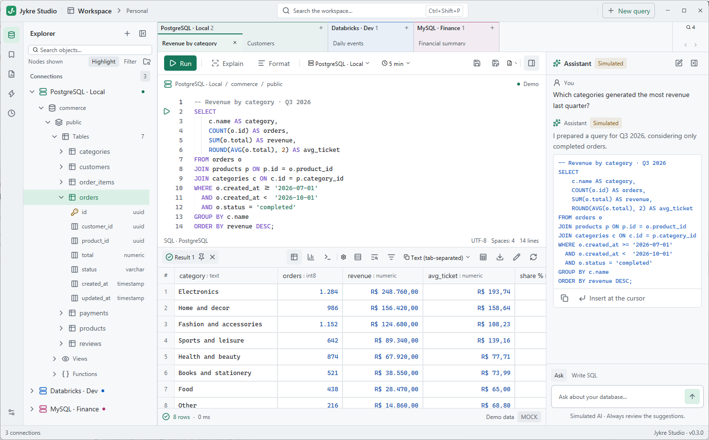
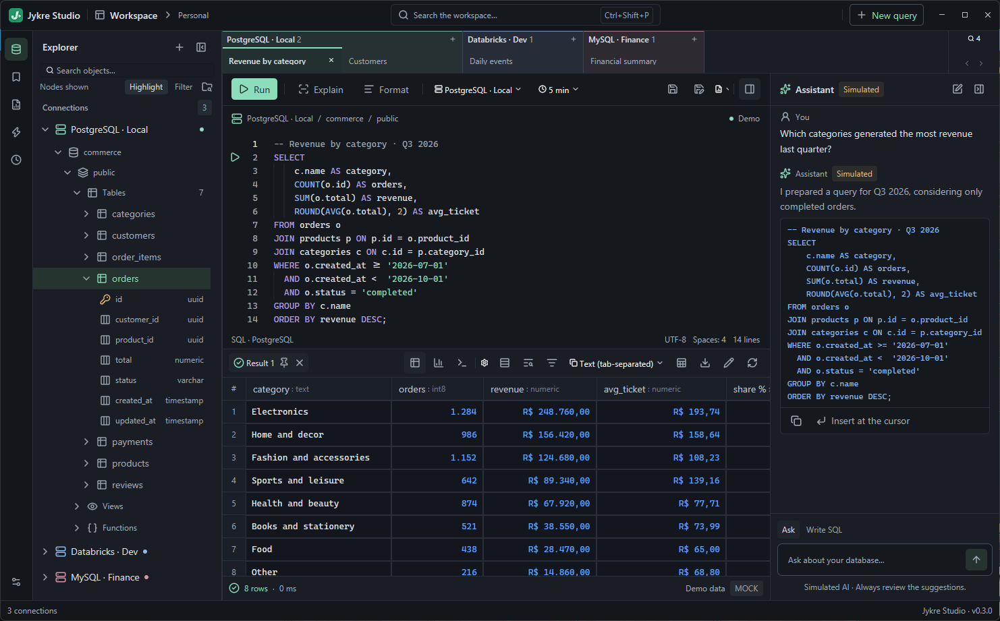

# Jykre Studio

[](../../actions/workflows/ci.yml)
[](LICENSE)

**Explore databases. Query data. Stay focused.**

Jykre Studio is a desktop application for exploring database structures,
writing SQL queries and inspecting results in one native window.





Both figures are the same demo workspace. The window labels the data as
simulated, and nothing in them is a real connection. The rail opens the
explorer, saved queries, reports, automation, run history and preferences.
The mark above is the official icon
([`assets/icon/jykre.svg`](assets/icon/jykre.svg)). The Windows executable
embeds the same drawing as [`assets/icon/jykre.ico`](assets/icon/jykre.ico).

## Why Jykre Studio?

The everyday path is short: connect, look at the structure, run SQL, read
the result.

Jykre Studio is a workspace for that path. You browse schemas, tables and
columns without writing a query just to discover them. Each query tab keeps
its own session. Results arrive page by page in a grid. A metadata cache on
this computer stays browsable after a restart. Remembered passwords go to
the operating system vault, or stay in memory when you do not ask to store
them.

Backups, role administration and server monitoring belong to other tools.

## Features

- **Database explorer.** Move through schemas, tables and columns, and
  refresh one branch without re-reading the whole connection. Search uses
  the local metadata cache.
- **SQL editor.** Write SQL, run the selection, the statement at the cursor,
  or every statement, and keep several scripts open. **Format** follows the
  connection's dialect. PostgreSQL, MySQL and Databricks errors are marked
  where the server says they are.
- **Saved queries.** `Ctrl S` writes a plain `.sql` file. The folder can live
  in Git, be edited elsewhere, or be backed up. Tags and the file's
  connection stay on this computer.
- **Results.** Inspect rows in a grid, copy a selection into a spreadsheet,
  and export the whole result, every page, to CSV, Excel,
  JSON, JSON Lines, SQL `INSERT`s or Markdown.
- **Editing and import.** On a result that reads one table and has a primary
  key, or a unique key on `NOT NULL` columns, edit cells and review the
  statements before they are written. **Import from file…** loads a CSV or
  an `.xlsx` sheet into a table, all or nothing. Databricks does not offer
  that import; editing there opens the statements in a new tab
  (**Generate SQL…**) instead of writing them.
- **Connections.** Add PostgreSQL, MySQL, Databricks and SQLite from the
  explorer, test the connection, and delete it later with its remembered
  password and metadata cache.
- **Reports.** A report collects panels — a table, a bar, line or pie chart,
  or a single number — each on its own connection. Panels share named
  parameters, filled in before the run and bound by the driver.
- **Assistant (optional).** After you set it up in **Preferences**, it can
  talk to Anthropic, OpenAI, an OpenAI-compatible server or Ollama. It sees
  SQL, errors, row counts and structure. Cell values come only from a query
  you approve and then send.
- **MCP server (optional).** In **Preferences** you can switch on a server
  that listens only on this computer (`127.0.0.1`) while the window is open.
  An MCP client you choose, authenticated by a token you create, can search
  the metadata cache, describe a table and run a query you approve.

What you can do depends on the driver. The grid says when a result is
read-only, and why.

### Automation

Automation saves work you would otherwise run by hand: a **SQL Job** (one
statement, with typed inputs bound by the driver), an **external program**
started without a shell, or a **chain** that passes a job's declared outputs
to the next step and stops at the first failure. A schedule can run a job or
a chain while Jykre Studio is open.

Limits that matter before you rely on it:

- **Nothing runs while the application is closed.** Times missed in that
  gap are not made up unless you choose to catch them up.
- **There is no sandbox.** An external program runs with your privileges. It
  can read your files and use the network. Jykre Studio supervises it; it
  does not contain it.
- A program's stdout, stderr and `jjp/1` log are kept on this computer,
  under the data folder, for 7 days. Keep passwords and tokens out of that
  output.
- A scheduled run never asks for a password. A connection whose password is
  not remembered fails that run.
- SQL Jobs on Databricks are covered by local tests and are not validated
  against a live workspace.

A short example of the local program protocol is in
[`examples/jjp/`](examples/jjp/README.md). There is no SDK. Details are in
[Security](docs/standards/security.md#automation-external-programs-and-jjp1)
and [Reliability](docs/standards/reliability.md#automation).

## Supported databases

| Database | Status | Notes |
| --- | --- | --- |
| PostgreSQL | Supported | Versions 14 and 18 are validated in the full test gate. The TLS mode is part of the connection. |
| MySQL | Supported | Versions 8.4 and 9.7 are validated in the full test gate. The TLS mode is part of the connection. |
| SQLite | Supported | An existing database file, opened with the SQLite bundled in the application. **Open read-only** is optional. A missing file is never created. No password. |
| Databricks | Supported, with an external CLI | An authenticated [Databricks CLI](https://docs.databricks.com/dev-tools/cli/) profile. SQL needs a SQL warehouse or a classic all-purpose cluster that is already running. Metadata uses Unity Catalog. Not validated against a live workspace in CI. |

PostgreSQL, MySQL and SQLite need nothing installed beside Jykre Studio.
Databricks needs the CLI on the machine.

## Queries, sessions and credentials

**Statements that change data are sent and run.** A SQLite connection opened
read-only refuses writes. A connection marked
**Production** asks before a statement the application treats as risky, such
as one that changes every row of a table or drops data, and before edited
rows are written.

**Each query tab keeps its session** between runs, so `USE`, `SET`, temporary
tables and an open transaction carry over on PostgreSQL, MySQL and SQLite.
The toolbar shows that transaction as the server reports it. Databricks shows
no transaction state. Closing a tab or the application with an open
transaction asks first. A failed statement does not drop the session.

**Results stay bounded.** Each connection has a row limit, 1,000 by default
and at most 100,000. A page also stops at 256 MB. The statement timeout is
chosen in the editor toolbar. See [Results](docs/reference/results.md).

**Passwords stay out of the application's files.** **Remember password**
stores a PostgreSQL or MySQL password in the operating system vault (Windows
Credential Manager, macOS Keychain, Linux Secret Service). Otherwise it lives
only in the session. If the vault fails, the interface says so and the
password stays in that session. Databricks tokens are resolved by the CLI and
kept in memory. API keys for the hosted assistant providers go to the same
vault. `config.db` and the metadata caches hold connection settings and
object names. They do not hold passwords or query results, and they are not
encrypted: at rest they have the protection of your account and disk.

Beside **Connected**, a lock shows that the session is encrypted, with the
TLS version, and an amber **Not encrypted** shows that it is not, as the
server reports it.

## Installation

### Download

The [latest release](../../releases/latest) publishes a Windows x86_64 `.zip`
and a Linux x86_64 `.tar.gz`.

**Windows 10 or 11.** Extract the archive and run `jykre.exe`.

**Linux.** The published binary is built on Ubuntu 24.04 and needs glibc
2.39 or newer. Extract the archive and, from that folder, run
`./install.sh`. It adds Jykre Studio to the current user's application menu,
with its icon. The desktop matches the window by the app id
`io.github.alandariva.JykreStudio`. Run the script again after moving the
folder. `./install.sh --uninstall` removes the entry. File dialogs need
`xdg-desktop-portal` with a backend such as `xdg-desktop-portal-gtk`.

**macOS.** There is no published build, and macOS is not validated.

### Updates

Once a day the application can ask GitHub whether a newer version exists,
pre-releases included. A newer one appears in the status bar.
**Preferences › About › Updates** turns the check off, checks now, or
downloads. Nothing is downloaded until you choose **Download and install**.
Only an archive signed with the release key
([`assets/update/release-key.pub`](assets/update/release-key.pub)) is
installed, by replacing the files in the folder the application shipped in.
Your own files there, and the data folder, are left as they are. The request
carries your address and the version. A development build, or a folder the
application cannot write, offers the release page instead.

The signature's context is the archive's file name. For the 0.4.0 archives,
with [zipsign](https://crates.io/crates/zipsign) 0.2.2:

```bash
zipsign verify zip --context jykre-studio-v0.4.0-windows-x86_64.zip jykre-studio-v0.4.0-windows-x86_64.zip assets/update/release-key.pub
zipsign verify tar --context jykre-studio-v0.4.0-linux-x86_64.tar.gz jykre-studio-v0.4.0-linux-x86_64.tar.gz assets/update/release-key.pub
```

### Build from source

- Rust stable 1.95 or newer (`rustup update stable`).
- On Linux, the GPUI packages and a Vulkan driver. On Debian and Ubuntu:
  `pkg-config libxkbcommon-dev libxkbcommon-x11-dev libwayland-dev
  libx11-xcb-dev libxcb1-dev libfontconfig-dev libfreetype-dev libvulkan-dev
  libasound2-dev libdbus-1-dev libssl-dev`.
- The Databricks CLI, only for Databricks connections.

```bash
git clone https://github.com/alandariva/jykre-studio.git
cd jykre-studio
cargo run --release --locked
```

The first build downloads and compiles the dependencies. After that,
`--offline` works from the Cargo cache.

To open the interface on simulated data that never reaches a server:

```bash
JYKRE_DEMO=1 cargo run --locked
```

```powershell
$env:JYKRE_DEMO='1'; cargo run --locked
```

Demo connections and results are labelled as such.

### Where your data lives

| Platform | Data folder |
| --- | --- |
| Windows | `%LOCALAPPDATA%\JykreStudio` |
| macOS | `~/Library/Application Support/JykreStudio` |
| Linux | `$XDG_DATA_HOME/jykre-studio` (default `~/.local/share/jykre-studio`) |

`JYKRE_CONFIG_DIR` points the application at another folder. Saved queries
default to `Documents/Jykre Studio/Queries`, or the folder chosen in
**Preferences › Editor**. The files in the data folder are described in
[Persistence](docs/reference/persistence.md).

## Getting started

1. Launch Jykre Studio.
2. Choose **+** in the explorer and create a connection. **Test connection**
   reaches the server. Saving checks the configuration and starts reading
   metadata for the objects you choose.
3. Browse the tree. Double-click a table or view (or press Enter) to open a
   query for it, or press `Ctrl N` for an empty editor on the active
   connection.
4. Run with the toolbar or `Ctrl Enter`. The result opens in the grid under
   the editor.
5. Copy or export the result. When the result allows it, edit and write back.

`Ctrl S` saves the tab to its `.sql` file. `Ctrl B` hides the explorer.
Shortcuts can be changed in **Preferences › Shortcuts**. The full set is in
[User experience](docs/reference/ux.md).

## Technology

- **Rust** — application logic, database drivers and local storage.
- **[GPUI](https://www.gpui.rs/)**, through `gpui-kit` — the interface, drawn
  in-process in Rust, with no web view.
- **SQLx** — PostgreSQL, MySQL and SQLite sessions. TLS uses rustls.
- **Databricks CLI and HTTPS** — profiles, SQL execution and Unity Catalog
  metadata. Redirects are disabled.
- **Operating system vault** — remembered database passwords and assistant
  API keys.

Versions and the reasons for each dependency are in
[Stack and dependencies](docs/standards/stack-and-dependencies.md). How the
crates fit together is in
[Architecture](docs/reference/architecture.md).

## Project status

The project is in active development. The latest release is
[v0.4.0](../../releases/tag/v0.4.0).

Version 0.2.0 made daily use reliable, including updates from signed
releases. Version 0.3.0 adds automation while the application is open,
editing in the result grid, CSV and Excel import, shortcuts you choose, and
grid columns that can be hidden, moved, frozen and found. Version 0.4.0 adds
an optional local MCP server, so an external assistant you choose can use the
same read-only tools as the in-app assistant.

Windows is the primary platform. Linux is validated on Ubuntu 24.04 with
X11. Wayland and macOS are not validated. Behavior can change between
releases.

## Roadmap

Planned work is tracked in [GitHub Issues](../../issues). The features in
this document are what the application does today.

## Contributing

Bug reports, suggestions and changes are welcome. Open an issue before a
substantial change.

[Development documentation](docs/README.md) is the source of truth for how
the project is built. For a change to code, run:

```bash
cargo xtask check
```

Drivers, execution contracts, dependencies and release preparation also need
`cargo xtask check --full`. The policy is in
[Testing](docs/standards/testing.md).

The interface is available in English and Brazilian Portuguese. The locale
comes from `JYKRE_LOCALE` (for example `pt-BR`) or from the operating system,
and falls back to English. Adding a language is described in
[UI guidelines](docs/standards/ui-guidelines.md#text).

Runnable examples live under [`examples/`](examples/), including `drivers`
and `grouped_tabs`.

Report vulnerabilities in private, as [SECURITY.md](SECURITY.md) describes.
Security fixes go to the latest release and the latest commit on `main`.

## License

[MIT](LICENSE). Copyright (c) 2026 Alan de Oliveira.

## Further reading

| Topic | Document |
| --- | --- |
| Layout, states and shortcuts | [User experience](docs/reference/ux.md) |
| Grid, export, editing, import and reports | [Results](docs/reference/results.md) |
| Connection options and driver differences | [Drivers](docs/reference/drivers.md) |
| Local files | [Persistence](docs/reference/persistence.md) |
| Credentials, TLS and external programs | [Security](docs/standards/security.md) |
| Architecture | [Architecture](docs/reference/architecture.md) |
| Development index | [docs/README.md](docs/README.md) |
