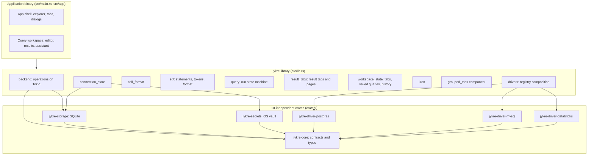

# Architecture

## Overview

Jykre Studio is a single native process. The interface is drawn by
[GPUI](https://www.gpui.rs/) through `gpui-kit` ([ADR-0001](adr/0001-native-ui-with-gpui.md));
there is no WebView and no IPC layer. Database access, local persistence and
credentials live in UI-independent crates
([ADR-0006](adr/0006-layered-crates-independent-of-the-ui.md)).



## Layers and responsibilities

| Layer | Location | Does | Does not |
| --- | --- | --- | --- |
| **Views** | `src/app/` (demo data in `src/app/demo/`, used with `JYKRE_DEMO=1`) | Render state, capture input, hold UI state (open tabs, selection, expanded nodes, panel sizes), start operations and show their outcome | Network or disk I/O, SQL parsing, formatting rules, decisions by database type |
| **Application library** | `src/*.rs` (`jykre` crate) | Orchestrates operations (`backend`), connection profiles (`connection_store`), SQL text handling (`sql`), run states (`query`), value presentation rules (`cell_format`), translations (`i18n`), reusable components (`grouped_tabs`), driver composition (`drivers`) | Depend on a specific view |
| **Core** | `crates/core` | Driver and session contracts, configuration, credentials, errors, result and metadata types, registry | I/O of any kind; depend on any other internal crate, SQLx or reqwest |
| **Storage** | `crates/storage` | SQLite repositories for configuration, preferences and per-connection metadata | Store secrets; know drivers or the UI |
| **Secrets** | `crates/secrets` | Read, write and delete credentials in the OS vault | Anything else; fall back to a file |
| **Drivers** | `crates/driver-*` | Validate configuration, connect, execute, cancel, introspect and classify errors for one database | Persist; talk to the UI; know another driver |
| **Tooling** | `xtask` | Local gate, architecture check, translation catalogs | Ship in the application |

## Dependency rules

`cargo xtask check` reads `cargo metadata` and fails on a forbidden direct
edge, including dev and build dependencies:

1. `jykre-core` depends on no internal crate and on neither `sqlx` nor
   `reqwest`.
2. Drivers, `jykre-storage` and `jykre-secrets` depend on no internal crate
   other than `jykre-core`. **A driver never depends on another driver.**
3. No crate under `crates/` depends on GPUI (`gpui*`) or Tauri.
4. Only the `jykre` crate composes the drivers, in
   `drivers::builtin_registry()`. Adding a database means a new crate plus one
   registration line (see [Drivers](drivers.md#adding-a-driver)).

Transitive dependencies and where logic lives inside the `jykre` crate are
checked in review.

## Repository layout

```text
.
├── Cargo.toml              # workspace, shared dependency versions, the jykre crate
├── src/
│   ├── main.rs             # binary entry point
│   ├── lib.rs              # jykre library: backend, cell_format, connection_store,
│   │                       # drivers, grouped_tabs, i18n, query, sql
│   └── app/                # the application's GPUI views; demo/ holds the demo data
├── crates/
│   ├── core/               # jykre-core
│   ├── driver-postgres/    # jykre-driver-postgres
│   ├── driver-mysql/       # jykre-driver-mysql
│   ├── driver-databricks/  # jykre-driver-databricks
│   ├── storage/            # jykre-storage
│   └── secrets/            # jykre-secrets
├── examples/               # runnable examples (connect, drivers, grouped_tabs)
├── locales/                # translation catalogs (pt-BR.json)
├── tests/fixtures/         # seeds for the gate's disposable databases
├── dev/seed/               # seeds for the local manual-testing databases
├── xtask/                  # cargo xtask check / i18n
├── docs/                   # this documentation and the ADRs
└── docker-compose.*.yml    # test (gate) and dev (manual) databases
```

Conventions:

- Crates are named `jykre-<area>` and live in `crates/<area>`; the `crates/*`
  pattern adds them to the workspace.
- Unit tests live in `#[cfg(test)] mod tests` in the same file, or in a sibling
  `tests.rs`/`*_tests.rs` file for large suites; integration tests live in each
  crate's `tests/`.
- Shared dependency versions are declared once in `[workspace.dependencies]`;
  crates refer to them with `workspace = true`.

## Domain model

The full types live in `jykre-core`.

| Type | Description |
| --- | --- |
| `ConnectionId` | Newtype over a UUID. Do not pass raw strings or UUIDs between layers. |
| `DriverKind` | `Postgres`, `MySql`, `Databricks`; `#[non_exhaustive]`. |
| `ConnectionConfig` | Driver identity plus non-sensitive JSON options owned by the driver. Serializable. |
| `Credentials`, `ResolvedConnection` | Configuration plus resolved secrets. In memory only; not serializable (checked by `compile_fail` doctests). |
| `DriverDescriptor`, `DriverStatus` | What a driver is and supports. Consumers check status and capabilities, not the kind. |
| `QueryRequest`, `ExecutionOptions` | SQL as written plus row limit, timeout and session context. |
| `ColumnInfo`, `Cell`, `Row`, `RowSink` | Streaming result model; NULL and exact decimals are preserved. |
| `MetadataObject`, `ObjectPath` | Database, catalog, schema, table, view, materialized view, column, foreign key and partition nodes addressed by structural paths, with types, defaults, comments and keys. |
| `MetadataScope` (`jykre::metadata_scope`) | What the user chose to introspect: everything, whole namespaces (including what is created in them later) or last-level namespaces. Pending until chosen. |
| `DriverError`, `ErrorCode`, `ServerDiagnostic` | Classified errors; messages never contain secrets, SQL or raw configuration. A database error keeps the server's own message, SQLSTATE, vendor code and position. |

## Main flows

### Run a query

```mermaid
sequenceDiagram
    participant W as Workspace (UI thread)
    participant R as backend::run (Tokio)
    participant D as Driver session
    W->>W: QueryRun::start splits statements; queue_all marks them Pending
    W->>R: backend::query(connection, tab session, requests, cancel, progress)
    R->>D: ping the kept session (or open one), execute each statement
    R-->>W: progress: the position of each statement as it starts (statement_started)
    D-->>R: columns and rows through RowSink (bounded by the row limit)
    R->>R: convert rows to display data, drop driver cells
    R-->>W: completed results and the first error
    R-->>W: the session, unless it was lost
    W->>W: keep the session; QueryRun::finish discards a superseded or cancelled run; publish result and statuses
```

- `Ctrl Enter` and `Ctrl Shift Enter` run the selection, split into
  statements, or the statement at the cursor (`sql::statement_at`, which
  picks nothing when the cursor is on no statement);
  `Ctrl Alt Enter` and the gutter buttons run all statements or one, and a
  result tab's `↻` runs its own statement again (`query::Scope`). While a run
  is active, a run shortcut asks before cancelling
  (`query::ShortcutAction`). `result_tabs::ResultTabs` decides which result
  tab each statement fills (`Placement`, which never replaces a pinned tab)
  and keeps each tab's pages; the next page is read with `backend::fetch`
  from the result the session keeps open.
- Splitting and highlighting share one tokenizer whose rules follow the
  connection's `SqlDialect` (`jykre::sql`): MySQL backslash escapes, `#`
  comments, `DELIMITER` and routine bodies; PostgreSQL `E''` strings, dollar
  quotes and `BEGIN ATOMIC`; Databricks compound statements. A tab without a
  connection uses generic rules.
- **Format** parses with `sqruff-lib` in the same dialect (ANSI without a
  connection), off the UI thread. Only whitespace and keyword case may
  change: a result that changes anything else is refused, and what does not
  parse is left as it was. Each statement is formatted on its own and the
  text between statements (blank lines, comments, `DELIMITER` lines) is kept,
  so every statement keeps a line of its own; with a selection, only the
  selection is formatted (`sql::format_range`).
- **Explain** runs `EXPLAIN` followed by the statement at the cursor (or the
  one selected) into a new result tab (`sql::explain`, by the connection's
  `SqlDialect`). Only queries and data changes are explained, so the
  statement itself never runs and its words are never read as `EXPLAIN`
  options such as `ANALYZE`.
- Each tab keeps one session between runs ([ADR-0014](adr/0014-a-session-per-tab.md)).
  Databricks warehouses keep logical catalog/schema state; classic clusters keep
  a server SQL context. CLI authentication and HTTP pools are shared across
  sessions by authentication identity ([ADR-0005](adr/0005-databricks-through-cli-and-rest.md)).
  The workspace hands it to the run and takes it back with the result; a
  session that comes back from a superseded run, or after the connection
  changed, is closed.
- Statements run in order and stop at the first failure. Whether earlier
  statements are committed depends on the session's transaction, which the
  workspace infers from the statements it ran (`jykre::transaction`) and
  shows in the toolbar; the failure message claims nothing about it.
- Every statement that ends is logged in the tab's `run_log::RunLog`, shown
  in Messages, independently of the result tabs.
- A tab without a connection runs nothing outside the demo
  (`JYKRE_DEMO`). A connection without a remembered password asks for it
  before the session opens (`connection_store::needs_password`).
- Cancelling fires the run's `CancellationToken`; the driver interrupts the
  server-side work and keeps the session when it can bring it back to a known
  state, or closes it.

### Refresh metadata

A connection introspects only what the user chose in the connection dialog
(`jykre::metadata_scope::MetadataScope`, [ADR-0015](adr/0015-introspect-only-what-the-user-chooses.md)).
The dialog lists namespaces with `Driver::discover_namespaces`, one level at
a time; until something is chosen, nothing is introspected.

1. Refreshing the connection starts `backend::apply_selection` with the
   choice (or only what a change added); refreshing a node starts
   `backend::refresh_metadata` for that node. A connection runs one refresh
   at a time: one asked for meanwhile waits in its queue
   (`jykre::refresh_queue::RefreshQueue`), which skips a node already covered
   by a waiting one and lets a broader node replace the waiting nodes inside
   it. Saving the connection stops its refreshes only after the save
   succeeded.
2. `apply_selection` lists the broader rules (**Everything** skips what the
   driver leaves out, such as Databricks' `system` catalog), then reads each
   last-level namespace as its own scope, up to four at a time, publishing
   them one at a time, and reports progress and the time left after each one.
   A namespace the cache does not hold yet is published with its names first
   and in full right after.
3. For each scope, the driver streams batches into a pending refresh in the
   connection's metadata file. On success the pending objects replace that
   scope in one transaction; on failure or cancellation they are discarded
   and the last good read stays. See
   [Persistence](persistence.md#atomic-metadata-refresh).
4. After a complete read, what the choice no longer covers leaves the cache
   (`MetadataRepository::retain`).

## Concurrency

- **UI thread.** GPUI runs views on one foreground thread. Entity updates,
  `cx.spawn` tasks and event handlers all run there and must stay short.
- **Tokio runtime.** `backend::run` owns the only Tokio runtime (multi-thread,
  created on first use). All network, database, vault and SQLite work runs
  there. Do not create another runtime.
- **CPU work that grows with the data** (converting rows, building indexes,
  sorting thousands of items) runs inside the `backend::run` future, in
  `tokio::task::spawn_blocking`, or on GPUI's background executor
  (`cx.background_spawn`); never in a view method or in `render`.
- **Cancellation.** Every long operation takes a `CancellationToken`
  (`tokio-util`). Dropping a view cancels its operations.
- **Stale results.** Async work reports back with `WeakEntity::update` and
  checks a generation counter (for example `execution_id`), so a result from a
  superseded run is discarded instead of overwriting a newer one.
- **Shared state.** Prefer message passing and owned data. A `RefCell` borrow
  or a `std::sync::Mutex` guard is never held across `.await`.

## States

Operation states are explicit enums, never combinations of booleans. A view
holds one value per operation, for example:

- Query run: `Idle | Running { started_at } | Cancelling | Done | Failed { error } | Cancelled`
  (`jykre::query::RunState`, owned by `QueryRun` together with the status of
  each statement).
- Metadata scope: `Idle { last_success_at } | Refreshing | Failed { error, last_success_at }`
  (stored as `RefreshStatus` in the metadata file, its state read as
  `jykre_storage::RefreshState`).

The footer, the gutter and every other indicator derive from that single
value, so they cannot disagree.

## Extension points

- **New database:** a `crates/driver-<database>` crate implementing `Driver`
  and `Session`, registered in `builtin_registry()`. See [Drivers](drivers.md).
- **New metadata object kind:** a new `ObjectKind` value plus introspection in
  the drivers. The metadata schema stores kinds as text, so no migration is
  needed.
- **New operation on results** (export, edit): implemented on the result data
  outside the views, then exposed by the results view.
- **New language:** a catalog in `locales/` (see the root README).

## Known deviations

Technical debt the maintainer accepted for now:

| Standard | Current code |
| --- | --- |
| Statements are split as the database splits them | `sql::statements` follows each dialect's rules in the application, not a splitter provided by the driver. Blocks are recognised by their keywords (`CREATE PROCEDURE/FUNCTION/TRIGGER/EVENT … BEGIN … END`, `BEGIN ATOMIC`, a Databricks `BEGIN … END`); other constructs that hold semicolons are split on them |
| The UI shows the server's transaction state, read from the protocol | Drivers report it through `Session::transaction` with a probe query (PostgreSQL) or only `autocommit = 0` (MySQL), because SQLx keeps the protocol's state private. What a driver cannot tell is inferred from the statements a tab ran (`jykre::transaction`), so under MySQL a `BEGIN` inside a procedure is not shown ([TD-001](technical-debt.md#td-001--transaction-state-is-not-read-from-the-protocol)) |
