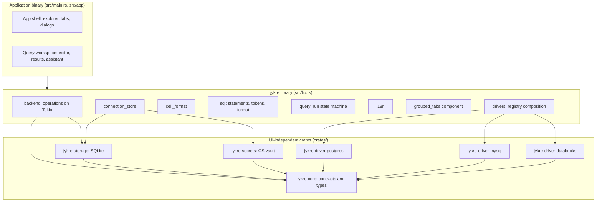

# Architecture

## Overview

Jykre Studio is a single native process. The interface is drawn by
[GPUI](https://www.gpui.rs/) through `gpui-kit` ([ADR-0001](adr/0001-native-ui-with-gpui.md));
there is no WebView and no IPC layer. Database access, local persistence and
credentials live in UI-independent crates
([ADR-0006](adr/0006-layered-crates-independent-of-the-ui.md)).



## Layers and responsibilities

| Layer | Location | Does | Does not |
| --- | --- | --- | --- |
| **Views** | `src/app/` (demo data in `src/app/demo/`, used with `JYKRE_DEMO=1`) | Render state, capture input, hold UI state (open tabs, selection, expanded nodes, panel sizes), start operations and show their outcome | Network or disk I/O, SQL parsing, formatting rules, decisions by database type |
| **Application library** | `src/*.rs` (`jykre` crate) | Orchestrates operations (`backend`), connection profiles (`connection_store`), SQL text handling (`sql`), run states (`query`), value presentation rules (`cell_format`), translations (`i18n`), reusable components (`grouped_tabs`), driver composition (`drivers`) | Depend on a specific view |
| **Core** | `crates/core` | Driver and session contracts, configuration, credentials, errors, result and metadata types, registry | I/O of any kind; depend on any other internal crate, SQLx or reqwest |
| **Storage** | `crates/storage` | SQLite repositories for configuration, preferences and per-connection metadata | Store secrets; know drivers or the UI |
| **Secrets** | `crates/secrets` | Read, write and delete credentials in the OS vault | Anything else; fall back to a file |
| **Drivers** | `crates/driver-*` | Validate configuration, connect, execute, cancel, introspect and classify errors for one database | Persist; talk to the UI; know another driver |
| **Tooling** | `xtask` | Local gate, architecture check, translation catalogs | Ship in the application |

## Dependency rules

`cargo xtask check` reads `cargo metadata` and fails on a forbidden direct
edge, including dev and build dependencies:

1. `jykre-core` depends on no internal crate and on neither `sqlx` nor
   `reqwest`.
2. Drivers, `jykre-storage` and `jykre-secrets` depend on no internal crate
   other than `jykre-core`. **A driver never depends on another driver.**
3. No crate under `crates/` depends on GPUI (`gpui*`) or Tauri.
4. Only the `jykre` crate composes the drivers, in
   `drivers::builtin_registry()`. Adding a database means a new crate plus one
   registration line (see [Drivers](drivers.md#adding-a-driver)).

Transitive dependencies and where logic lives inside the `jykre` crate are
checked in review.

## Repository layout

```text
.
├── Cargo.toml              # workspace, shared dependency versions, the jykre crate
├── src/
│   ├── main.rs             # binary entry point
│   ├── lib.rs              # jykre library: backend, cell_format, connection_store,
│   │                       # drivers, grouped_tabs, i18n, query, sql
│   └── app/                # the application's GPUI views; demo/ holds the demo data
├── crates/
│   ├── core/               # jykre-core
│   ├── driver-postgres/    # jykre-driver-postgres
│   ├── driver-mysql/       # jykre-driver-mysql
│   ├── driver-databricks/  # jykre-driver-databricks
│   ├── storage/            # jykre-storage
│   └── secrets/            # jykre-secrets
├── examples/               # runnable examples (connect, drivers, grouped_tabs)
├── locales/                # translation catalogs (pt-BR.json)
├── tests/fixtures/         # seeds for the gate's disposable databases
├── dev/seed/               # seeds for the local manual-testing databases
├── xtask/                  # cargo xtask check / i18n
├── docs/                   # this documentation and the ADRs
└── docker-compose.*.yml    # test (gate) and dev (manual) databases
```

Conventions:

- Crates are named `jykre-<area>` and live in `crates/<area>`; the `crates/*`
  pattern adds them to the workspace.
- Unit tests live in `#[cfg(test)] mod tests` in the same file, or in a sibling
  `tests.rs`/`*_tests.rs` file for large suites; integration tests live in each
  crate's `tests/`.
- Shared dependency versions are declared once in `[workspace.dependencies]`;
  crates refer to them with `workspace = true`.

## Domain model

The full types live in `jykre-core`.

| Type | Description |
| --- | --- |
| `ConnectionId` | Newtype over a UUID. Do not pass raw strings or UUIDs between layers. |
| `DriverKind` | `Postgres`, `MySql`, `Databricks`; `#[non_exhaustive]`. |
| `ConnectionConfig` | Driver identity plus non-sensitive JSON options owned by the driver. Serializable. |
| `Credentials`, `ResolvedConnection` | Configuration plus resolved secrets. In memory only; not serializable (checked by `compile_fail` doctests). |
| `DriverDescriptor`, `DriverStatus` | What a driver is and supports. Consumers check status and capabilities, not the kind. |
| `QueryRequest`, `ExecutionOptions` | SQL as written plus row limit, timeout and session context. |
| `ColumnInfo`, `Cell`, `Row`, `RowSink` | Streaming result model; NULL and exact decimals are preserved. |
| `MetadataObject`, `ObjectPath` | Database, catalog, schema, table, view and column nodes addressed by structural paths. |
| `DriverError`, `ErrorCode` | Classified errors; messages never contain secrets, SQL or raw configuration. |

## Main flows

### Run a query

```mermaid
sequenceDiagram
    participant W as Workspace (UI thread)
    participant R as backend::run (Tokio)
    participant D as Driver session
    W->>W: QueryRun::start splits statements and marks them Running
    W->>R: backend::query(connection, tab session, requests, cancel)
    R->>D: ping the kept session (or open one), execute each statement
    D-->>R: columns and rows through RowSink (bounded by the row limit)
    R->>R: convert rows to display data, drop driver cells
    R-->>W: completed results and the first error
    R-->>W: the session, unless it was lost
    W->>W: keep the session; QueryRun::finish discards a superseded or cancelled run; publish result and statuses
```

- `Ctrl Enter` runs the selection, split into statements, or the statement at
  the cursor (`sql::statement_at`); `Ctrl Shift Enter` and the gutter buttons
  run all statements or one (`query::Scope`).
- Each tab keeps one session between runs ([ADR-0014](adr/0014-a-session-per-tab.md)).
  The workspace hands it to the run and takes it back with the result; a
  session that comes back from a superseded run, or after the connection
  changed, is closed.
- Statements run in order and stop at the first failure; earlier statements
  are not rolled back automatically, and the UI says so.
- Cancelling fires the run's `CancellationToken`; the driver interrupts the
  server-side work and keeps the session when it can bring it back to a known
  state, or closes it.

### Refresh metadata

1. The explorer starts `backend::refresh_metadata` for a scope (the whole
   connection or one node).
2. The driver introspects that scope and streams batches into a pending
   refresh in the connection's metadata file.
3. On success the pending objects replace that scope in one transaction;
   on failure or cancellation they are discarded and the last good read stays.
   See [Persistence](persistence.md#atomic-metadata-refresh).

## Concurrency

- **UI thread.** GPUI runs views on one foreground thread. Entity updates,
  `cx.spawn` tasks and event handlers all run there and must stay short.
- **Tokio runtime.** `backend::run` owns the only Tokio runtime (multi-thread,
  created on first use). All network, database, vault and SQLite work runs
  there. Do not create another runtime.
- **CPU work that grows with the data** (converting rows, building indexes,
  sorting thousands of items) runs inside the `backend::run` future, in
  `tokio::task::spawn_blocking`, or on GPUI's background executor
  (`cx.background_spawn`); never in a view method or in `render`.
- **Cancellation.** Every long operation takes a `CancellationToken`
  (`tokio-util`). Dropping a view cancels its operations.
- **Stale results.** Async work reports back with `WeakEntity::update` and
  checks a generation counter (for example `execution_id`), so a result from a
  superseded run is discarded instead of overwriting a newer one.
- **Shared state.** Prefer message passing and owned data. A `RefCell` borrow
  or a `std::sync::Mutex` guard is never held across `.await`.

## States

Operation states are explicit enums, never combinations of booleans. A view
holds one value per operation, for example:

- Query run: `Idle | Running { started_at } | Cancelling | Done | Failed { error } | Cancelled`
  (`jykre::query::RunState`, owned by `QueryRun` together with the status of
  each statement).
- Metadata scope: `Idle { last_success_at } | Refreshing | Failed { error, last_success_at }`
  (stored as `RefreshStatus` in the metadata file).

The footer, the gutter and every other indicator derive from that single
value, so they cannot disagree.

## Extension points

- **New database:** a `crates/driver-<database>` crate implementing `Driver`
  and `Session`, registered in `builtin_registry()`. See [Drivers](drivers.md).
- **New metadata object kind:** a new `ObjectKind` value plus introspection in
  the drivers. The metadata schema stores kinds as text, so no migration is
  needed.
- **New operation on results** (export, edit): implemented on the result data
  outside the views, then exposed by the results view.
- **New language:** a catalog in `locales/` (see the root README).

## Known deviations

None at the moment.
