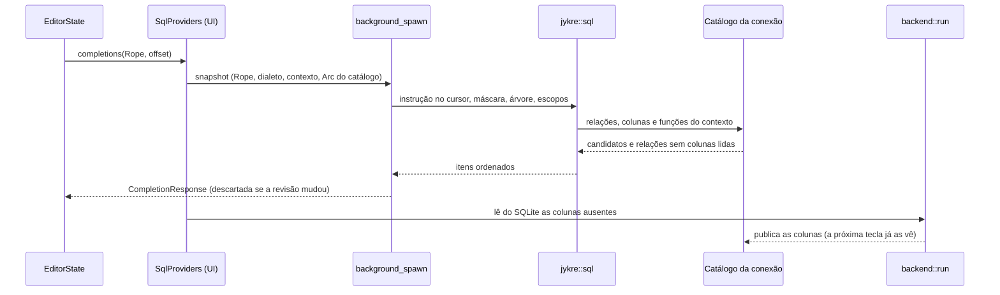

# Investigação arquitetural — editor SQL: autocomplete, highlighting e formatação

Data: 4 de novembro de 2026 · Branch `release/0.1.0` (`c876fc3`). Nenhum código foi alterado; este documento é uma proposta e ainda não foi aprovado pelo mantenedor.

**Como ler.** Cada afirmação relevante leva uma marca:

- **[V] Verificado**: conferido no código do projeto, no código-fonte da versão da dependência em `~/.cargo/registry` ou no repositório/documentação oficial do candidato (links na seção H).
- **[I] Inferência**: conclusão técnica a partir de fatos verificados, sem medição.
- **[H] Hipótese**: precisa ser testada na prova de conceito (seção G) antes de virar decisão.

Notas de 1 a 5 nas matrizes: 1 = inadequado, 2 = fraco, 3 = aceitável com ressalvas, 4 = bom, 5 = o melhor disponível no critério. Pesos: qualidade funcional 25%, dialetos 20%, integração Rust/GPUI 15%, maturidade 15%, desempenho 10%, extensibilidade 10%, manutenção 5%.

---

## Resumo da recomendação

1. **Não existe** biblioteca, LSP ou motor maduro que entregue autocomplete semântico para PostgreSQL, MySQL **e** Databricks e que possa ser embutido num app Rust/GPUI. Os melhores motores são de um banco só (Postgres Language Server, Squawk) ou exigem outro runtime (sqls em Go, sql-language-server em TypeScript, dt-sql-parser em TypeScript) e não cobrem Databricks.
2. **Arquitetura híbrida, toda em processo:**
   - **Léxico**: o tokenizer por dialeto que o projeto já tem (`jykre::sql`) continua sendo a fonte única de verdade para highlighting, divisão de instruções e checagem da formatação.
   - **Estrutura**: [tree-sitter](https://github.com/tree-sitter/tree-sitter) com a gramática [DerekStride/tree-sitter-sql](https://github.com/DerekStride/tree-sitter-sql) (crate `tree-sitter-sequel`). Ela lê apenas a instrução sob o cursor, com literais e comentários mascarados pelo nosso lexer.
   - **Semântica**: uma camada própria de escopos e candidatos, alimentada pelo cache de metadados existente e por catálogos de palavras-chave e funções por dialeto.
   - **Formatação**: `sqruff-lib`, restrito a regras de layout e capitalização, atrás de uma guarda. A guarda recusa qualquer saída que mude a sequência de tokens.
3. **Highlighting**: continua léxico com o nosso tokenizer, agora incremental e com cores do tema. Uma camada semântica (tabela, coluna, alias, CTE) entra pelo `DocumentRangeSemanticTokensProvider` que o gpui-kit 0.9 já oferece. O highlighter tree-sitter do gpui-component foi **rejeitado**: a gramática não entende escapes `\` em strings, comentários `#` nem comentários aninhados [V], e ficaria em desacordo com a divisão de instruções.
4. As fases 1 e 2 do plano não adicionam dependências e já corrigem problemas encontrados no código atual (seção A.5). Uma PoC curta decide se tree-sitter e sqruff entram nas fases 3 e 4. Se a PoC reprovar tree-sitter, o plano segue com a arquitetura heurística (A3), sem perder trabalho.

---

## A. Diagnóstico do projeto atual

### A.1 Arquitetura e restrições

| Tema | Situação | Marca |
| --- | --- | --- |
| Processo | Um único processo nativo; UI em GPUI via `gpui-kit` 0.9.0 (`gpui-base`/`gpui-component` 0.9.0, `gpui-pre` 0.3.11) | [V] `Cargo.toml`, `Cargo.lock` |
| Camadas | Views em `src/app/`; lógica sem janela em `src/*.rs` (crate `jykre`); crates `crates/*` sem GPUI | [V] [architecture.md](architecture.md) |
| Regras de ouro relevantes | Views não decidem (1); lógica por dialeto, não por `DriverKind` (3); nunca bloquear a UI (6); um frame custa o que está na tela (7) | [V] [README.md](README.md#golden-rules) |
| Orçamentos | Frame ≤ 8 ms p95; busca de metadados ≤ 50 ms p95; memória ociosa ≤ 200 MB; 500 000 objetos por conexão; 50 abas | [V] [performance.md](performance.md#budgets) |
| Dependências | Toda dependência nova precisa de aprovação; licenças só da lista do `deny.toml` (sem GPL/AGPL/SSPL); sem WebView, sem segundo runtime async, só rustls | [V] [stack-and-dependencies.md](stack-and-dependencies.md), `deny.toml:29` |
| Mudança de stack | Exige ADR | [V] [workflow.md](workflow.md#architecture-decisions) |
| Princípio | "Nothing remote on the interactive path": explorer, busca (e, por extensão, o editor) leem só o cache local | [V] [performance.md:44](performance.md) |

### A.2 O editor do gpui-kit 0.9 — capacidades verificadas no código-fonte

Fonte: `~/.cargo/registry/src/index.crates.io-*/gpui-base-0.9.0/src/input/editor/` e `gpui-component-0.9.0/src/`.

| Capacidade | Como existe | Marca |
| --- | --- | --- |
| Highlighting plugável | Trait `InputHighlighter` (`update(InputEdit, &Rope)`, `styles(range, resolver)`, `fold_ranges`) e `HighlightStyleResolver`, que resolve nomes semânticos (`"keyword"`, `"string"`) pelo tema | [V] `highlighting.rs:30` |
| Completion | `CompletionProvider::completions(&Rope, offset, ctx) -> Task<CompletionResponse>`. Uma nova requisição substitui a anterior, e a resposta é descartada se a revisão do documento ou o cursor mudaram | [V] `lsp/completions.rs:146`, `:403` |
| Gatilho manual | Ação `ShowCompletions` existe, **sem atalho padrão** | [V] `lsp/completions.rs:317` |
| Menu | Mostra `detail` e `documentation` do item; ordem = a que o provider devolve | [V] `gpui-component/src/input/popovers/completion_menu.rs:161`, `:442` |
| Hover, definição, code actions, cores | `HoverProvider`, `DefinitionProvider`, `CodeActionProvider`, `DocumentColorProvider`, `show_document` | [V] `lsp/mod.rs:39` |
| Semantic tokens | `DocumentRangeSemanticTokensProvider`, com debounce de 100 ms e cor resolvida pelo nome no tema a cada pintura (troca de tema sem refazer a análise) | [V] `lsp/semantic_tokens.rs:36`, `:130` |
| Diagnósticos | `DiagnosticSet` com severidade, código e origem | [V] `diagnostics.rs:186` |
| **Ausentes** | Signature help, snippets (`InsertTextFormat`), `sort_text`, provider de formatação e cliente LSP (transporte JSON-RPC/processo) | [V] busca sem resultados em `gpui-base-0.9.0/src/input` |
| Highlighter tree-sitter pronto | Feature `tree-sitter-sql` do `gpui-component` → `tree-sitter-sequel` ≥ 0.3.8 + `tree-sitter` 0.26.13. Parse incremental, 2 ms síncrono (até 256 KB) e reparse em background após 150 ms. **Não habilitado** no projeto (não há `tree-sitter` no `Cargo.lock`) | [V] `gpui-component-0.9.0/Cargo.toml`, `highlighter/languages.rs:508`, `highlighter/input_adapter.rs:30-32` |
| Highlighter syntect | Feature `syntect` (+ `two-face`) | [V] `gpui-component-0.9.0/Cargo.toml` |

### A.3 Componentes SQL existentes

| Componente | Arquivo | O que faz bem | Marca |
| --- | --- | --- | --- |
| Tokenizer por dialeto | [src/sql.rs:142](../src/sql.rs) (`tokens`, `next_token`) | MySQL: escapes `\`, `#`, `/*! */`, comentários não aninhados, `$` em identificadores. PostgreSQL: `E''`, dollar quotes, comentários aninhados. Operadores multicaractere. Sem dialeto: regras genéricas | [V] |
| Divisão de instruções | [src/sql.rs:347](../src/sql.rs) (`statements`, `statement_at`) | Rotinas MySQL, `DELIMITER`, `BEGIN ATOMIC` (PG), compound statements Databricks; testes por dialeto | [V] |
| Formatação | [src/sql.rs:500](../src/sql.rs) (`format`, `map_offset`) | Só muda espaços e a caixa das palavras-chave, por isso `map_offset` mantém cursor e seleção; desfazer preservado ([src/app/workspace.rs:2531](../src/app/workspace.rs)) | [V] |
| Highlighter | [src/app/sql.rs](../src/app/sql.rs) (`SqlHighlighter`) | Cores coerentes com a divisão (mesmo tokenizer) | [V] |
| Completion/hover/definição | [src/completion.rs](../src/completion.rs) + [src/app/sql_providers.rs](../src/app/sql_providers.rs) | Relações após `FROM/JOIN/UPDATE/INTO/TABLE/DESCRIBE`, nomes qualificados, CTEs (nomes), namespaces, colunas após `alias.`, colunas de todas as relações da instrução, aspas conforme o dialeto, "Loading columns…" sem bloquear, hover com tipo/nulidade/chave/default/comentário, Ctrl+clique abre no explorer | [V] |
| Classificação de DDL | [src/ddl.rs](../src/ddl.rs) | Alvos de `CREATE/ALTER/DROP` para invalidar o cache | [V] |

### A.4 Metadados

- **Armazenamento** [V]: um arquivo SQLite por conexão ([crates/storage/src/metadata.rs](../crates/storage/src/metadata.rs)) com `objects(path_key, parent_key, kind, name, object_json, search_name)`, índice FTS5 trigram para busca e `metadata_info.version`, incrementado a cada publicação atômica.
- **Escopo** [V]: só o que o usuário escolheu é introspectado ([ADR-0015](adr/0015-introspect-only-what-the-user-chooses.md)). O autocomplete só conhece esse escopo.
- **Tipos** [V]: `ObjectKind` = `Database, Catalog, Schema, Table, View, MaterializedView, Column, ForeignKey, Partition` ([crates/core/src/metadata.rs:6](../crates/core/src/metadata.rs)). Não há funções, procedures, tipos nem sequências. Adicionar um tipo é um ponto de extensão documentado; o esquema guarda o tipo como texto, sem migração ([architecture.md](architecture.md#extension-points)).
- **Para o editor** [V]: `backend::name_index` lê todas as relações (`MetadataRepository::relations`) e monta um `NameIndex` imutável fora da UI (`spawn_blocking`) ([src/backend.rs:271](../src/backend.rs)). `backend::relation_columns` lê as colunas de uma relação sob demanda ([src/backend.rs:315](../src/backend.rs)). A aba guarda o índice e as colunas já lidas, invalidados pela versão do cache ([src/app/workspace.rs:1229](../src/app/workspace.rs)).
- **Contexto** [V]: `SessionContext { catalog, schema }` por aba resolve nomes não qualificados; `DriverCapabilities::identifier_quote` decide a aspa ([crates/core/src/driver.rs:20](../crates/core/src/driver.rs)); `SqlDialect { Postgres, MySql, DatabricksSql }` vem do descritor do driver ([crates/core/src/connection.rs:54](../crates/core/src/connection.rs)).

### A.5 Problemas encontrados no código atual

Estes problemas existem hoje, independentemente da arquitetura escolhida.

| # | Problema | Evidência | Marca |
| --- | --- | --- | --- |
| P1 | O highlighter retokeniza **o documento inteiro** a cada edição, na thread de UI, e `styles()` percorre **todos** os tokens para cada faixa pedida. O custo cresce com o documento, não com a tela (regra de ouro 7) | [src/app/sql.rs:41](../src/app/sql.rs), [:65](../src/app/sql.rs) | [V] código; magnitude [H] |
| P2 | Identificadores entre aspas (`"x"`, `` `x` ``) são `TokenKind::String` e saem coloridos como string | [src/sql.rs:164](../src/sql.rs) | [V] |
| P3 | Palavras-chave e funções são 33 + 12 palavras fixas, iguais para os três dialetos; `EXPLAIN`, `ANALYZE` e `DATE` são classificados como função; não há tipos | [src/sql.rs:203-209](../src/sql.rs) | [V] |
| P4 | Cores hexadecimais fixas, sem tema claro/escuro (desvio já registrado) | [src/app/sql.rs:44-52](../src/app/sql.rs), [ui-guidelines.md:131](ui-guidelines.md) | [V] |
| P5 | Completion, hover e definição rodam **síncronos na UI**: `text.to_string()` e `statements()` do documento inteiro a cada tecla | [src/app/sql_providers.rs:58](../src/app/sql_providers.rs), [src/completion.rs:290](../src/completion.rs) | [V] código; magnitude [H] |
| P6 | `ddl::parts`, base do completion, tokeniza com regras **genéricas**, enquanto a divisão usa o dialeto da aba. Um comentário `#` no MySQL ou `'C:\'` no PostgreSQL produz tokens diferentes nas duas camadas | [src/ddl.rs:49](../src/ddl.rs) | [V] código; efeito [I] |
| P7 | `references()` achata a instrução: aliases e relações de subconsultas e corpos de CTE vazam para o escopo externo; colunas de CTEs e tabelas derivadas são desconhecidas | [src/completion.rs:219](../src/completion.rs) | [V] |
| P8 | Sem palavras-chave nem funções; `WHERE`, `GROUP BY` e `ORDER BY` têm o mesmo tratamento; filtro só por prefixo, sem relevância | [src/completion.rs:452](../src/completion.rs) | [V] |
| P9 | Sem gatilho manual: `ShowCompletions` não tem atalho e o app não liga nenhum | [src/app/mod.rs:1933-1946](../src/app/mod.rs) | [V] |
| P10 | O cache de colunas é **por aba**: 50 abas da mesma conexão podem guardar as mesmas colunas 50 vezes | [src/app/workspace.rs:112-116](../src/app/workspace.rs) | [V] código; memória [H] |
| P11 | A formatação só quebra linha nas cláusulas de topo e na lista do `SELECT`. Não indenta subconsultas, CTEs, `JOIN … ON` nem `CASE`; DML e DDL ficam quase intocados | [src/sql.rs:500-569](../src/sql.rs) | [V] |

### A.6 Pontos de integração

1. `InputHighlighter` (troca do `SqlHighlighter`) e `HighlightStyleResolver` (cores do tema) [V].
2. `Lsp` do editor: `completion_provider`, `hover_provider`, `definition_provider`, `semantic_tokens_provider` e `code_action_providers`. Todos devolvem `Task`, então o trabalho pode ir para `cx.background_spawn` com um snapshot do `Rope` (clonar o `Rope` é barato, por ser imutável e compartilhado) [V traits; custo do clone I].
3. `format_sql` na `Workspace`: o invariante de `map_offset` precisa ser preservado [V].
4. `NameIndex` + `relation_columns` + versão do cache: a base de metadados do autocomplete já existe e é atômica [V].
5. Atalhos em [src/app/mod.rs](../src/app/mod.rs) (`ShowCompletions` em `ctrl-space`) [V].

---

## B. Melhores bibliotecas para cada funcionalidade

### B.1 Autocomplete

Ponto de partida: **parser não é autocomplete**. Um motor de completion precisa de (a) uma árvore que sobreviva a SQL incompleto, (b) escopos (CTEs, subconsultas, aliases), (c) a cláusula sob o cursor, (d) metadados e catálogos do dialeto, e (e) ranking. Os candidatos abaixo são comparados nessas cinco partes.

**1. Gramática tree-sitter `DerekStride/tree-sitter-sql` (crate `tree-sitter-sequel`) + motor próprio sobre o cache.**
- Fortes: gramática "general/permissive" [V README], tolerante a erros e incremental (propriedade do tree-sitter [V]). Ativa: push em 2026-10-30, MIT [V]. É a base de três projetos sérios: extensão SQL do Zed (`extension.toml` [V]), highlighter do gpui-component [V] e gramática do Postgres Language Server, que a **bifurcou** para completions ([NOTICE](https://github.com/supabase-community/postgres-language-server/blob/main/crates/pgls_treesitter_grammar/NOTICE) [V]).
- Fracos [V no `grammar.js`/`grammar/*.js`]: uma única gramática para todos os bancos, sem regras léxicas por dialeto. Strings `'([^']|'')*'` e `"[^"]*"` não aceitam escape `\` (MySQL, Databricks). Comentários só `--` e `/* */` não aninhado; não há `#`. Não há `PIVOT`. A última publicação no crates.io é a 0.3.11 (2025-10-01), atrás do repositório.
- O motor (escopos, cláusula, candidatos, ranking) é desenvolvimento nosso. Justificativa: nenhum motor existente cobre os três dialetos, é embutível e conhece o nosso modelo de caminhos (`ObjectPath`, níveis de namespace, `SessionContext`).

**2. Postgres Language Server — `pgls_completions` (supabase-community, Rust, MIT).**
- Fortes [V]: completion de tabelas, colunas, funções, schemas, policies, roles e palavras-chave (`providers/`), com relevância (`relevance.rs`, `fuzzy-matcher`). Para tornar SQL incompleto parseável, insere um token sentinela no cursor (`sanitization.rs`, `REPLACED_TOKEN`). Usa tree-sitter com uma gramática derivada da DerekStride, e o projeto é muito ativo (5,2 mil estrelas, push 2026-11-02).
- Fracos [V]: só PostgreSQL. Os crates não são publicados (versão `0.0.0`). O catálogo (`pgls_catalog`) é dele e lê o banco por conta própria (`sqlx`), e sem conexão "these features are not available" ([docs](https://pg-language-server.com/latest/features/editor_features/)). Usá-lo como biblioteca exigiria dependência git e adaptar o nosso cache ao `Snapshot` dele [I].
- **Uso recomendado: referência de design** (sentinela, relevância, testes em snapshot), não dependência.

**3. `sqlparser-rs` (Apache DataFusion, Apache-2.0) + token sentinela.**
- Fortes [V]: dialetos `postgresql`, `mysql` e `databricks` existem (`src/dialect/`). Muito mantido (0.63.0, 2026-09-13; 88 milhões de downloads), AST completa.
- Fracos [V README]: "only a syntax parser", sem semântica. Spans são "work in progress; many nodes report missing or inaccurate spans", e o completion precisa de posições exatas. A API retorna `Result<Vec<Statement>, ParserError>`, sem árvore parcial [I]; não há issue de "error recovery" no repositório [V busca]. Um erro em qualquer ponto da instrução (um `JOIN` incompleto depois do cursor, ou uma sintaxe Databricks não modelada) derruba a análise inteira [I].

**4. `sqls` (Go, MIT): o LSP de SQL multi-banco mais citado.** Entra na matriz como representante dos LSPs.
- Fortes [V README]: completion em `SELECT` (com subquery), `INSERT`, `UPDATE`, `DELETE`; completion de `JOIN` por chave estrangeira; formatação. Ativo (v0.2.48, 2026-07-15).
- Fracos: sem `CREATE/ALTER TABLE` [V]; sem Databricks [V]; processo externo em Go que conecta ao banco por conta própria ("Switch Connection", "Execute SQL" [V]). Isso contradiz o modelo de credenciais (só no cofre, em memória) e a escolha de escopo da ADR-0015 [I].

**Descartados para autocomplete:**
- [joe-re/sql-language-server](https://github.com/joe-re/sql-language-server): TypeScript; reescrito em setembro de 2026 e distribuído como executável Bun; MySQL/PG/SQLite; última release 1.7.0 de 2023 [V].
- [dt-sql-parser](https://github.com/DTStack/dt-sql-parser): TypeScript/ANTLR, com `getSuggestionAtCaretPosition` para MySQL, PostgreSQL, Spark, Hive, Flink, Trino e Impala [V]. Exige runtime JS, que o projeto proíbe [I], e o próprio README admite limites em subconsultas aninhadas [V].
- [Squawk](https://github.com/sbdchd/squawk): Rust, no estilo rust-analyzer, com completion, hover e formatação [V capabilities]. Completa a partir do índice semântico dos arquivos (`squawk_sema`), não de um catálogo vivo [V]. Foco em PostgreSQL [I].
- [duck-sqllsp](https://github.com/gentleeduck/duck-sqllsp) (2 estrelas) e [banshee](https://github.com/octofhir/banshee) (3 estrelas): jovens demais [V].
- [polyglot-sql](https://github.com/tobilg/polyglot): análise para SQL completo, não incompleto [I].
- [DBeaver](https://github.com/dbeaver/dbeaver/tree/devel/plugins/org.jkiss.dbeaver.model.lsm) (Java; modelo semântico com gramática ANTLR [V diretório `grammar/`]) e [pgcli](https://github.com/dbcli/pgcli) (Python; heurística sobre `sqlparse`, `suggest_type(full_text, text_before_cursor)` [V]): servem apenas de referência.

| Critério (peso) | tree-sitter-sequel + motor próprio | pgls_completions | sqlparser-rs + sentinela | sqls (LSP) |
| --- | ---: | ---: | ---: | ---: |
| Qualidade funcional (25%) | 4 | 5 | 2 | 3 |
| Dialetos (20%) | 4 | 1 | 3 | 2 |
| Integração Rust/GPUI (15%) | 4 | 2 | 5 | 1 |
| Maturidade (15%) | 4 | 4 | 5 | 3 |
| Desempenho (10%) | 4 | 4 | 5 | 3 |
| Extensibilidade (10%) | 5 | 3 | 3 | 1 |
| Manutenção (5%) | 3 | 2 | 3 | 2 |
| **Total ponderado** | **4,05** | **3,15** | **3,55** | **2,25** |

Justificativas:
- **tree-sitter + motor**:
  - Qualidade 4: árvore tolerante a erros com escopos reais, mas o motor ainda precisa amadurecer.
  - Dialetos 4: estrutura permissiva comum aos três bancos; os defeitos léxicos [V] são neutralizados pela máscara do nosso lexer [H1], por isso não leva 5.
  - Integração 4: crate Rust com C compilado por `cc`, já presente no `Cargo.lock` [V].
  - Extensibilidade 5: a mesma árvore serve hover, definição, semantic tokens e diagnósticos.
  - Manutenção 3: motor próprio e possível fork da gramática, como fez o Postgres LS.
- **pgls**: qualidade 5 é a melhor que existe para PG, mas um único dialeto (1). Integração 2: crates não publicados e catálogo próprio.
- **sqlparser**: qualidade 2 pela falta de recuperação de erros e pelos spans incompletos; dialetos 3 porque os três existem, mas o parser é estrito e rejeita sintaxe que não modela. Integração, maturidade e desempenho são excelentes (5).
- **sqls**: integração 1, por exigir processo, cliente LSP inexistente no gpui-kit [V] e credenciais fora do cofre; dialetos 2, sem Databricks.

### B.2 Syntax highlighting

**1. Tokenizer próprio por dialeto (evoluído) + semantic tokens.**
- Fortes: já é a regra documentada ("splitting, highlighting and formatting share one tokenizer", [architecture.md:167](architecture.md)) e cobre os três dialetos com testes [V]. A camada semântica via `DocumentRangeSemanticTokensProvider` [V] colore identificadores resolvidos (tabela, view, coluna, alias, CTE, parâmetro) com debounce de 100 ms e cores pelo nome do tema.
- Fracos: P1–P4 precisam ser corrigidos (re-lex por janela a partir de um ponto de reinício, busca binária em `styles`, nomes do tema). As classes estruturais (nome de função vs. coluna) dependem da camada semântica.

**2. Highlighter tree-sitter do gpui-component (feature `tree-sitter-sql`) com `highlights.scm`.**
- Fortes [V]: pronto (uma feature), incremental, parse em background com cancelamento, injeções. A extensão do Zed tem `highlights.scm` próprio (MIT) [V].
- Fracos [V]: herda os defeitos léxicos da gramática. `'a\'b'` no MySQL/Databricks, `# comentário` no MySQL e `/* /* */ */` no PostgreSQL ficam errados, e o editor discordaria da divisão de instruções e da execução. Corrigir isso exige fork da gramática, e ainda assim uma gramática só não pode tratar `\` como escape no MySQL e como literal no PostgreSQL ao mesmo tempo [I].

**3. syntect (feature `syntect` do gpui-component).** Gramática TextMate de SQL genérica, por regex, sem dialeto e sem incrementalidade estrutural [I]. Pior nos dois eixos que importam.

**Descartado:** reaproveitar o editor do Zed. Os crates `editor`, `language`, `languages` e `lsp` do Zed são **GPL-3.0-or-later** [V], licença fora da lista do `deny.toml` [V]. Só a extensão SQL (MIT) pode ser aproveitada, como referência das capturas.

| Critério (peso) | Lexer próprio + semantic tokens | tree-sitter (gpui-component) | syntect |
| --- | ---: | ---: | ---: |
| Qualidade funcional (25%) | 4 | 3 | 2 |
| Dialetos (20%) | 5 | 2 | 2 |
| Integração Rust/GPUI (15%) | 5 | 4 | 4 |
| Maturidade (15%) | 3 | 4 | 4 |
| Desempenho (10%) | 4 | 5 | 3 |
| Extensibilidade (10%) | 4 | 3 | 2 |
| Manutenção (5%) | 4 | 3 | 4 |
| **Total ponderado** | **4,20** | **3,30** | **2,80** |

Justificativas:
- **Lexer próprio**: dialetos 5 porque as regras léxicas dos três bancos já estão testadas [V]. Maturidade 3 por ser código próprio, ainda que coberto por testes. Desempenho 4 condicionado à correção de P1 [H5].
- **tree-sitter**: desempenho 5 [V incremental + background], mas dialetos 2 pelos defeitos léxicos verificados.

### B.3 Formatação

**1. `sqruff-lib` (quarylabs/sqruff, Rust, Apache-2.0).**
- Fortes [V]:
  - Port Rust do sqlfluff, com gramáticas por dialeto, inclusive `postgres.rs`, `mysql.rs`, `databricks.rs` e `sparksql.rs` (`crates/lib-dialects/src`).
  - Árvore sem perdas, que preserva comentários [I: herança do desenho do sqlfluff].
  - Regras configuráveis (`rules`, `exclude_rules`, indentação; [docs](https://playground.quary.dev/docs/usage/configuration/)).
  - Muito ativo: 0.44.0 em 2026-10-30.
  - O LSP do sqruff formata com `linter.lint_string(source, filename, true).fix_string()` ([crates/lsp/src/lib.rs:232](https://github.com/quarylabs/sqruff/blob/main/crates/lsp/src/lib.rs)), ou seja, o mesmo caminho fica disponível como biblioteca.
- Fracos:
  - "Formatar" é `lint + fix` de **todas** as regras ativas [V]. É preciso restringir a layout (LT) e capitalização segura (palavras-chave, funções, tipos), e nunca CP02 (identificadores): em MySQL, nomes de tabela podem diferenciar maiúsculas [I].
  - Árvore de dependências pesada [V crates.io]: `fancy-regex`, `regex`, `rayon`, `icu_casemap`, `toml`, `configparser`, `ignore`, `walkdir`, `pretty_assertions` (dependência normal) e `serde_yaml` (versão `0.9.34+deprecated`, não opcional em `sqruff-lib-dialects`).
  - API 0.x pensada para CLI/LSP, não como biblioteca estável [I].
  - Custo de CPU e de binário desconhecido [H3, H4].

**2. `sqlformat-rs` (Rust, MIT OR Apache-2.0).**
- Fortes [V]: port do sql-formatter-plus, baseado em tokens. Por isso nunca falha em SQL inválido ou incompleto [I]. Leve (dependências `unicode_categories`, `winnow`; `winnow` já está no `Cargo.lock`), "comment-aware", com opções de indentação, caixa e blocos inline; 66 milhões de downloads.
- Fracos [V]: `Dialect` = `Generic`, `PostgreSql`, `SQLServer`, sem MySQL nem Databricks, então os escapes e comentários `#` do MySQL dependem do tokenizer genérico dele [H]. Opções de estilo limitadas. Última versão 0.5.0 (2025-10-09).

**3. Formatador próprio atual (`jykre::sql::format`).** Seguro por construção (só espaços e caixa) e por dialeto, mas qualidade baixa (P11). Cada recurso de estilo teria de ser escrito à mão.

**Descartados para formatação:**
- `sqlparser` pretty print (`{:#}`): o round-trip é "with comments removed" [V README].
- `polyglot-sql`: regera SQL a partir da AST e pode normalizar sintaxe [H]; projeto de fevereiro de 2026 [V].
- [sql-formatter](https://github.com/sql-formatter-org/sql-formatter): JS, sem Databricks (tem `spark`) [V].
- [pgFormatter](https://github.com/darold/pgFormatter): Perl, só PostgreSQL [V].
- [sqlfluff](https://github.com/sqlfluff/sqlfluff): Python.
- `squawk-fmt`: só PostgreSQL. Tem um desenho excelente, que é copiado na guarda: `validate_no_dropped_tokens`, `validate_parses` e idempotência ([validation.rs](https://github.com/sbdchd/squawk/blob/master/crates/squawk_fmt/src/validation.rs) [V]).

| Critério (peso) | sqruff-lib | sqlformat-rs | Próprio atual |
| --- | ---: | ---: | ---: |
| Qualidade funcional (25%) | 4 | 3 | 2 |
| Dialetos (20%) | 5 | 2 | 4 |
| Integração Rust/GPUI (15%) | 3 | 5 | 5 |
| Maturidade (15%) | 4 | 4 | 2 |
| Desempenho (10%) | 3 | 5 | 5 |
| Extensibilidade (10%) | 4 | 2 | 2 |
| Manutenção (5%) | 3 | 4 | 2 |
| **Total ponderado** | **3,90** | **3,40** | **3,15** |

Justificativas:
- **sqruff**:
  - Dialetos 5: único com gramáticas reais dos três bancos [V]; a cobertura efetiva é medida na PoC [H3].
  - Integração 3: dependências pesadas e API não pensada para embutir.
  - Desempenho 3: parse de árvore completa, desconhecido [H3].
- **sqlformat-rs**: integração e desempenho 5, mas dialetos 2 (sem MySQL nem Databricks).
- **Próprio**: dialetos 4, porque nunca quebra literais, mas o layout não conhece estruturas do dialeto.

---

## C. Comparação de arquiteturas

| | A1 — LSP externo | A2 — Bibliotecas prontas | A3 — Heurística evoluída | **A4 — Híbrida (recomendada)** |
| --- | --- | --- | --- | --- |
| Completion | Postgres LS (PG) + sqls (MySQL); nada para Databricks | `sqlparser-rs` + sentinela + `NameIndex` | Lexer próprio + heurísticas por cláusula, como o pgcli | tree-sitter sobre instrução mascarada + modelo de escopos próprio + `NameIndex` + catálogos |
| Highlighting | Semantic tokens dos servidores + lexer | tree-sitter do gpui-component | Lexer próprio evoluído | Lexer próprio evoluído + semantic tokens da análise |
| Formatação | sqruff LSP ou sqls | `sqlformat-rs` | Formatador próprio ampliado | `sqruff-lib` + guarda de tokens (fallback: atual) |
| Processos novos | 2–3 servidores | 0 | 0 | 0 |
| Dependências novas | Cliente LSP + binários por plataforma | `sqlparser`, `tree-sitter`, `tree-sitter-sequel`, `sqlformat` | Nenhuma | `tree-sitter`, `tree-sitter-sequel`, `sqruff-lib` |

| Critério (peso) | A1 | A2 | A3 | A4 |
| --- | ---: | ---: | ---: | ---: |
| Qualidade funcional (25%) | 3 | 3 | 3 | 4 |
| Dialetos (20%) | 2 | 3 | 4 | 4 |
| Integração Rust/GPUI (15%) | 1 | 4 | 5 | 4 |
| Maturidade (15%) | 4 | 4 | 2 | 4 |
| Desempenho (10%) | 2 | 4 | 5 | 4 |
| Extensibilidade (10%) | 2 | 3 | 2 | 5 |
| Manutenção (5%) | 2 | 3 | 2 | 3 |
| **Total ponderado** | **2,40** | **3,40** | **3,40** | **4,05** |

Justificativas:
- **A1**:
  - Integração 1: o gpui-kit não tem cliente LSP [V]. Seria preciso gerenciar processos e binários por plataforma e passar credenciais a terceiros. Os servidores introspectam o banco de novo, ignorando o cache local e o escopo da ADR-0015 [I].
  - Desempenho 2: cada servidor mantém o próprio cache de schema na memória (o Postgres LS faz cache "on startup" [V]) contra um orçamento de 200 MB [I].
  - Dialetos 2: sem Databricks.
- **A2**: integra bem, mas junta três lexers diferentes (tree-sitter, sqlparser, sqlformat) que discordam do nosso em literais e comentários [V para tree-sitter; I para os outros]. O completion falha em SQL incompleto (B.1).
- **A3**: não tem dependências e é perfeita nos dialetos léxicos. Em compensação, toda capacidade nova vira mais heurística, não há base para diagnósticos (extensibilidade 2) e o código é inteiramente próprio, sem validação externa (maturidade 2).
- **A4**:
  - Reaproveita o que é maduro onde é maduro: tree-sitter para estrutura tolerante a erros, sqruff para layout por dialeto, gpui-base para todo o lado de UI.
  - Mantém o nosso lexer onde ele é superior.
  - Desenvolve apenas o que não existe pronto para três dialetos com o nosso modelo de metadados.
  - As fases 1 e 2 são comuns a A3 e A4, então a PoC decide sem desperdício.

---

## D. Recomendação final

| Decisão | Escolha |
| --- | --- |
| **Autocomplete** | Motor próprio em `jykre::sql` sobre a árvore do **tree-sitter + `tree-sitter-sequel`**. A árvore lê só a instrução sob o cursor, com literais, comentários e caracteres não ASCII de identificadores mascarados pelo nosso lexer, preservando os offsets byte a byte [H1]. Usa token sentinela no cursor (técnica verificada no Postgres LS) e, quando a árvore for inútil, cai na heurística atual (corrigida). |
| **Highlighting** | `SqlHighlighter` próprio, incremental e com cores do tema, sobre o lexer por dialeto. Semantic tokens da análise para identificadores. |
| **Formatação** | **`sqruff-lib`** com regras de layout e capitalização segura por dialeto, aplicado instrução por instrução (divididas pelo nosso splitter) e verificado por uma **guarda de tokens**. Se a PoC reprovar o sqruff (H3/H4), o fallback é `sqlformat-rs` atrás da mesma guarda. |
| **Compartilhado** | (1) Lexer + splitter: fonte única de verdade léxica. (2) Árvore + modelo de escopos por instrução: completion, hover, definição, semantic tokens e diagnósticos futuros. (3) Catálogo de completion por conexão: `NameIndex` + colunas (LRU) + funções do cache. (4) Catálogos estáticos por dialeto: palavras-chave, funções embutidas, tipos. |
| **Não compartilhado** | O parser interno do sqruff, usado só na formatação e sob demanda: é especializado e pesado demais para rodar a cada tecla [I]. |

**Responsabilidades dos módulos** (todos no crate `jykre`, sem GPUI e sem I/O, conforme a regra de ouro 1):

| Módulo | Responsabilidade |
| --- | --- |
| `sql::lexer` (hoje `sql.rs`) | Tokens por dialeto, com novos tipos: `QuotedIdentifier`, `Operator`, `Parameter`/`Variable`, `Type`. Pontos de reinício por linha para re-lex incremental |
| `sql::split` | `statements`, `statement_at` (atual) |
| `sql::syntax` | Máscara + parse tree-sitter de uma instrução; sentinela; mapa de offsets |
| `sql::scope` | Escopos: relações com alias, CTEs com colunas, tabelas derivadas, subconsultas, `LATERAL`; cláusula no cursor |
| `sql::complete` | Candidatos (palavras-chave por cláusula, relações, namespaces, colunas, CTEs, funções com assinatura) e ranking: prefixo exato > prefixo sem caixa > *contains*, depois prioridade por contexto e por distância de escopo |
| `sql::catalog` | Palavras-chave, funções embutidas e tipos por dialeto (dados gerados, ver F) |
| `sql::format` | Divisão → sqruff por instrução → guarda → montagem; fallback para o formatador atual |
| `completion` (atual) → `metadata_index` | `NameIndex` e colunas por conexão, compartilhados entre abas |
| `src/app/sql.rs`, `src/app/sql_providers.rs` | Só adaptação aos traits do gpui-base: snapshot, `background_spawn`, conversão para `lsp_types` |

**Integração com GPUI.**
- **Providers**: só tiram o snapshot na UI (`Rope`, dialeto, `SessionContext`, `Arc` do catálogo) e devolvem `cx.background_spawn(...)`. O gpui-base já descarta respostas obsoletas [V].
- **Highlighter**: síncrono, mas limitado à janela re-lexada, e com busca binária em `styles`.
- **Atalhos**: `ctrl-space` → `ShowCompletions`.
- **Formatação**: roda no executor de background e aplica o resultado com `replace_all`, mantendo o histórico de desfazer como hoje.
- **I/O de metadados**: continua em `backend::run` (Tokio), conforme [architecture.md](architecture.md#concurrency).

**Uso dos metadados.**
- Nada remoto no caminho interativo: o completion lê o `NameIndex` e as colunas do cache SQLite.
- Colunas ausentes são lidas em background e aparecem na tecla seguinte (comportamento atual) [V].
- O catálogo passa a ser **por conexão** (corrige P10), invalidado pela `version` do cache.
- **Funções definidas pelo usuário** entram como novo `ObjectKind` (`Function`/`Procedure`, com assinatura, retorno e comentário), introspectado pelos drivers dentro do escopo escolhido. É mudança em `jykre-core` e nos drivers, e pede aprovação.
- **Funções embutidas e palavras-chave** vêm de catálogos estáticos gerados das fontes oficiais:
  - PostgreSQL: `pg_get_keywords()` [V existência] e `pg_proc` do `pg_catalog`.
  - MySQL: `INFORMATION_SCHEMA.KEYWORDS` (8.0+, coluna `RESERVED`) [V].
  - Databricks: `sql_keywords()` (Databricks SQL e DBR 13.3+) [V] e `SHOW FUNCTIONS`/`DESCRIBE FUNCTION` [I].
- Chaves estrangeiras (`ObjectKind::ForeignKey`, já no cache [V]) alimentam sugestões de `JOIN … ON` (como o sqls faz [V]).

**Por que esta combinação é superior.**
1. É a única que cobre os três dialetos sem processo externo.
2. Mantém o editor, a divisão e a execução de acordo sobre onde termina cada literal, regra hoje documentada e testada.
3. Usa uma árvore tolerante a erros, abordagem validada por quem faz o melhor completion open source para PostgreSQL.
4. Entrega formatação de nível sqlfluff com garantia mecânica de que só espaços e caixa mudam, o que mantém o `map_offset` atual válido.
5. Não duplica a introspecção nem tira credenciais do cofre.

---

## E. Desenho arquitetural

```mermaid
flowchart LR
    subgraph UI["Thread de UI (GPUI)"]
        Editor["EditorState (gpui-base)"]
        HL["SqlHighlighter (InputHighlighter)"]
        Prov["SqlProviders: completion, hover, definição, semantic tokens, code actions"]
        WS["Workspace (aba): dialeto, SessionContext, Ctrl+Space, Formatar"]
    end
    subgraph BG["Executor de background (GPUI)"]
        Job["Análise por snapshot do Rope; resposta obsoleta descartada pelo editor"]
    end
    subgraph LS["jykre::sql (sem GPUI, sem I/O)"]
        Lex["Lexer por dialeto (verdade léxica única)"]
        Split["Divisor de instruções"]
        Mask["Máscara de literais, comentários e sentinela"]
        TS["tree-sitter + tree-sitter-sequel (árvore tolerante a erros)"]
        Scope["Modelo de escopos e cláusula no cursor"]
        Comp["Motor de completion e ranking"]
        Sem["Semantic tokens e símbolo no cursor"]
        Fmt["Formatação por instrução + guarda de tokens"]
        Sq["sqruff-lib (layout e capitalização)"]
        Cat["Catálogos estáticos por dialeto"]
    end
    subgraph Meta["Metadados"]
        Idx["Catálogo por conexão: NameIndex + colunas LRU + funções (versão do cache)"]
        Run["backend::run (Tokio)"]
        Repo["MetadataRepository (SQLite por conexão)"]
        Drv["Drivers: refresh e apply_selection"]
        DB[("PostgreSQL / MySQL / Databricks")]
    end
    Editor -- "InputEdit" --> HL
    HL --> Lex
    Editor -- "pedido + Rope" --> Prov
    Prov --> Job
    WS -- "Formatar" --> Job
    Job --> Split
    Lex --> Split
    Split --> Mask
    Lex --> Mask
    Mask --> TS
    TS --> Scope
    Scope --> Comp
    Scope --> Sem
    Cat --> Comp
    Idx --> Comp
    Idx --> Sem
    Job --> Fmt
    Fmt --> Sq
    Fmt -- "verifica tokens com" --> Lex
    Comp -- "colunas ausentes" --> Run
    Run --> Repo
    Repo --> Idx
    Drv --> Repo
    Drv --> DB
```

Fluxo de uma sugestão:

**Concorrência e caches.**
- **Completion e hover**: sem debounce. A análise de uma instrução é pequena [H2], e a requisição nova substitui a anterior [V].
- **Semantic tokens**: debounce de 100 ms do gpui-base [V].
- **Highlighting**: síncrono e limitado à janela re-lexada [H5].
- **Diagnósticos futuros**: debounce de 300 ms após a última tecla.
- **Cache de análise**: por aba, guarda as últimas instruções analisadas por hash do texto da instrução, de modo que uma edição em outra instrução não invalida a atual.
- **Cache de catálogo**: por `(ConnectionId, versão do cache)`.

---

## F. Plano de integração

| Fase | Conteúdo | Depende de | Critérios de aceitação |
| --- | --- | --- | --- |
| **0. PoC** (descartável, fora do `main`) | Ver G.2 | — | Relatório com os números de G.2; decisão "vai/não vai" para as fases 3 e 4 |
| **1. Fundamentos sem dependências** | (a) Highlighter: re-lex incremental a partir de ponto de reinício, busca binária em `styles`, nomes do tema, `QuotedIdentifier`/`Operator`/`Parameter`/`Type` (P1–P4). (b) Providers em background, `ctrl-space`, `parts` com o dialeto da aba (P5, P6, P9). (c) Palavras-chave por cláusula e ranking na heurística atual (P8). (d) Catálogo de colunas por conexão (P10) | — | Frame ≤ 8 ms p95 digitando num script de 10 MB (frame probe, release); trabalho na UI por tecla ≤ 1 ms; completion p95 ≤ 10 ms com documento de 1 MB e cache de 500 000 objetos (benchmark criterion); testes por dialeto para literais, comentários e identificadores entre aspas; o desvio de cores sai de `ui-guidelines.md` |
| **2. Catálogos de linguagem** | `cargo xtask` gera palavras-chave, funções embutidas (com assinatura e resumo) e tipos: PG 18 e MySQL 9.7 a partir dos bancos Docker do gate; Databricks por `sql_keywords()`/`SHOW FUNCTIONS` com a CLI (manual). Completion de funções com assinatura em `detail` e hover. Introspecção de funções do usuário (novo `ObjectKind`, **aprovação**) | — | 100% das palavras de `pg_get_keywords()` (PG 18) e de `INFORMATION_SCHEMA.KEYWORDS` (MySQL 9.7) no catálogo; teste que falha se o snapshot divergir do gerador; hover de função mostra assinatura |
| **3. Análise estrutural** | Dependências `tree-sitter` (mesma versão menor que o gpui-component, por causa de `links = "tree-sitter"` [V]) e `tree-sitter-sequel` fixado (**aprovação + ADR**); máscara; sentinela; escopos (CTEs com colunas, tabelas derivadas, subconsultas, `LATERAL`); cláusula; fallback heurístico; semantic tokens; definição de alias/CTE dentro do documento | 0 (H1, H2) | No corpus da PoC, contexto correto ≥ 90% nos prefixos truncados (SELECT/INSERT/UPDATE/DELETE) nos três dialetos e nunca pior que a heurística nos testes atuais; análise p95 ≤ 5 ms por instrução de até 20 KB fora da UI; `cargo xtask check --full` e `cargo deny` passam |
| **4. Formatação profissional** | `sqruff-lib` (**aprovação + ADR**) restrito a LT + CP01/CP03/CP05; por instrução e por seleção (instruções que a seleção toca); guarda; preferências (caixa, indentação, vírgula); aviso "N instruções não formatadas" quando a guarda recusa | 0 (H3, H4) | Teste de propriedade: a saída nunca muda a sequência de tokens não brancos (palavras-chave e funções comparadas sem caixa); ≥ 95% das instruções parseáveis do corpus formatadas por dialeto; idempotência; script de 1 000 linhas ≤ 100 ms p95 fora da UI; desfazer restaura; `cargo deny` passa |
| **5. Diagnósticos e code actions** (opcional) | Avisos de nome não resolvido **só** em namespaces introspectados por inteiro; `JOIN … ON` por chave estrangeira; expandir `*`; qualificar nome | 2, 3 | Zero falso positivo no corpus com escopo completo; nenhum aviso em namespaces fora do escopo |

Dependências: a fase 1 começa já e é útil em qualquer arquitetura. A fase 2 também, e alimenta a 3. As fases 3 e 4 dependem da PoC, e a 5 da 2 e da 3.

**Externo (integral) versus próprio.**

| Aproveitado integralmente | Desenvolvimento próprio (por quê) |
| --- | --- |
| tree-sitter: parse, recuperação de erros, consultas | Máscara e sentinela: nenhuma gramática trata os léxicos dos três dialetos [V] |
| `tree-sitter-sequel`: gramática SQL permissiva | Modelo de escopos e cláusula: não há motor multi-dialeto embutível (B.1) |
| `sqruff-lib`: layout e gramáticas por dialeto | Guarda de tokens e montagem por instrução: o sqruff não conhece `DELIMITER` nem o nosso invariante de `map_offset` |
| gpui-base: menu, popovers, semantic tokens, diagnósticos, descarte de obsoletos | Ranking e candidatos ligados a `ObjectPath`/`SessionContext` |
| `lsp-types`: tipos de fronteira (já aprovado) | Gerador de catálogos (xtask) a partir das fontes oficiais |
| Cache de metadados, `NameIndex`, `relation_columns` (já existem) | Re-lex incremental do highlighter |

---

## G. Riscos e validação

### G.1 Riscos

| Risco | Tipo | Impacto | Mitigação |
| --- | --- | --- | --- |
| Lacunas da gramática em construções de dialeto (Databricks: `PIVOT` ausente [V], `col:campo`, `\|>`, `IDENTIFIER()`, parâmetros `:p`; MySQL: dicas de índice; PG: `DISTINCT ON`) | Suporte | Árvore com `ERROR` perto da construção | Fallback heurístico; testes por dialeto; contribuir upstream ou bifurcar a gramática (precedente do Postgres LS [V]) |
| `tree-sitter-sequel` no crates.io atrasado em relação ao repositório | Manutenção | Correções demoram a chegar | Fixar revisão git ou vendorizar o parser gerado (branch `gh-pages`, como o README orienta [V]) |
| `links = "tree-sitter"` [V]: só uma versão de `tree-sitter` por build | Compatibilidade | Conflito ao habilitar features tree-sitter do gpui-component | Usar a versão menor que o gpui-kit fixa (0.26 no 0.9 [V]) e atualizar junto com a família GPUI |
| Compilação C (gramática) em Windows/Linux/macOS | Distribuição | Build quebra no CI | `cc` já está no lockfile [V]; a PoC compila no CI Windows |
| Peso do sqruff (dependências, `serde_yaml` obsoleto, `pretty_assertions` como dependência normal [V]) | Dependência | Binário, tempo de build, `cargo deny` | Medir na PoC (H4); fallback `sqlformat-rs` |
| sqruff muda mais que espaços (regra mal configurada) | Semântica | SQL alterado | Lista explícita de regras + guarda obrigatória + testes de propriedade |
| API do sqruff instável (0.x, lançamentos semanais [V]) | Manutenção | Quebra a cada atualização | Adaptador fino isolado em `sql::format`; versão fixada e atualizada como tarefa própria |
| Memória do `NameIndex` com 500 000 objetos | Desempenho | Orçamento de 200 MB | Medir (H7); compartilhar por conexão; estrutura compacta (nomes interned) |
| Falsos positivos em diagnósticos com escopo parcial (ADR-0015) | UX | Avisos errados | Diagnosticar só namespaces introspectados por inteiro; fase opcional |
| Catálogos estáticos divergirem da versão do servidor (PG 14 vs. 18, MySQL 8.4 vs. 9.7) | Dialeto | Sugestão inexistente na versão | Gerar da versão mais nova validada; marcar a versão mínima quando a fonte informar |
| Gaps do editor: sem signature help nem snippets [V] | UX | Argumentos de função menos guiados | Assinatura em `detail`/`documentation` e no hover; propor `SignatureHelpProvider` upstream ao gpui-kit |

### G.2 Prova de conceito mínima

Escopo: um exemplo ou benchmark em branch descartável, sem integração com a UI. Sai dela só um relatório de números.

1. **Corpus.** Cerca de 300 instruções reais por dialeto: as seeds de `tests/fixtures` e `dev/seed`, exemplos das documentações oficiais e as instruções dos testes de `src/sql.rs` e `src/completion.rs`. Cada instrução também é truncada após cada token, para gerar prefixos com o cursor no fim.
2. **H1 — estrutura com máscara.** Parse com `tree-sitter-sequel` sobre o texto mascarado. Mede-se: fração de instruções completas sem `ERROR`; fração de prefixos em que a extração de relações/aliases/CTEs e da cláusula do cursor bate com o esperado (gabarito escrito à mão para 50 casos por dialeto). **Vai** se ≥ 90%.
3. **H2 — custo.** Parse + extração de escopos: p95 ≤ 2 ms por instrução de até 20 KB (release, máquina de referência).
4. **H3 — formatação.** `sqruff-lib` com LT + CP01/CP03/CP05 por dialeto. Mede-se: taxa de aprovação da guarda (≥ 95% das instruções parseáveis), idempotência, p95 por instrução e por script de 1 000 linhas, e comentários preservados.
5. **H4 — peso.** Diferença no executável release (≤ +10%), no build limpo (≤ +20%) e resultado de `cargo deny --locked check`.
6. **H5 — highlighter incremental.** Custo do re-lex por janela por tecla num script de 10 MB (≤ 1 ms) contra a retokenização completa atual (medida também, para registrar a linha de base de P1).
7. **H6/H7 — catálogos e memória.** Gerar o catálogo do PG 18 e do MySQL 9.7 pelo Docker do gate. Medir a memória do `NameIndex` com o cache sintético de 500 000 objetos usado nos benchmarks.

Se H1 ou H2 reprovarem, a fase 3 é substituída pela heurística evoluída (A3), sobre o mesmo modelo de escopos alimentado por tokens. Se H3 ou H4 reprovarem, a fase 4 usa `sqlformat-rs` com a mesma guarda.

### G.3 Hipóteses em aberto (resumo)

| ID | Hipótese |
| --- | --- |
| H1 | A máscara do nosso lexer torna a árvore do `tree-sitter-sequel` utilizável nos três dialetos, inclusive em instruções incompletas |
| H2 | Analisar uma instrução custa poucos milissegundos, sem precisar de parse incremental do documento |
| H3 | O sqruff, restrito a layout e capitalização, formata ≥ 95% das instruções sem mudar tokens, Databricks incluído |
| H4 | O peso do sqruff é aceitável e passa no `cargo deny` |
| H5 | O re-lex por janela mantém a tecla ≤ 1 ms num script de 10 MB |
| H6 | Os catálogos podem ser gerados de forma reproduzível a partir das fontes oficiais |
| H7 | O `NameIndex` de 500 000 objetos cabe no orçamento de memória quando compartilhado por conexão |

### G.4 Resultados da PoC (4 de novembro de 2026)

**Como foi feita.**
- A PoC é um projeto Cargo descartável, fora do repositório, que usa `crates/sql` e `crates/sql-language` por `path`, com `tree-sitter` 0.26.13 e `tree-sitter-sequel` 0.3.11. Nada foi adicionado ao projeto.
- **Máscara:** o lexer do dialeto troca strings, comentários, parâmetros e bytes não ASCII por texto neutro do mesmo tamanho.
- **Sentinela:** um nome é inserido no cursor quando ali não há palavra sendo digitada.
- **Parênteses:** os que ficaram abertos antes do cursor são fechados depois dele.
- **Extração:** relações e aliases do `statement` ou `subquery` mais próximo, CTEs dos ancestrais, tabelas de origem das tabelas derivadas, e a cláusula no cursor.
- **Comparação:** contra a heurística atual (`completion::request`), resolvendo os nomes num `NameIndex` com todas as tabelas do corpus.
- **Corpus:** 64 instruções escritas à mão, com o cursor marcado e um gabarito de cláusula e tabelas em escopo: 25 do PostgreSQL, 19 do MySQL e 20 do Databricks. É menos que os 50 por dialeto previstos.
- **Ajustes de gabarito depois da primeira rodada:**
  - o cursor dentro do `ORDER BY` de uma janela passou de `select` para `order_by`;
  - no `LATERAL` do PostgreSQL, as tabelas da tabela derivada entraram no escopo.
- **Correções de extração:** CTEs deixaram de contar como tabelas, e `INSERT … SELECT`, `MERGE` e `JOIN LATERAL (…)` passaram a ser tratados. São lógica do motor, não limitações da gramática. [V]

**Editando no meio de uma instrução** (gabarito, com texto depois do cursor):

| Dialeto | Cláusula certa (tree-sitter) | Tabelas certas (tree-sitter) | Ambas | Tabelas certas (heurística atual) | Instruções completas sem `ERROR` |
| --- | ---: | ---: | ---: | ---: | ---: |
| PostgreSQL | 96% | 100% | 96% | 75% | 96% |
| MySQL | 95% | 95% | 95% | 84% | 68% |
| Databricks | 100% | 90% | 90% | 85% | 65% |

A heurística erra onde ela achata a instrução (P7): relações de CTEs e subconsultas que vazam para o escopo externo e aliases de tabelas derivadas. [V]

**Digitando no fim** (cada prefixo da instrução preenchida, cursor no fim):

| Dialeto | Posições onde se espera um nome | Contexto limpo (tree-sitter) | Sem fechar parênteses | Todas as posições: cláusula achada | Heurística responde |
| --- | ---: | ---: | ---: | ---: | ---: |
| PostgreSQL | 320 | 87% | 74% | 71–73% | 98–100% |
| MySQL | 196 | 90% | 79% | 70% | 98–100% |
| Databricks | 234 | 80% | 69% | 67–68% | 98–100% |

"Contexto limpo" significa uma cláusula achada sem nó de erro em volta do cursor. As posições "onde se espera um nome" são as que vêm depois de `.`, `,`, `(`, de um operador ou de palavras como `SELECT`, `WHERE`, `ON`, `BY` e `SET`. [V]

**Lacunas da gramática encontradas:**
- PostgreSQL: `DISTINCT ON`;
- MySQL: `STRAIGHT_JOIN`;
- Databricks: `LATERAL VIEW`, `PIVOT` e `QUALIFY` (lido como alias ou região de erro);
- `MERGE … UPDATE SET *` termina em erro. [V]

**Custo** (release, máquina do mantenedor):

| Medida | Resultado |
| --- | --- |
| Máscara, sentinela, parse e extração | p50 19 µs, p95 102 µs, máximo 0,4 ms, em 2 486 análises de instruções até ~400 bytes |
| Instrução de 19,6 KB | p95 4,35 ms |
| Instrução de ~10 KB | p95 2,0 ms |
| Peso no executável | o executável da PoC tem 2,9 MB no total, contra 69,4 MB do app em release, ou seja, ≤ +4% |

**Achado lateral (corrigido).** A heurística não respondia com o cursor depois de um espaço no fim da última instrução (`WHERE |`): `Ctrl+Space` ali não sugeria nada. `completion::statement_at` passou a considerar esse cursor parte da instrução, e um teste cobre o caso.

**Decisão quanto às hipóteses:**

| ID | Resultado |
| --- | --- |
| H1 | **Não passou no critério combinado** (≥ 90% nos prefixos): 87%, 90% e 80% nas posições onde se espera nome, e 60–73% em todas as posições. Passou no gabarito de edição no meio (96%, 95% e 90%, contra 75%, 84% e 85% da heurística) |
| H2 | **Não passou** em 20 KB (p95 4,35 ms, contra ≤ 2 ms). Passou nas instruções típicas (p95 0,1 ms) e em ~10 KB |
| H3, H4 | Substituídas: o mantenedor aprovou e integrou o sqruff (N010) |
| H5 | **Não passou:** `relex` custa 5,3 ms por tecla em 10 MB, contra 57 ms de retokenizar tudo. A cópia do vetor de tokens é o que sobra |
| H6 | Passou: `cargo xtask catalogs` gera os três dialetos de forma reproduzível |
| H7 | Não medida |

**Recomendação.** Pela regra combinada no plano, a etapa 5 **não adota o tree-sitter agora** e segue pela heurística evoluída (A3): um modelo de escopos sobre os tokens que já temos, sem dependência nova.
- **CTEs:** corpo delimitado por parênteses depois de `nome AS`.
- **Subconsultas:** escopo próprio, delimitado por parênteses.
- **Tabelas derivadas:** expõem as tabelas e colunas de origem.
- **Fechamento de parênteses:** o mesmo da PoC.

Os motivos:
- a vantagem do tree-sitter está justamente nos escopos aninhados, que um modelo sobre tokens pode tratar;
- nos prefixos o tree-sitter falha em 10–40% das posições, então a heurística continuaria necessária como reserva;
- MySQL e Databricks têm erro de gramática em cerca de um terço das instruções completas.

**Critério de aceitação da etapa 5:** com o corpus da PoC promovido a teste, o modelo de tokens precisa acertar ≥ 90% em cada dialeto (o nível do tree-sitter) e responder em 100% dos prefixos.

**Quando reabrir o tree-sitter:** se o modelo de tokens não chegar a esse nível, ou quando diagnósticos de sintaxe exigirem uma árvore completa. O código da PoC, o corpus e os resultados ficaram fora do repositório, no scratchpad da sessão. [I]

---

## H. Fontes

**Projeto e dependências instaladas** (código lido nesta investigação)
- [docs/architecture.md](architecture.md), [docs/performance.md](performance.md), [docs/stack-and-dependencies.md](stack-and-dependencies.md), [docs/workflow.md](workflow.md), [docs/ux.md](ux.md), [docs/ui-guidelines.md](ui-guidelines.md)
- [src/sql.rs](../src/sql.rs), [src/completion.rs](../src/completion.rs), [src/ddl.rs](../src/ddl.rs), [src/backend.rs](../src/backend.rs), [src/app/sql.rs](../src/app/sql.rs), [src/app/sql_providers.rs](../src/app/sql_providers.rs), [src/app/workspace.rs](../src/app/workspace.rs), [crates/storage/src/metadata.rs](../crates/storage/src/metadata.rs), [crates/core/src/metadata.rs](../crates/core/src/metadata.rs)
- `gpui-base` 0.9.0 e `gpui-component` 0.9.0 em `~/.cargo/registry` ([docs.rs/gpui-component/0.9.0](https://docs.rs/gpui-component/0.9.0)); repositório [longbridge/gpui-kit](https://github.com/longbridge/gpui-kit)

**Editores e gramáticas**
- [tree-sitter/tree-sitter](https://github.com/tree-sitter/tree-sitter) (`lib/Cargo.toml`: `links = "tree-sitter"`)
- [DerekStride/tree-sitter-sql](https://github.com/DerekStride/tree-sitter-sql) · [crate tree-sitter-sequel](https://crates.io/crates/tree-sitter-sequel)
- [zed-extensions/sql](https://github.com/zed-extensions/sql) (gramática e queries) · licença dos crates do Zed: [crates/editor/Cargo.toml](https://github.com/zed-industries/zed/blob/main/crates/editor/Cargo.toml)

**Language servers e motores de completion**
- [supabase-community/postgres-language-server](https://github.com/supabase-community/postgres-language-server) · [recursos do editor](https://pg-language-server.com/latest/features/editor_features/) · [pgls_completions](https://github.com/supabase-community/postgres-language-server/tree/main/crates/pgls_completions) · [NOTICE da gramática](https://github.com/supabase-community/postgres-language-server/blob/main/crates/pgls_treesitter_grammar/NOTICE)
- [sbdchd/squawk](https://github.com/sbdchd/squawk) · [squawk_fmt/validation.rs](https://github.com/sbdchd/squawk/blob/master/crates/squawk_fmt/src/validation.rs)
- [sqls-server/sqls](https://github.com/sqls-server/sqls)
- [joe-re/sql-language-server](https://github.com/joe-re/sql-language-server)
- [DTStack/dt-sql-parser](https://github.com/DTStack/dt-sql-parser) · [DTStack/monaco-sql-languages](https://github.com/DTStack/monaco-sql-languages)
- [dbeaver/dbeaver — model.lsm](https://github.com/dbeaver/dbeaver/tree/devel/plugins/org.jkiss.dbeaver.model.lsm)
- [dbcli/pgcli — sqlcompletion.py](https://github.com/dbcli/pgcli/blob/main/pgcli/packages/sqlcompletion.py)
- [gentleeduck/duck-sqllsp](https://github.com/gentleeduck/duck-sqllsp) · [octofhir/banshee](https://github.com/octofhir/banshee)

**Parsers**
- [apache/datafusion-sqlparser-rs](https://github.com/apache/datafusion-sqlparser-rs) (README: "Syntax vs Semantics", round-trip sem comentários, spans)
- [tobilg/polyglot](https://github.com/tobilg/polyglot) · [pganalyze/pg_query.rs](https://github.com/pganalyze/pg_query.rs)

**Formatadores**
- [quarylabs/sqruff](https://github.com/quarylabs/sqruff) · [crates/lsp/src/lib.rs](https://github.com/quarylabs/sqruff/blob/main/crates/lsp/src/lib.rs) · [configuração](https://playground.quary.dev/docs/usage/configuration/)
- [shssoichiro/sqlformat-rs](https://github.com/shssoichiro/sqlformat-rs)
- [sql-formatter-org/sql-formatter](https://github.com/sql-formatter-org/sql-formatter) · [darold/pgFormatter](https://github.com/darold/pgFormatter) · [sqlfluff/sqlfluff](https://github.com/sqlfluff/sqlfluff)

**Catálogos oficiais de palavras-chave**
- Databricks [`sql_keywords()`](https://docs.databricks.com/aws/sql/language-manual/functions/sql_keywords)
- MySQL [`INFORMATION_SCHEMA.KEYWORDS`](https://dev.mysql.com/doc/refman/8.0/en/information-schema-keywords-table.html)
- PostgreSQL `pg_get_keywords()` ([commit de origem](https://forger.sitiv.fr/open-dsi/postgres/commit/c63147d6f0e86d96ffb315147f36af613a35c2ce); colunas a conferir no manual da versão)

Dados de manutenção (último push, licença, versões) consultados em 2026-11-04 pela API do GitHub e do crates.io.
