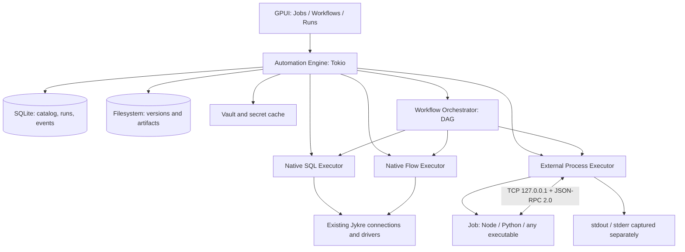

# Jykre Studio — Automation Engine, Jobs and Workflows

**Functional and technical specification · version 1.0 (proposal)**
**Date:** November 7, 2026
**Approval:** Proposed
**Implementation:** Not started; proposed architecture, not implemented features
**Audience:** product, UX, architecture, Rust engineering and testing

> This is the original v1.0 proposal. The [architecture review](../research/automation-engine-architecture-review.md) recommends substantial changes that still require maintainer approval. Translation and organization do not resolve those decisions.

> **Core principle:** a job is a reusable unit of work receiving typed inputs, performing a task and producing events, outputs and optional artifacts. Jobs can be native (SQL or declarative flow) or external (any executable), sharing one execution and observability model.

## Contents

1. [Overview and decisions](#1-overview-and-decisions)
2. [Scope, requirements and principles](#2-scope-requirements-and-principles)
3. [Conceptual model](#3-conceptual-model)
4. [User experience](#4-user-experience)
5. [Job definitions and versioning](#5-job-definitions-and-versioning)
6. [Native SQL jobs](#6-native-sql-jobs)
7. [External jobs and runtimes](#7-external-jobs-and-runtimes)
8. [JJP — Jykre Job Protocol](#8-jjp--jykre-job-protocol)
9. [Capabilities available to jobs](#9-capabilities-available-to-jobs)
10. [Inputs, outputs and human interaction](#10-inputs-outputs-and-human-interaction)
11. [Workflows and job chaining](#11-workflows-and-job-chaining)
12. [Caching, credentials and reuse](#12-caching-credentials-and-reuse)
13. [Artifacts and files](#13-artifacts-and-files)
14. [Persistence and directory layout](#14-persistence-and-directory-layout)
15. [Execution states and rules](#15-execution-states-and-rules)
16. [Security and trust boundaries](#16-security-and-trust-boundaries)
17. [Rust implementation architecture](#17-rust-implementation-architecture)
18. [APIs and end-to-end examples](#18-apis-and-end-to-end-examples)
19. [Operation, retention and recovery](#19-operation-retention-and-recovery)
20. [Roadmap, acceptance and testing](#20-roadmap-acceptance-and-testing)
21. [Open decisions](#21-open-decisions)
22. [Glossary](#22-glossary)

## 1. Overview and decisions

### 1.1 Goal

Add local automation to Jykre Studio to execute, schedule, combine and observe tasks. Users can create jobs without code, reuse SQL against existing connections and execute external-language scripts, with standardized inputs, results and history.

### 1.2 Consolidated decisions

| Topic | Architectural decision |
| --- | --- |
| Host application | Jykre Studio, Rust with GPUI |
| Async engine | Tokio, reusing existing services and drivers |
| Job classes | `native_sql`, `native_flow`, `external_process` |
| SQL job | Runs directly against a registered connection without a helper process |
| External languages | Any installed runtime/executable |
| External job communication | TCP loopback (`127.0.0.1`), JSON-RPC 2.0 |
| MVP framing | One UTF-8 JSON message per line, NDJSON |
| Output separation | Unrestricted stdout/stderr; JJP uses a separate socket |
| IPC authentication | A short random token unique to each run |
| MVP TLS | Not required for strictly local use; transport prepared for future TLS |
| Input/output schemas | A JSON Schema subset defined by the Jykre version |
| Metadata, history, states | SQLite |
| Code, stdout/stderr, artifacts | Filesystem |
| Persistent credentials | OS vault, with an explicit secure fallback where applicable |
| Ephemeral tokens | Protected temporary storage, preferably memory |
| Orchestration | DAG workflows, directed acyclic graphs |
| Scheduled execution with Jykre closed | Outside MVP; requires an independent agent |

### 1.3 Overall architecture



Native jobs run internally without opening TCP connections to themselves. Only external jobs use JJP for events and capability calls.

### 1.4 MVP non-goals

- Hosting a remote service or multi-user server.
- Strong sandboxing of arbitrary scripts; JJP permissions do not isolate an OS process.
- Creating a new programming language.
- Guaranteed execution while the app is closed.
- A token database exposed as a plaintext credential catalog.
- Replacing the existing SQL editor or connection manager.

## 2. Scope, requirements and principles

### 2.1 Functional requirements

| ID | Requirement | Priority |
| --- | --- | --- |
| RF-001 | Create, edit, duplicate, disable, delete and version jobs | MVP |
| RF-002 | Run jobs manually with an input form | MVP |
| RF-003 | Native SQL jobs linked to existing connections | MVP |
| RF-004 | External scripts and configurable runtimes | MVP |
| RF-005 | Record logs, progress, state, results and failures | MVP |
| RF-006 | External jobs call JJP APIs through RPC | MVP |
| RF-007 | Request user input with a timeout | MVP |
| RF-008 | Produce and register artifacts | MVP |
| RF-009 | Chain jobs and map outputs to inputs | MVP |
| RF-010 | Run workflows manually | MVP |
| RF-011 | Schedule jobs/workflows by interval or cron | Evolution 1 |
| RF-012 | Result caching with TTL and concurrent deduplication | Evolution 1 |
| RF-013 | Reuse ephemeral tokens by secure reference | Evolution 1 |
| RF-014 | Parallel/conditional jobs and failure recovery | Evolution 1 |
| RF-015 | Jobs in command palette/result context | Evolution 2 |
| RF-016 | Advanced visual workflow editor | Evolution 2 |
| RF-017 | Agent running jobs while Jykre is closed | Evolution 2 |
| RF-018 | Remote plugins/runtimes with TLS | Future |

**Interpretation:** MVP is the desired minimum contract for a first usable version. Incremental deliveries may divide the roadmap without changing the data model.

### 2.2 Non-functional requirements

- **RNF-001 — failure isolation:** external process errors cannot bring down the main application.
- **RNF-002 — responsiveness:** execution must not block GPUI's rendering thread.
- **RNF-003 — language independence:** no SDK requirement; any TCP/JSON client can implement JJP.
- **RNF-004 — traceability:** every run references its definition/version, initiating user, sanitized inputs, time and final state.
- **RNF-005 — predictability:** configurable timeouts, memory/message limits, concurrency and results, with defaults.
- **RNF-006 — security:** validate capabilities server-side, rather than trusting job declarations.
- **RNF-007 — integrity:** artifact copying, state commits and cleanup must reasonably withstand failures.
- **RNF-008 — portability:** core support for Windows, Linux and macOS; runtimes must be installed.
- **RNF-009 — extensibility:** versioned JJP methods tolerate optional features.

## 3. Conceptual model

### 3.1 Entities

| Entity | Meaning |
| --- | --- |
| `JobDefinition` | Identity, type, description, inputs/outputs, permissions, defaults and settings |
| `JobVersion` | Immutable code/manifest/SQL/flow snapshot with hash |
| `JobRun` | One execution: inputs, logs, outputs, state, timestamps |
| `WorkflowDefinition` | Steps, dependencies and mappings |
| `WorkflowVersion` | Immutable DAG and step-contract snapshot |
| `WorkflowRun` | One complete workflow execution |
| `WorkflowStepRun` | Step instance linked to a `JobRun` |
| `Artifact` | Managed run-linked file identified by ID |
| `JobCacheEntry` | Reusable result by key, version, scope and TTL |
| `SecretRef` | Opaque, authorized, temporary secret reference |
| `InteractionRequest` | User question with deadline and outcome |
| `RuntimeDefinition` | External executable startup and JJP establishment |
| `ScheduleDefinition` | Recurring trigger, overlap policy and execution window |

### 3.2 Relationships

```text
JobDefinition 1 ── N JobVersion
JobVersion    1 ── N JobRun
JobRun        1 ── N Event
JobRun        1 ── N Artifact
WorkflowDefinition 1 ── N WorkflowVersion
WorkflowVersion    1 ── N WorkflowRun
WorkflowRun  1 ── N WorkflowStepRun ── 1 JobRun
JobVersion   1 ── N JobCacheEntry (by key and scope)
JobRun       1 ── N InteractionRequest
```

Pin every job's version when the workflow runs, even if jobs are edited later.

## 4. User experience

### 4.1 Suggested navigation

**Automation** sidebar with **Jobs**, **Workflows**, **Runs**, **Schedules** and **Settings**.

**Job list:** name, type (SQL/Flow/Script), connection/runtime, enabled state, last run, next scheduled run and quick actions. Search name, description, language, tags, connection and status.

**Create job:** choose:

1. **Native SQL:** select an existing connection and open the SQL editor.
2. **Native Flow:** assemble integrated HTTP, SQL, condition, question, notification and other actions.
3. **External script:** select a runtime, command, working directory and entrypoint.

**Job detail:** `Editor`, `Inputs/Outputs`, `Permissions`, `Runs`, `Schedule`, `Versions`, `Settings`.

**Run:** a JSON Schema-generated form shows the database connection, sensitive permissions and **Run**. Results present logs, progress, outputs, artifacts and terminal state.

**User question:** a non-modal panel with timeout and explicit answer/decline actions, leaving other navigation available.

### 4.2 SQL Job in the interface

Minimum fields:

- **Name** and description.
- **Connection:** existing connections with availability indicators.
- **SQL:** the existing full editor, with dialect, highlighting, autocomplete, formatting and shortcuts.
- **Inputs:** name, type, required flag, default, description, presentation.
- **Outputs:** result-derived or explicitly declared schema.
- **Execution:** session mode, timeout, row limit, multi-statement policy.
- **Permissions:** read/write and sensitive-operation confirmation.

**Preview parameters** fills inputs and tests the job. Saved versions remain distinct from tests of unsaved content.

### 4.3 Runs and history

Each row shows `run_id`, job/version, initiator, origin (`manual`, `schedule`, `workflow`, `job`), start/end, duration, state, result summary, artifact count and rerun. Mask sensitive inputs/answers. Filter by time range, state, connection and workflow.

## 5. Job definitions and versioning

### 5.1 Common contract

Every definition has `id`, `name`, `kind`, `version`, `inputs_schema`, `outputs_schema`, `permissions`, `execution`, `tags`, `enabled`. Validate parameters before startup and outputs before completion.

Simplified conceptual manifest:

```json
{
  "schema_version": "1.0",
  "id": "sfmc.lookup-de",
  "name": "Look up Data Extension",
  "kind": "native_sql",
  "version": 1,
  "inputs_schema": {
    "type": "object",
    "properties": {
      "external_key": {
        "type": "string",
        "title": "External Key",
        "minLength": 1
      }
    },
    "required": ["external_key"],
    "additionalProperties": false
  },
  "outputs_schema": {
    "type": "object",
    "properties": {
      "address": { "type": ["string", "null"] }
    }
  },
  "execution": {
    "timeout_ms": 30000,
    "max_concurrency": 1
  }
}
```

Store SQL, connection and execution parameters in the `native_sql` definition. Later connection/query values are illustrative.

### 5.2 Versioning rules

- Saving creates an immutable `JobVersion` or a draft until publication, depending on UX.
- Each run uses exactly one version; record its SHA-256 hash and connection reference.
- Never include secrets in versions.
- Workflows reference their pinned version, not a subsequently latest version.
- Snapshot/hash external code before execution to prevent changes during a job.
- Deletion allows archiving/disabling while preserving history subject to retention.

### 5.3 Portability

Import/export definitions and sources as a directory or package. Remap connection IDs and credential references at the destination; never export secret values in a package.

## 6. Native SQL jobs

A **first-class** job type, rather than merely an optional workflow step. Its internal Rust executor **uses no TCP/JJP or external process**.

### 6.1 SQL Job definition

A SQL Job contains:

- `connection_ref`: stable existing-connection ID; avoid name-only identity.
- `sql`: SQL text editable in the native editor.
- `parameters`: typed query inputs, without string interpolation.
- `result_mode`: `rows`, `scalar`, `affected_rows`, `none`.
- `session_mode`: default `isolated`; possibly `shared_session` as an explicit restricted operation.
- `timeout_ms`, `max_rows`, `max_result_bytes`.
- `multi_statement`: default `false`.
- `transaction_mode`: `none`, `auto` or an explicitly approved policy.

Example:

```yaml
id: data.hlg.lookup-de
kind: native_sql
connection_ref: conn-databricks-hlg
session_mode: isolated
sql_file: query.sql
result_mode: rows
multi_statement: false
limits:
  timeout_ms: 30000
  max_rows: 1000
  max_result_bytes: 2097152
inputs:
  external_key: { type: string, required: true }
```

`query.sql`:

```sql
SELECT external_key, address
FROM integration.data_extensions
WHERE external_key = :external_key
LIMIT 1;
```

**Note:** table/fields are examples. Resolve dialect and placeholders through the actual connection driver.

### 6.2 Safe parameter binding

- Use driver **bind parameters**, never `.replace()` or value-concatenated SQL.
- An internal layer may normalize conceptual `:name` markers, respecting dialect-specific literals, comments, identifiers, operators, PostgreSQL `::` and dollar quotes.
- Most drivers **cannot bind** table/column names. Use catalog/allowlist selection and separate identifier validation.
- Arrays/lists require dialect-aware parameterized expansion or a native driver strategy, never unsafe concatenation.
- JSON Schema validation supplements driver type validation.

### 6.3 Structured result

`result_mode: rows` produces a stable envelope:

```json
{
  "columns": [
    { "name": "external_key", "type": "string" },
    { "name": "address", "type": "string" }
  ],
  "rows": [
    { "external_key": "DE_MEMBERS", "address": "..." }
  ],
  "row_count": 1,
  "truncated": false,
  "execution_ms": 48
}
```

`scalar` maps one value to an output such as `outputs.address`. `row_count` counts returned rows, not total query cardinality. Truncation sets `truncated: true` and offers full-result artifact export when the driver streams.

Document special-type serialization (`DECIMAL`, `TIMESTAMP`, `BINARY`, `JSON`, `ARRAY`, `STRUCT`, `VARIANT`, etc.) to prevent silent precision loss. Prefer artifacts/references for binaries and large results.

### 6.4 Sessions and transactions

- **Default `isolated`:** obtain a connection separate from the interactive editor session, using existing credentials/settings; never interfere with open user transactions.
- **`shared_session`:** future opt-in only with serialized access, accurate transaction state and informed approval. Scheduled jobs cannot silently use editor sessions.
- Query success does not prove commit. Commit/rollback policy must be explicit and consistent with driver state.
- Enforce `db.write` and appropriate confirmation/policy for writes. Textual SQL classification warns; **it is not a security boundary**. Prefer genuinely read-only database users for restricted reads.
- For long queries, timeout/cancellation attempts driver interruption and handles connection state before returning it to the pool.

### 6.5 Multiple statements and large results

- MVP: **one logical statement per SQL Job**, using the existing dialect splitter and rejecting multiples when `multi_statement=false`.
- Later multi-statement scripts require explicit error, transaction and multiple-result policies.
- Limit serialized rows/bytes; large extracts produce CSV/JSON/Parquet artifacts where supported, rather than giant SQLite JSON.
- Stream instead of loading whole result sets when supported.

### 6.6 Workflow uses

`external_key` can come from a form or another job; outputs can feed Python, HTTP, a flow condition or another SQL Job.

## 7. External jobs and runtimes

### 7.1 Concept

`external_process` starts user-defined Node.js, Python, PowerShell, Bash, compiled Rust, third-party CLIs or other executables. Jykre starts/monitors them, supplies inputs and interprets outputs without implementing their language.

### 7.2 Runtime registration

A runtime can declare:

```json
{
  "id": "nodejs",
  "display_name": "Node.js",
  "executable": "node",
  "argument_template": ["${entrypoint}"],
  "supported_extensions": [".js", ".mjs", ".cjs"],
  "supports_jjp": true
}
```

Resolve *argument_template* variables structurally **without a shell**, unless the user knowingly configures a shell job. Discover or let the user pin the executable path.

### 7.3 Preparation and startup

1. Load definition/version and validate inputs.
2. Create an isolated temporary run directory.
3. Reserve IPC session and ephemeral token.
4. Spawn via `tokio::process::Command` with `cwd`, arguments, variables and limits.
5. Capture stdout/stderr separately; never parse them as JJP.
6. If supported, connect via TCP loopback and perform `job.hello`.
7. Send `job.execute` with validated inputs; await events/completion.
8. Finish collection, record exit code/final state and clean temporary files under policy.

**Without JJP:** jobs still run; stdout/stderr, exit code and explicitly collected files provide observability. Exit 0 succeeds; nonzero, timeout or cancellation fails.

### 7.4 Execution contract

JJP parameters arrive through `job.execute`, avoiding business data in command arguments. Prefer sensitive references/capabilities over environment values. Minimal bootstrap variables follow section 16's security caveats.

## 8. JJP — Jykre Job Protocol

### 8.1 Transport and framing

- MVP: persistent TCP to Jykre's server bound to `127.0.0.1`.
- OS-selected dynamic port; bind **before starting** jobs.
- Random single-use per-`run_id` token authenticates the session and binds run permissions.
- JSON-RPC 2.0: `jsonrpc`, `id`, `method`, `params`, `result`, `error`.
- One UTF-8 JSON message per line; escape newlines inside JSON strings.
- With `id`: calls require responses and may await/block through SDK APIs. Without `id`: notifications have no responses.
- JSON-RPC does not determine blocking; SDKs do. Distinct IDs allow concurrent pending calls.
- Reject unknown/unauthorized methods and enforce a configurable frame maximum, initially **1 MiB**, for example.
- Large tables/files use pagination, streaming or artifacts instead of huge frames.

### 8.2 Bootstrap and handshake

Startup variable example:

```text
JYKRE_IPC_HOST=127.0.0.1
JYKRE_IPC_PORT=49321
JYKRE_RUN_ID=run-01
JYKRE_IPC_TOKEN=<ephemeral-secret>
JYKRE_PROTOCOL=jjp/1
```

**Required** first message, before business methods:

```json
{
  "jsonrpc": "2.0",
  "id": 1,
  "method": "job.hello",
  "params": {
    "protocol": "jjp/1",
    "run_id": "run-01",
    "token": "<ephemeral-secret>",
    "capabilities": ["job.events", "job.rpc"]
  }
}
```

Response:

```json
{
  "jsonrpc": "2.0",
  "id": 1,
  "result": {
    "session_id": "session-01",
    "protocol": "jjp/1",
    "capabilities": ["job.events", "jykre.db.query", "jykre.ask"],
    "max_message_bytes": 1048576
  }
}
```

Never return the token. Reject other methods before hello; close on authentication failure and limit attempts.

### 8.3 Parameterized execution

After handshake, **Jykre → job**:

```json
{
  "jsonrpc": "2.0",
  "id": "exec-01",
  "method": "job.execute",
  "params": {
    "run_id": "run-01",
    "inputs": { "external_key": "DE_MEMBERS" },
    "deadline_at": "2026-11-07T13:05:00Z"
  }
}
```

An SDK could answer on completion **or** acknowledge immediately and later send `job.complete`/`job.fail`. **Normative v1 decision:** immediately return `{"accepted": true}` to `job.execute`, with a separate terminal `job.complete`/`job.fail`, avoiding duplicate outcomes and simplifying async control.

### 8.4 Job-to-Jykre events

| Method | Type | Essential fields |
| --- | --- | --- |
| `job.log` | Notification | `level`, `message`, `fields?` |
| `job.progress` | Notification | `value` 0–100, `stage?`, `message?` |
| `job.status` | Notification | `key`, `value`, `label?`; business indicator, not engine state |
| `job.metric` | Notification | `name`, `value`, `unit?`, `tags?` |
| `job.artifact.add` | Request | `path`, `name`, `mime_type?`, `retention?` |
| `job.complete` | Request | `outputs` |
| `job.fail` | Request | `code`, `message`, `details?` |
| `job.heartbeat` | Notification | `at?` |

Example:

```json
{
  "jsonrpc": "2.0",
  "method": "job.progress",
  "params": { "value": 65, "stage": "fetch", "message": "Fetching records" }
}
```

### 8.5 Job-to-Jykre calls

| Method | Expected result |
| --- | --- |
| `jykre.db.query` | Bounded/paginated authorized query result |
| `jykre.ask` | User input or timeout/cancellation error |
| `jykre.confirm` | `confirmed: true/false` or timeout |
| `jykre.notify` | Receipt acknowledgement |
| `jykre.secrets.get_ref` | Authorized reference, not its contents |
| `jykre.secrets.create_ephemeral` | Secure reference with effective TTL |
| `jykre.http.request` | Size-limited authorized HTTP result |
| `jykre.storage.get`/`set` | Value in approved storage scope |
| `jykre.jobs.run` | `run_id` and outputs after completion, or error, according to mode |
| `jykre.artifacts.resolve` | Authorized read reference/path for a managed artifact |
| `jykre.context.get` | Non-sensitive run metadata |

### 8.6 Jykre-to-job commands

- `job.cancel` notification: cooperative cancellation with `reason`, `grace_ms`.
- `job.ping` request: SDK responsiveness check where implemented.
- `job.execute` request: start under the execution contract.

After grace expiry, Jykre may terminate uncooperative jobs. Child cleanup may require Windows/Unix-specific mechanisms and process-tree policies.

### 8.7 Errors and terminal states

JSON-RPC error example:

```json
{
  "jsonrpc": "2.0",
  "id": 18,
  "error": {
    "code": -32041,
    "message": "User input timeout",
    "data": {
      "domain_code": "USER_INPUT_TIMEOUT",
      "retryable": false
    }
  }
}
```

Publish stable `domain_code` values: `INVALID_INPUT`, `PERMISSION_DENIED`, `USER_INPUT_TIMEOUT`, `JOB_TIMEOUT`, `JOB_CANCELLED`, `DB_ERROR`, `JOB_NOT_FOUND`, `CACHE_UNAVAILABLE`, `ARTIFACT_TOO_LARGE`, `PROTOCOL_ERROR`, `PROCESS_EXIT_NONZERO`, `INTERNAL_ERROR`, etc. Assign compatible JSON-RPC numeric ranges.

**Termination rules:**

1. `job.complete`/`job.fail` are idempotent per-run terminal operations answered by the server.
2. Accepted `complete` records `COMPLETING`; `SUCCEEDED` requires coherent process exit 0 or controlled session closure under runtime policy.
3. Nonzero exit after `complete` yields `FAILED`; retain partial outputs for diagnosis, not as valid final results.
4. Accepted `fail` records failure intent; terminate/await within grace and finalize `FAILED`.
5. JJP exit without an explicit terminal message fails unless the definition opts into `implicit_success_on_zero_exit=true`. Non-JJP jobs follow exit code.
6. Reject result-changing calls after terminal state.

### 8.8 Transport evolution

Abstract `AsyncRead + AsyncWrite` and framing. Future `rustls`/`tokio-rustls` TLS need not change methods; UDS/Named Pipes are alternatives. Persistent loopback TLS has little traffic cost but needs certificates and identity validation; MVP operational cost likely exceeds benefit.

## 9. Capabilities available to jobs

### 9.1 Minimal SDK API

The optional SDK may expose a high-level API such as:

```typescript
interface JykreClient {
  readonly inputs: Record<string, unknown>;
  log: {
    debug(message: string, fields?: object): void;
    info(message: string, fields?: object): void;
    warn(message: string, fields?: object): void;
    error(message: string, fields?: object): void;
  };
  progress(value: number, message?: string, stage?: string): void;
  status(key: string, value: unknown, label?: string): void;
  metric(name: string, value: number, unit?: string): void;
  db: { query(request: DbQueryRequest): Promise<DbQueryResult> };
  ask(request: AskRequest): Promise<unknown>;
  confirm(request: ConfirmRequest): Promise<boolean>;
  notify(request: NotificationRequest): Promise<void>;
  artifact(request: ArtifactRequest): Promise<ArtifactRef>;
  jobs: { run(request: RunJobRequest): Promise<JobRunResult> };
  storage: { get(key: string): Promise<unknown>; set(key: string, value: unknown): Promise<void> };
  secrets: {
    getRef(name: string): Promise<SecretRef>;
    createEphemeral(request: EphemeralSecretRequest): Promise<SecretRef>;
  };
  complete(outputs: Record<string, unknown>): Promise<void>;
  fail(error: JobError): Promise<void>;
  onCancel(callback: (reason: string) => void): void;
}
```

This describes a desired interface, **not an already published package**.

### 9.2 Operation semantics

| Capability | Semantics |
| --- | --- |
| `log` | Append-only level/structured-field event; mask sensitive data |
| `progress` | Nonterminal indicator in 0–100; regression allowed for explicitly identified rework |
| `status` | Domain indicator such as `api_enabled: false`; never changes run state |
| `metric` | Numeric sample for display/aggregation |
| `db.query` | Existing connection/security policy; conservative time/row/byte defaults |
| `ask` | Request an answer, enter `WAITING_INPUT`, receive answer/timeout |
| `confirm` | Boolean `ask`; does not replace dangerous-operation authorization |
| `notify` | Nonblocking local notification with priority and optional deduplication |
| `artifact` | Register/copy a file to managed storage and return its ID |
| `jobs.run` | Start a child job with explicit inputs, authorization and parent/child tracing |
| `storage.get/set` | Small job-namespaced values; unsuitable for secrets |
| `secrets` | Authorized references or controlled-use ephemeral secrets |
| `complete` | Declare/validate final outputs and signal completion |
| `fail` | Finish with stable code, message, sanitized details and error status |
| `onCancel` | Cooperatively abort before forced termination |

### 9.3 Permissions

Separate **integration capabilities** from **OS permissions**. Check connections, SQL actions, HTTP destinations, child jobs and secrets server-side. Restricted JJP scripts **remain local processes able to access OS-permitted resources**; the protocol is not a sandbox.

Illustrative manifest:

```json
{
  "permissions": {
    "db": {
      "connections": ["conn-databricks-hlg"],
      "allow_read": true,
      "allow_write": false
    },
    "user_interaction": true,
    "notifications": true,
    "http": {
      "hosts": ["*.rest.marketingcloudapis.com"],
      "https_only": true
    },
    "secrets": ["sfmc-prd"],
    "jobs": ["sfmc.auth"]
  }
}
```

Host allowlists authorize `jykre.http.request`, but cannot prevent a process's own network calls. Real network blocking needs OS isolation.

## 10. Inputs, outputs and human interaction

### 10.1 Inputs

- `inputs_schema` uses an explicit JSON Schema subset: types, `required`, `enum`, `default`, limits, patterns, descriptions.
- Generate text, numeric, boolean, selection, date, JSON and secret/reference fields.
- Validate in the form, again in the engine and before every workflow step.
- Apply defaults server-side; invalid names/extra properties follow the schema.
- Store a **sanitized input snapshot**; never persist sensitive values as ordinary JSON.
- Child invocations meet the same input contract as manual runs.

### 10.2 Outputs

- Every job type returns a JSON key/value object governed by `outputs_schema`.
- Small outputs stay in SQLite by `run_id`.
- Large/binary outputs become artifacts; never truncate silently.
- Outputs feed `jobs.run`, workflow mappings and manual inspection.
- Sensitive values use `SecretRef`; tokens never become ordinary output strings.

### 10.3 Human interactions

Example call:

```json
{
  "jsonrpc": "2.0",
  "id": 42,
  "method": "jykre.ask",
  "params": {
    "title": "DE found",
    "message": "Continue with the export?",
    "type": "select",
    "options": [
      { "value": "yes", "label": "Yes" },
      { "value": "no", "label": "No" }
    ],
    "timeout_ms": 60000,
    "required": true
  }
}
```

Rules:

1. Create `InteractionRequest` with `request_id`, `run_id`, type, schema, deadline, `PENDING`.
2. Enter `WAITING_INPUT`, suspending only dependent steps; independent branches may continue.
3. Present a non-modal run-panel question; notify the user if necessary.
4. Send the validated answer in the same JSON-RPC request's `result`.
5. On expiry return `USER_INPUT_TIMEOUT`; fail by default, or let the job catch the error and decide.
6. Decline returns an explicit answer such as `false` or `USER_INPUT_CANCELLED`, per contract; “No” is not a technical failure.
7. Automatic jobs without active UI need `fail_immediately`, `wait_until_timeout` or `default_answer` policy; never implicitly default destructive actions.
8. Persist interaction status/metadata, mask sensitive answers and restrict retention.

### 10.4 Notifications versus questions

Notifications never suspend jobs. Questions request correlated answers and may enter `WAITING_INPUT`. `confirm()` never replaces `db.write` security approval required by organizational policy.

## 11. Workflows and job chaining

### 11.1 Principle

A **workflow** is a DAG of reusable-job steps mapping outputs to inputs. Jobs remain independently executable. Workflows have their own inputs/outputs and history separate from component job runs.

### 11.2 Example: discover and export a Data Extension

```yaml
id: sfmc.export-de
name: Export Data Extension
inputs:
  external_key: { type: string, required: true }
steps:
  - id: auth
    job: sfmc.auth
    with:
      connection: sfmc-prd
    cache: reuse

  - id: lookup
    job: sfmc.lookup-de
    needs: [auth]
    with:
      external_key: ${inputs.external_key}
      auth_ref: ${steps.auth.outputs.token_ref}

  - id: export
    job: sfmc.export-csv
    needs: [lookup]
    with:
      de_address: ${steps.lookup.outputs.address}
      auth_ref: ${steps.auth.outputs.token_ref}
outputs:
  de_address: ${steps.lookup.outputs.address}
  export_file: ${steps.export.artifacts.csv}
```

Identifiers/expressions are **proposed syntax**. Resolve references structurally without `eval` or arbitrary executable interpolation. `needs` must cover every dependency, including `auth` referenced by `export`. A validator may infer output dependencies or require declarations; v1.0 specifies **inference and validation of expression-derived dependencies**.

### 11.3 Link types

| Mechanism | Example |
| --- | --- |
| Sequence | B starts when A succeeds |
| Parallelism | Independent B and C start after A |
| Condition | C runs only if `steps.B.outputs.valid == true` |
| Data chaining | `steps.A.outputs.id → steps.B.inputs.id` |
| Artifact | `steps.A.artifacts.csv → steps.B.inputs.file_ref` |
| Error recovery | `on_failure` starts diagnosis/compensation |
| Subworkflow | Invoke another workflow with a depth limit |
| Dynamic call | `jykre.jobs.run` with parent/child hierarchy |

### 11.4 Orchestration rules

- Detect cycles on DAG publication; reject future-step references without valid dependencies.
- Bound global, per-workflow, per-job and per-connection parallelism.
- Each step owns state and a `JobRun` referencing `WorkflowRun`/`parent_run_id`.
- Failures stop by default (`fail_fast`) or recover with `continue_on_error`/`on_failure`.
- Retry only eligible failures with maximum attempts, backoff and jitter. **No automatic retry of side effects** without explicit idempotency configuration.
- Cancel active children; preserve completed-step results.
- `WAITING_INPUT` cannot block independent branches.
- Pin job versions at workflow startup; no runtime/SQL changes mid-run.
- Validate output/artifact types, existence, authorization and retention.

### 11.5 Jobs calling jobs

`jykre.jobs.run({job, inputs, cache})` is the programmatic alternative to the workflow editor. Validate permissions, prevent infinite recursion, bound depth, inherit cancellation and audit parent/child relationships.

## 12. Caching, credentials and reuse

### 12.1 Job cache

A `cacheable` job's key derives from:

- Job ID and immutable version;
- Relevant canonical inputs and context/scope;
- Environment/credential/tenant identity, without plaintext secret values;
- Applicable `run`, `workflow`, `user`, `workspace` scope policies.

Store TTL/effective expiry. Invalidate on relevant version, credential, connection or parameter changes. Respect retention/permissions: **cache cannot expose another identity's data without authorization**.

**Singleflight:** identical concurrent requests await one in-progress result, avoiding repeated external calls. Do not cache failures by default; error caching needs an explicit short TTL.

### 12.2 Example: Salesforce Marketing Cloud authentication

`sfmc.auth` requests OAuth tokens using authorized credentials. Inputs: `connection`, `mid?`, `scopes?`. Outputs: `token_ref`, `rest_instance_url`, `expires_at`. **Never return `access_token` as ordinary output.**

Flow:

```text
Look up DE ────────┐
Export DE ──────────┼──> cache(sfmc.auth, credential + MID + scopes)
Look up journeys ──┘                      │
                                          ├─ valid: reuse token_ref
                                          └─ missing/expiring: run sfmc.auth
```

The generator sees the provider token; its SDK may send it once to Jykre's ephemeral vault over an authorized channel. Consumers receive only `SecretRef` and use authorized, destination-restricted `jykre.http.request`. An explicitly trusted job may request disclosure with elevated permission and an audit record.

Respect actual provider `expires_in`, minus an early-expiry margin. On 401, invalidate the reference and optionally allow one controlled refresh before retrying a safe operation.

### 12.3 Credential vault

- Persistent credentials stay outside ordinary SQLite in the OS secure facility.
- SQLite holds only `credential_id`, aliases and non-secret metadata.
- Without a usable vault, prefer blocking persistent storage or requiring an explicit security choice; never silently save plaintext.
- Temporary secrets may live in memory with TTL and per-job/run/workflow ACLs.
- No tokens in stdout/stderr, structured logs, history, diagnostic dumps or artifacts.
- Avoid tokens in process arguments; environment bootstrap uses only short session tokens and accounts for same-user process exposure.

### 12.4 Shareable non-secret data

Metadata, addresses and small lists can use ordinary SQLite cache; large data uses managed artifacts. Cache invalidation never erases execution history.

## 13. Artifacts and files

### 13.1 Concept

An artifact is a produced file **promoted** into Jykre-managed storage: Data Extension CSV, JSON report, PDF, exported log, SQL dump, result capture or diagnostic file.

| Output | Storage | Use |
| --- | --- | --- |
| `log` | SQLite event and/or stdout/stderr file | Diagnosis |
| `output` | Bounded structured SQLite JSON | Passing values between jobs |
| `artifact` | File referenced by ID | Export/open/consume files |
| `secret_ref` | Temporary vault plus minimal metadata | Controlled credential sharing |

### 13.2 Registration API

```javascript
const artifact = await jykre.artifact({
  path: "./output/members.csv",
  name: "members.csv",
  mimeType: "text/csv",
  retention: "default"
});

await jykre.complete({
  row_count: 1250,
  export_artifact_id: artifact.id
});
```

Return `artifact_id` **only after consistently copying and registering** the file.

### 13.3 Ingestion flow

1. Job writes in its temporary directory or another authorized location.
2. Send `job.artifact.add` with path/metadata.
3. Normalize/validate path, authorization, limits, extension/type; prevent `..`, unauthorized symlinks and conflicting names.
4. Copy into managed staging, calculate size/SHA-256, sync under the required guarantee.
5. Atomically promote via same-volume rename where supported, and register SQLite metadata.
6. Return artifact ID/metadata.
7. Remove orphaned staging/temporary files after run closure.

Artifact names are not arbitrary write paths. Generated IDs determine final directories, not job-supplied names.

### 13.4 Consumption by another job

Consumers receive `{ "artifact_id": "art-456" }`. Validate permission, retention and physical existence. External processes get temporary read-only copies or a read API. Native SQL jobs can generate artifacts through engine-managed export.

### 13.5 Retention and pinning

- `temporary`, `default` or `pinned` artifacts.
- Never automatically delete active-workflow references.
- Recoverable metadata/file deletion uses `DELETING` and reconciliation scans.
- Explicitly pinned artifacts from deleted runs may survive in a separate collection.
- Enforce global and per-run/job storage limits, with warnings.

## 14. Persistence and directory layout

### 14.1 Base directory

Use OS-standard directories and allow chosen destinations for artifacts/large files:

| OS | Suggested location |
| --- | --- |
| Windows | `%LOCALAPPDATA%\Jykre Studio\` |
| Linux | `${XDG_DATA_HOME:-~/.local/share}/jykre-studio/` |
| macOS | `~/Library/Application Support/Jykre Studio/` |

**Note:** configuration/data paths may differ; consult platform directory APIs. Never use `/tmp` for persistent artifacts.

### 14.2 Illustrative tree

```text
jykre-studio/
├── jykre.db
├── jobs/
│   ├── job-123/
│   │   ├── versions/
│   │   │   └── 0001/
│   │   │       ├── job.json
│   │   │       └── query.sql
│   │   └── drafts/
│   └── job-456/
│       └── versions/0001/
│           ├── job.json
│           └── script.mjs
├── workflows/
│   └── workflow-123/versions/0001/workflow.json
├── runs/
│   └── 2026/11/
│       └── run-abc123/
│           ├── stdout.log
│           ├── stderr.log
│           └── artifacts/
│               └── art-def456-members.csv
├── cache/
│   └── blobs/
└── tmp/
    └── run-abc123/
```

External/Git-linked jobs may retain source code outside this tree. Jykre retains metadata and executed-version snapshots according to configuration.

### 14.3 Storage responsibilities

| Information | Destination | Notes |
| --- | --- | --- |
| Registered jobs/workflows | SQLite | IDs, names, permissions, indexes |
| Versioned SQL/code/definitions | Files plus SQLite index | Immutable snapshot/hash |
| Run history | SQLite | State, times, errors, compact outputs |
| Structured events | SQLite | Pagination, limits, retention |
| stdout/stderr | Per-run files | Rotation, size limits |
| Artifacts | Per-run directories | SQLite ID references |
| Small-value cache | SQLite | TTL/scope validation |
| Large-blob cache | `cache/blobs/` | SQLite index |
| Persistent credentials | OS vault | No secret value in SQLite |
| Ephemeral tokens | Protected process memory | Opaque reference/TTL |

### 14.4 Minimal relational model

The following tables form the core; names/columns evolve through migrations.

```sql
CREATE TABLE jobs (
  id TEXT PRIMARY KEY,
  name TEXT NOT NULL,
  kind TEXT NOT NULL CHECK(kind IN
    ('native_sql', 'native_flow', 'external_process')),
  enabled INTEGER NOT NULL DEFAULT 1,
  current_version INTEGER NOT NULL,
  created_at TEXT NOT NULL,
  updated_at TEXT NOT NULL
);

CREATE TABLE job_versions (
  job_id TEXT NOT NULL REFERENCES jobs(id),
  version INTEGER NOT NULL,
  manifest_json TEXT NOT NULL,
  source_path TEXT,
  source_sha256 TEXT NOT NULL,
  created_at TEXT NOT NULL,
  PRIMARY KEY (job_id, version)
);

CREATE TABLE job_runs (
  id TEXT PRIMARY KEY,
  job_id TEXT NOT NULL,
  job_version INTEGER NOT NULL,
  parent_run_id TEXT,
  workflow_run_id TEXT,
  state TEXT NOT NULL,
  origin TEXT NOT NULL,
  inputs_redacted_json TEXT NOT NULL,
  outputs_json TEXT,
  error_code TEXT,
  error_message TEXT,
  exit_code INTEGER,
  started_at TEXT,
  finished_at TEXT,
  created_at TEXT NOT NULL,
  FOREIGN KEY (job_id, job_version)
    REFERENCES job_versions(job_id, version)
);

CREATE TABLE job_artifacts (
  id TEXT PRIMARY KEY,
  run_id TEXT NOT NULL REFERENCES job_runs(id),
  display_name TEXT NOT NULL,
  relative_path TEXT NOT NULL,
  mime_type TEXT,
  size_bytes INTEGER NOT NULL,
  sha256 TEXT NOT NULL,
  retention TEXT NOT NULL,
  state TEXT NOT NULL,
  created_at TEXT NOT NULL
);

CREATE INDEX idx_job_runs_job_created
  ON job_runs(job_id, created_at DESC);
CREATE INDEX idx_job_runs_state ON job_runs(state);
CREATE INDEX idx_artifacts_run ON job_artifacts(run_id);
```

Additional required tables, indexed by `run_id`/`created_at`/`expires_at`:

- `job_run_events`: `id`, `run_id`, `sequence`, `timestamp`, `kind`, `payload_redacted_json`.
- `job_interactions`: `id`, `run_id`, `request_id`, `state`, `deadline_at`, `request_redacted_json`, `response_redacted_json`.
- `workflows`, `workflow_versions`: immutable definition, hash, manifest JSON.
- `workflow_runs`, `workflow_step_runs`: workflow, step, job_run, state, attempts, dependencies.
- `job_cache`: key, scope, result references, expiry, version, state.
- `job_schedules`: cron/interval, timezone, next trigger, overlap policy, enabled.
- `runtime_definitions`: command/arguments, capabilities, platform.
- `job_permission_grants`: job scope, authorized connection/secret/resource, audit.
- `credential_references`: alias, vault provider identifier, non-sensitive metadata.

Enable foreign keys, suitable journaling such as WAL under Jykre's global strategy, versioned migrations, transactional state writes and frequent-access indexes. Store UTC timestamps and display local UI time.

### 14.5 Reliability across SQLite and files

SQLite and the filesystem share no ACID transaction. Use staging, intermediate state, rename and confirmation, with startup reconciliation for missing/orphaned files. Complete code snapshots before creating executable references.

## 15. Execution states and rules

### 15.1 Default states

```text
CREATED → QUEUED → STARTING → RUNNING ⇄ WAITING_INPUT
                                  │
                                  ├→ COMPLETING → SUCCEEDED
                                  ├→ FAILING    → FAILED
                                  ├→ CANCELLING → CANCELLED
                                  └→ TIMING_OUT → TIMED_OUT
```

Valid answers return `WAITING_INPUT` to `RUNNING`. `SUCCEEDED`, `FAILED`, `CANCELLED`, `TIMED_OUT` are terminal. Condition-skipped workflow steps may use `SKIPPED`.

### 15.2 State rules

- State belongs to the engine, not `job.status` text.
- The authoritative engine validates transitions and ignores late terminal events.
- `complete`/`fail` are verified terminal intents; process/exit also matter.
- Execution/question timeouts differ; questions consume the overall deadline unless approved policy explicitly pauses it.
- Repeated terminals cannot duplicate effects; idempotent calls return the existing result.
- Every transition emits a structured audit event.

### 15.3 Scheduler and concurrency

- Triggers: manual, application context, child job, workflow, interval, cron.
- `overlap_policy`: `skip`, `queue`, `parallel`; suggested scheduled default `skip`.
- Bound global, per-job, per-workflow, per-connection concurrency and queue size/wait.
- Missed triggers while closed: default `skip`, optional `catch_up_once`.
- Independent remote I/O may run concurrently; shared connections require synchronization and transaction-state respect.
- Coalesce frequent UI events without losing retained logs/audit.

### 15.4 Cancellation

1. Mark `CANCELLING`, reject relevant new requests and notify active children.
2. Send external JJP `job.cancel` or trigger native SQL/Flow cancellation tokens.
3. Wait `grace_ms`; request driver SQL cancellation if available.
4. Terminate external processes if necessary and clean their trees under OS policy.
5. Finish `CANCELLED`, preserving history, logs and published artifacts.

Timeout is not manual cancellation; retain the explicit terminal cause.

## 16. Security and trust boundaries

### 16.1 Threat model

At least:

1. Unauthorized local processes contacting the listener.
2. Legitimate jobs invoking ungranted capabilities.
3. Malicious/compromised jobs exfiltrating data/tokens/files.
4. Destructive SQL or incorrectly bound parameters.
5. Secrets unintentionally entering logs/history/artifacts.
6. Traversal, symlinks, file replacement during collection.
7. Misconfigured ports accessible beyond the machine.
8. Incorrect cache reuse across environments/credentials.
9. Local denial of service through large frames, many connections, log spam or endless jobs.

### 16.2 TCP session protection

- Bind random ports on `127.0.0.1` only, never `0.0.0.0`.
- Listen before spawn to reduce endpoint races.
- Use cryptographically random tokens of sufficient length, e.g. 256 bits, unique per run and invalidated at termination.
- No operation before hello; bound connection rate, frame size, auth failures and handshake time.
- Bind session to run ID, permissions and feasible spawned-process identity/tree. A stolen valid token permits impersonation; run ID alone authenticates nobody.
- Prefer minimally exposed bootstrap channels. Environment variables suit MVP convenience but are not secure vaults against same-user/privileged processes.
- Future TLS 1.3 helps remote/high-risk local communication **when server identity is validated**; it replaces neither authorization nor sandboxing.
- Strong same-user app isolation may need UDS/Named Pipes OS ACLs, peer identity and/or isolated services, plus TLS where applicable.

### 16.3 External execution security

JJP controls **only its APIs**. User-privileged external jobs can call HTTP, read allowed files and spawn processes despite contrary manifest `permissions.http`/`permissions.files` declarations.

Consequences:

- Clearly warn about untrusted scripts.
- Confirm third-party import/first run and permission changes.
- Future OS/container/restricted-process sandbox profiles govern file/network access.
- Never claim an internal allowlist “blocks Internet access” without real network isolation.
- Prefer least-privilege subprocesses and never automatically copy sensitive Jykre environment variables.

### 16.4 SQL security

- `connection_ref` names an existing connection; plaintext credentials need not reach the job.
- Mandatory binding where supported; native execution forbids SQL concatenation with untrusted inputs.
- Respect real database permissions; textual read-only analysis is no guarantee.
- Classify DDL/DML for warnings/write authorization and configured extra confirmation.
- Production policies are separate from staging/local.
- Do not reuse open editor-transaction sessions by default.

### 16.5 Secrets and audit policy

- By default no raw tokens, passwords, keys or `Authorization` in logs/history.
- Redacting `password`, `access_token`, `client_secret`, `authorization`, etc. is defense in depth, not a secrets API/explicit sensitive-field substitute.
- No secrets in `job_cache.outputs_json`, `job_runs.outputs_json`, artifact directories.
- Audit grants, secret access, SQL writes, child jobs and artifact exports.
- Future shared use needs user/organization authorization; local permissions are not multi-user access control.

## 17. Rust implementation architecture

### 17.1 Suggested modules

```text
automation/
├── domain/
│   ├── job.rs
│   ├── run.rs
│   ├── workflow.rs
│   ├── artifact.rs
│   └── permissions.rs
├── catalog/
│   ├── repository.rs
│   ├── versions.rs
│   └── migrations.rs
├── engine/
│   ├── scheduler.rs
│   ├── dispatcher.rs
│   ├── state_machine.rs
│   ├── run_context.rs
│   ├── cancellation.rs
│   └── limits.rs
├── executors/
│   ├── mod.rs
│   ├── native_sql.rs
│   ├── native_flow.rs
│   └── external_process.rs
├── protocol/
│   ├── jsonrpc.rs
│   ├── framing.rs
│   ├── tcp_server.rs
│   ├── handshake.rs
│   └── method_router.rs
├── services/
│   ├── artifact_store.rs
│   ├── secret_store.rs
│   ├── cache.rs
│   ├── interactions.rs
│   ├── notifications.rs
│   └── http_client.rs
├── workflow/
│   ├── dag.rs
│   ├── expressions.rs
│   └── orchestrator.rs
└── ui/
    ├── jobs.rs
    ├── editor.rs
    ├── run_details.rs
    └── workflow_editor.rs
```

Illustrative organization: adapt to Jykre's actual modules/crates. Never duplicate existing SQL clients, parsers/editors, secret managers or tab systems.

### 17.2 Executor interface

Conceptual pseudocode:

```rust
#[async_trait::async_trait]
pub trait JobExecutor: Send + Sync {
    async fn execute(
        &self,
        definition: &JobVersion,
        context: RunContext,
    ) -> Result<ExecutionOutcome, JobError>;

    async fn cancel(&self, run_id: &str) -> Result<(), JobError>;
}
```

`RunContext` contains `run_id`, `inputs`, deadline, permissions, cancellation token, event sender, artifact/secret interfaces, initiator identity and parent workflow reference. Executors publish events/intents to the engine, which coordinates persistence/state; they never arbitrarily update SQLite or UI.

### 17.3 Executors

**`NativeSqlExecutor`:** resolve connection, select driver, acquire isolated session, validate permissions, prepare bound SQL, execute, serialize rows/metadata, produce outputs/artifacts and release resources. Integrates directly with Jykre's SQL layer.

**`NativeFlowExecutor`:** run declarative `http.request`, `db.query`, `if`, `ask`, `notify`, `set_variable`, `delay`, `run_job` under the same `RunContext`, without a shell/process. SQL steps do not eliminate standalone `native_sql` jobs.

**`ExternalProcessExecutor`:** prepare runtime, collect stdout/stderr, bind JJP, monitor process/signals/deadlines/artifacts/exit code; operate in simple mode without JJP.

### 17.4 Internal event bus

Typed Rust events: `Log`, `Progress`, `Status`, `Metric`, `ArtifactRegistered`, `StateTransition`, `OutputUpdated`, `InteractionRequested`, `InteractionAnswered`. Native executors publish **without TCP**; externals use JJP adapters. One bus feeds SQLite, history, observability and async GPUI updates.

### 17.5 Transport and protocol separation

- Transport supplies frames to JSON-RPC parsing; handlers never know `TcpStream`.
- MVP `TcpTransport`; later `TlsTransport`, `UnixTransport`, `NamedPipeTransport`.
- JavaScript/Python/Rust SDKs can use identical methods over different transports.
- Separate stdout/stderr from JJP to preserve `console.log` and ordinary language output.

### 17.6 Integration with the existing SQL layer

Depend on a stable Jykre SQL manager interface with operations such as:

```rust
pub trait SqlJobConnectionService {
    // Conceptual signatures; not compilable as written.
    // resolve_connection(ref) -> driver + authorized config
    // acquire_isolated_session(ref) -> independent session
    // execute_prepared(session, sql, bindings, limits) -> result/stream
    // cancel(session_or_query_id) -> cancellation attempt
}
```

Avoid a second connection stack. Reuse existing pools, metadata, dialects, parser, typing and diagnostics. Never implicitly take over editor-session transactions.

## 18. APIs and end-to-end examples

### 18.1 Example A — Manual SQL Job lookup by External Key

**Definition:** `sfmc.de-address-sql`, demonstrating a Jykre-accessible database without assuming the SFMC API is directly SQL-queryable.

```yaml
id: sfmc.de-address-sql
kind: native_sql
name: Look up DE address in the data catalog
connection_ref: conn-databricks-hlg
result_mode: scalar
scalar_mapping:
  address: address
inputs:
  external_key: { type: string, required: true }
```

```sql
SELECT address
FROM catalog.data_extensions
WHERE external_key = :external_key
LIMIT 1;
```

**Operation:** `Ctrl+Shift+P → Look up DE address`, enter `external_key`; Jykre validates, directly queries the connection and shows `outputs.address`. No external process, TCP token or other-language programming.

### 18.2 Example B — JavaScript job querying an API by External Key

Illustrative user code using the proposed SDK:

```javascript
import { Jykre } from "@jykre/sdk";

const jykre = await Jykre.connect();

jykre.onExecute(async ({ inputs }) => {
  const externalKey = inputs.external_key;

  try {
    jykre.log.info("Looking up Data Extension", {
      external_key: externalKey
    });
    jykre.progress(20, "Authenticating");

    const auth = await jykre.jobs.run({
      job: "sfmc.auth",
      inputs: { connection: "sfmc-prd" },
      cache: "reuse"
    });

    jykre.progress(60, "Fetching metadata");
    const data = await jykre.http.request({
      method: "GET",
      url: "https://EXAMPLE.rest.marketingcloudapis.com/endpoint",
      auth: { tokenRef: auth.outputs.token_ref },
      query: { externalKey }
    });

    await jykre.complete({
      external_key: externalKey,
      address: data.address
    });
  } catch (err) {
    await jykre.fail({
      code: "SFMC_LOOKUP_FAILED",
      message: String(err?.message ?? err)
    });
  }
});
```

The URL and `onExecute` are **illustrative**; integrate/validate the actual Marketing Cloud endpoint under its applicable API. SDK guarantees at-most-once `complete/fail` and coherent RPC closure.

### 18.3 Example C — Job asking a question with a timeout

```javascript
const answer = await jykre.ask({
  title: "Confirm export",
  message: "Export 12,000 records to CSV?",
  type: "boolean",
  timeoutMs: 60000
});

if (!answer) {
  await jykre.fail({
    code: "USER_DECLINED",
    message: "Export declined by the user"
  });
  return;
}
```

Expiry returns `USER_INPUT_TIMEOUT`, explicitly catchable by the job. `USER_DECLINED` may be a business outcome under job policy rather than an infrastructure failure.

### 18.4 Example D — Producing an artifact

```javascript
const csvPath = "./out/members.csv";
// The job writes the file in its temporary directory.

const artifact = await jykre.artifact({
  path: csvPath,
  name: "members.csv",
  mimeType: "text/csv"
});

await jykre.complete({
  exported: 1250,
  csv_artifact_id: artifact.id
});
```

The run screen offers supported previews, open/copy-path actions and export to a chosen directory. Jykre copies into managed storage; user files never move without an explicit operation.

### 18.5 Example E — Native flow with SQL and HTTP

```yaml
id: monitor.hlq-check
kind: native_flow
trigger: manual
inputs:
  external_key: { type: string, required: true }
steps:
  - id: sql
    uses: db.query
    with:
      connection_ref: conn-postgres-hlg
      sql: "SELECT enabled FROM services WHERE external_key = :key"
      params:
        key: ${inputs.external_key}
  - id: warn
    if: ${steps.sql.outputs.rows[0].enabled == false}
    uses: notification.show
    with:
      title: Service disabled
      message: Check the staging configuration
```

Expressions must safely compare/access properties without arbitrary execution. Both **Flow SQL Step** and **standalone SQL Job** use a shared SQL executor.

## 19. Operation, retention and recovery

### 19.1 Suggested configurable retention

| Data | Suggested initial retention |
| --- | --- |
| Summary run history | 90 days |
| Detailed events | 30 days |
| stdout/stderr | 30 days |
| Ordinary artifacts | 30 days |
| Pinned artifacts | Until manual deletion, within quota |
| Ordinary cache | Job TTL and periodic cleanup |
| Ephemeral tokens | Until expiry or authorized scope end |
| Temporary files | Remove after completion; post-crash recovery |

These are **initial configuration proposals**, not universal requirements. Respect active-workflow references and pinned artifacts during cleanup.

### 19.2 Failure recovery

At startup:

1. Identify previous-process runs in `STARTING`, `RUNNING`, `WAITING_INPUT`, `COMPLETING`, `CANCELLING`.
2. Check for a supervisor/agent still owning them. Without an MVP agent, mark `INTERRUPTED`/`FAILED` after unplanned restart, retaining collected logs/artifacts.
3. Reconcile temporary files/pending artifacts.
4. Remove invalid session credentials/ephemeral references.
5. Recalculate future schedules under missed-trigger policy.

`INTERRUPTED` may be a cause within `FAILED` or a separate terminal state; keep the choice consistent in UI, database and API.

### 19.3 Engine observability

Useful metrics: runs/minute, queue time, RPC p50/p95/p99, JJP session count, handshake failures, log size, SQL duration, connection failures, interaction timeouts, cache hit rate, disk use. Configure instrumentation to avoid material rendering-thread cost and input/secret leakage.

### 19.4 Backup and migration

- Safely back up SQLite plus job/version/workflow/persistent-artifact directories.
- Coordinate metadata/file snapshots; `jykre.db` alone is incomplete.
- OS-vault credentials need reconfiguration or specific migration; never export without explicit protection.
- Restore validates hashes, relative paths and missing connection references.
- Include custom data paths in backup configuration.

## 20. Roadmap, acceptance and testing

### 20.1 Incremental deliveries

| Phase | Delivery | Main criterion |
| --- | --- | --- |
| 0 — Foundation | Models, migrations, states, limits, store, event bus | Simple native run with reliable history |
| 1 — Native SQL | Editor, connection choice, binds, outputs, cancellation | Parameterized SQL Job in isolated session |
| 2 — External + JJP | Runtime Registry, process, TCP, handshake, events, minimal JS SDK | `console.log` does not corrupt protocol |
| 3 — Interaction/artifacts | `ask/confirm`, timeout, notification, safe ingestion | Questions and managed artifacts |
| 4 — Workflows | DAG, output mapping, sequential/parallel execution, errors | Traceable SQL + JS + Flow chain |
| 5 — Cache/credentials | TTL/singleflight, ephemeral secrets | Shared SFMC auth for authorized jobs |
| 6 — Scheduling/UX | Cron, queues, run conflicts, palette, dashboards | Recurring routines, browsable history |
| 7 — Evolution | TLS/transports, agent, sandbox, advanced visual panel | Added capabilities without breaking JJP v1 |

### 20.2 Functional acceptance criteria

**CA-01 — Parameterized SQL Job:** given `native_sql`, an existing PostgreSQL/MySQL/Databricks connection and `external_key`, use bind parameters, respect dialect, display rows/metadata and record the run without an external process.

**CA-02 — Isolated session:** running a SQL Job never commits/rolls back or changes context in an open interactive editor transaction.

**CA-03 — Universal external script:** capture `console.log`/`console.error` without corrupting JJP; non-JJP processes run in simple mode.

**CA-04 — Concurrent RPC:** distinct simultaneous IDs get correct, possibly out-of-order responses; notifications need no response.

**CA-05 — Permissions:** no `db.write` means no writes through Jykre's SQL service; read-only database credentials protect data even with incorrect classification.

**CA-06 — Timed question:** `jykre.ask` enters `WAITING_INPUT`; expiry returns `USER_INPUT_TIMEOUT` and applies failure policy.

**CA-07 — Success/error:** validate outputs; `complete` plus exit 0 succeeds; `fail`, nonzero exit, timeout/cancellation produce coherent states/codes.

**CA-08 — Artifact:** managed copy, size/hash index, history display, authorized-only `artifact_id` access.

**CA-09 — Workflow:** SQL output feeds JavaScript; track each run and propagate cancellation/failure under policy.

**CA-10 — Authenticated cache:** authorized identical `sfmc.auth` requests share a valid TTL reference and one concurrent generator. Different MIDs/credentials never incorrectly share.

**CA-11 — Recovery:** reconcile incomplete runs/orphans after forced closure without false success.

**CA-12 — Portability:** MVP works on Windows/Linux/macOS with corresponding installed runtimes/drivers.

### 20.3 Technical test matrix

| Category | Required tests |
| --- | --- |
| Parser/framing | Partial/multiple chunks/frames, UTF-8, invalid JSON, newline, size limit |
| RPC | Out-of-order IDs, unanswered calls, timeout, unknown methods, domain errors |
| Authentication | Invalid/expired/reused tokens, pre-hello messages, concurrent connections |
| Process | Spawn failure, exit code, hang, cancellation, large stdout/stderr, descendants |
| SQL | Binds/types, dialects, `::`, strings/comments, multiple statements, limits, cancellation |
| Transaction | Open console transaction, isolated session, transaction timeout, unusable connection after failure |
| Workflow | Valid DAG, invalid cycle, parallel/conditional steps, retries, cascading failure/cancellation |
| Security | Per-connection permission, unauthorized secrets/artifacts, forbidden HTTP hosts, symlinks/traversal |
| Persistence | Migrations, crash between copy/index, restore, retention, expired cache |
| UX | JSON Schema forms, non-modal questions, per-step outcomes, keyboard/accessibility |
| Performance | RPC p95, concurrent throughput, CPU/RSS, event caps, GPUI impact |

### 20.4 Performance goals

No absolute timings before real-hardware benchmarks. Establish MVP baselines:

- Persistent TCP versus per-call connections; persistent is expected to win.
- RPC without payload, with small payloads and at the maximum size.
- 1, 10, 100 concurrent jobs within configured/environment capacity.
- Native SQL versus the same console query, measuring engine overhead only.
- Separate Node/Python startup time from RPC latency.
- High-frequency GPUI updates without unnecessary ancestor redraws.

Publish controlled-environment measurements; define numeric goals only after initial tests.

## 21. Open decisions

These **do not block** the domain-model structure, but must close before implementing the corresponding areas:

| ID | Question | Initial proposal |
| --- | --- | --- |
| DA-01 | Application-wide TCP listener or per-run listener? | One dynamic listener, per-run token |
| DA-02 | Environment bootstrap token or inherited channel? | Temporary MVP variable; document risk/hardening |
| DA-03 | Default JJP frame limit? | Configurable 1 MiB |
| DA-04 | Default JSON output limit? | 2 MiB, excess as artifact |
| DA-05 | Ship `shared_session`? | Not in MVP, `isolated` only |
| DA-06 | Multiple SQL statements? | Reject in MVP; later explicit contract |
| DA-07 | SDK `onExecute` or main callback? | `onExecute` following `job.execute` |
| DA-08 | Exit without explicit terminal JJP? | Fail by default, opt-in implicit success |
| DA-09 | Sensitive `ask` answers in history? | Metadata only, always masked content |
| DA-10 | Token cache after close? | No; ephemeral cache only in memory |
| DA-11 | Scheduling with app closed? | Future separate agent/supervisor |
| DA-12 | Trusted versus untrusted runtimes? | MVP warning/permissions, later real sandbox |
| DA-13 | Initial SDK languages? | JavaScript then Python; open JJP |
| DA-14 | Visual workflows in MVP? | Declarative editor/execution first, advanced visual later |
| DA-15 | Default retention/quotas? | Logs/artifacts 30 days, runs 90, configurable |

## 22. Glossary

- **Job:** independent task with input/execution/output contract.
- **SQL Job:** native execution by Jykre's SQL manager on a registered connection.
- **Flow Job:** declarative actions executed in Rust.
- **External Job:** external process in any language.
- **Workflow:** DAG of chained jobs/data mappings.
- **Run:** job/workflow execution instance.
- **Artifact:** managed physical file with ID/metadata.
- **Output:** structured JSON validated against schema.
- **Input:** typed parameter validated before execution.
- **JJP:** open external-job/Jykre protocol.
- **JSON-RPC:** JSON calls/responses/notifications contract.
- **TCP Loopback:** local-host TCP, usually `127.0.0.1`.
- **SecretRef:** opaque authorized-secret reference hiding values from ordinary consumers.
- **Singleflight:** identical concurrent requests merged into one generator.
- **DAG:** directed acyclic dependency graph.
- **TTL:** cache/temporary-credential validity period.
- **Isolated session:** job SQL session independent of interactive console/editor.

## Implementation executive summary

1. **Unified domain:** `JobDefinition`, `JobRun`, `WorkflowRun`, `Artifact`, states, SQLite.
2. **Native SQL first:** reuse connections, editor, binds, drivers, results, cancellation without external processes.
3. **External + JJP:** loopback TCP, auth handshake, JSON-RPC, JavaScript SDK, separate stdout/stderr.
4. **Controlled capabilities:** logs, progress, SQL, timed questions, notifications, success/error, artifacts.
5. **Workflows:** SQL/Flow/Script chaining, output/artifact references, failure/concurrency control.
6. **Secure caching/tokens:** SFMC auth, `SecretRef`, TTL, singleflight, per-consumer authorization.
7. **Operation:** UI, scheduling, history, retention, recovery, security tests, benchmarks.

**Expected outcome:** reusable SQL queries, external scripts or native flows with declared inputs/permissions, manual/on-demand execution and results/files visible in Jykre. Definitions can become workflow steps, child calls or application commands, with consistent traceability and security.
