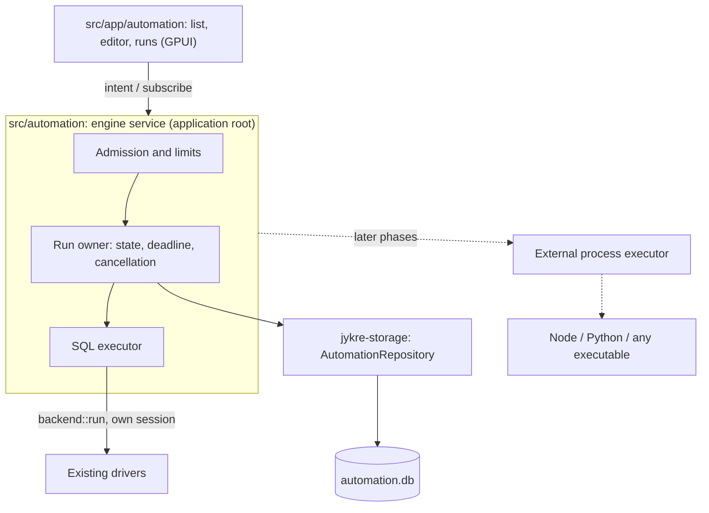

# Jykre Studio — Automation engine specification

**Version:** 1.2, decisions answered
**Date:** November 8, 2026 (1.1: November 7, 2026)
**Approval:** Approved for 0.3.0 by the maintainer on 2026-11-08: answers to
Q-01…Q-14 ([section 12](#12-decisions-required-from-the-maintainer)),
ADR-0033, ADR-0034 and ADR-0035 accepted, `process-wrap` approved (Q-11),
and the phase 5 revision (section 9.3) approved
**Implementation:** Not started (the [proof of concept](automation-sql-job-poc.md) is complete)
**Audience:** product, UX, architecture, Rust engineering and testing
**Codebase baseline:** `release/0.2.0`

Version 1.1 consolidates the original 1.0 proposal with the
[architecture review](../research/automation-engine-architecture-review.md)
of the same date. It kept the direction of 1.0, applied the review's
proposed changes and narrowed the first delivery to a **manual SQL Job**;
version 1.2 widens it to **SQL → script** (Q-01). The
1.0 text remains in the Git history; [Appendix B](#appendix-b--traceability-from-version-10)
maps each of its sections to what happened to it here. Finding IDs (`P-xx`),
design IDs (`Dxx`) and question IDs (`Q-xx`) refer to the review.

> **Version 1.2** records the maintainer's answers of 2026-11-08
> ([section 12](#12-decisions-required-from-the-maintainer)). The first
> delivery is now **SQL → script** in version 0.3.0 (Q-01), built straight
> through phases 1, 3, 4 and 5 with the interface at the end. Text that said
> *pending Q-xx* now states the answer.
> [ADR-0033](../adr/0033-automation-database-service-and-lock.md),
> [ADR-0034](../adr/0034-persisted-declared-outputs.md) and the
> [0.3.0 plan](releases/0.3.0.md) were accepted on 2026-11-08, and the
> process-supervision dependency was approved the same day (Q-11).

## Contents

1. [Overview](#1-overview)
2. [Scope by phase](#2-scope-by-phase)
3. [Conceptual model](#3-conceptual-model)
4. [SQL Job](#4-sql-job)
5. [Automation engine](#5-automation-engine)
6. [Persistence and recovery](#6-persistence-and-recovery)
7. [Security](#7-security)
8. [User experience and performance](#8-user-experience-and-performance)
9. [Later phases](#9-later-phases)
10. [Acceptance criteria](#10-acceptance-criteria)
11. [Test matrix](#11-test-matrix)
12. [Decisions required from the maintainer](#12-decisions-required-from-the-maintainer)
13. [Glossary](#13-glossary)
- [Appendix A — Future scenarios (non-normative)](#appendix-a--future-scenarios-non-normative)
- [Appendix B — Traceability from version 1.0](#appendix-b--traceability-from-version-10)

## 1. Overview

### 1.1 Goal

Let users save a unit of database work, run it again with typed inputs and
see what each run did, without keeping a tab open for it. Later phases extend
the same engine to external programs and to chains of jobs.

A **job** is a reusable definition with typed inputs. A **run** is one
execution of a job, with a state, a cause when it does not succeed, and
operational counters. The first job kind is SQL; external processes and
chains come later, through the same engine, states and history.

### 1.2 Principles kept from version 1.0

- **SQL runs natively.** A SQL Job runs through the existing drivers, without
  a helper process, TCP connection or protocol.
- **Jobs never use a tab's session.** A run opens its own session; an open
  transaction in a tab is never committed, rolled back or changed by a job.
- **The protocol is for external programs only**, and their stdout/stderr
  stay outside it.
- **Integration permissions are not a sandbox.** A permission restricts what
  a job may ask Jykre Studio to do; it never restricts what an operating
  system process can do on its own.
- **Bind, never concatenate.** Input values reach the database as bound
  parameters.

### 1.3 Non-goals

- A remote service, a multi-user server or execution while the application is
  closed.
- Sandboxing scripts.
- A new language: no `${}` expressions and no declarative flow executor
  (`native_flow` from 1.0 is removed, P-03).
- Durable storage of query results, input values or server messages
  (section 6.4).
- A second connection stack, SQL editor, vault or tab system.
- Promises the code cannot enforce: the engine has no read-only mode
  (section 4.5).

### 1.4 Release placement

Automation does **not** belong in 0.2.0, whose thesis is daily-use hardening
without new capabilities (D02, [release plan](releases/0.2.0.md)). It is the
thesis of [0.3.0](releases/0.3.0.md), which ships once SQL → script works
end to end (decision R, 2026-11-08).

### 1.5 Architecture



Views present runs and capture intent; the engine decides (golden rule 1).
Section 5.1 places each part in the existing crates.

## 2. Scope by phase

Each phase keeps its own acceptance criteria, and criteria from later phases
never change an earlier one's (D03). Since Q-01 chose SQL → script, phases 1,
3, 4 and 5 are built one after another without an intermediate release, and
the interface (phase 2, widened to processes and chains) comes last; 0.3.0
ships when all of them are accepted. Phases 6 and 7 stay later.

| Phase | Priority | Delivery | Blocked by |
| --- | --- | --- | --- |
| PoC | Optional | Headless SQL executor and engine without persistence or UI, to measure the open risks ([plan](automation-sql-job-poc.md)) | Nothing |
| 0 — Decisions | P0 | Answers to Q-01…Q-14, ADR-0033 and ADR-0034 with the DDL (all done 2026-11-08) | — |
| 1 — Durable SQL slice | P0 | Sections 4, 5 and 6 | Phase 0 |
| 3 — External process without protocol | P0 | Section 9.1 | Phase 1 |
| 4 — Minimal protocol `jjp/1` | P0 | Section 9.2 | Phase 3 |
| 5 — Linear chain | P0 | Section 9.3; SQL → script | Phases 1 and 4 |
| 2 — Interface | P0 | Section 8, for SQL Jobs, processes and chains | Phase 5 |
| 6 — On-demand capabilities | P2 | Section 9.4 | One ADR per capability |
| 7 — Evolution | P3 | Section 9.5 | Q-14 and per-capability decisions |

### 2.1 Functional requirements

| ID | Requirement | Phase |
| --- | --- | --- |
| RF-001 | Create, edit, duplicate and delete SQL Jobs | 1–2 |
| RF-002 | Run a job manually with an input form, and stop it | 1–2 |
| RF-003 | SQL Jobs bound to an existing connection and a pinned context | 1 |
| RF-005 | Record each run's state, cause, timing and operational counters | 1 |
| RF-004 | External programs, started without a shell | 3 |
| RF-006 | External programs report logs, progress and their outcome through `jjp/1` | 4 |
| RF-009 | Chain jobs linearly, mapping outputs to inputs | 5 |
| RF-010 | Run a chain manually after confirming the whole plan | 5 |
| RF-008 | Produce and register artifacts | 6 |
| RF-007 | Ask the user for input, with a timeout | 6 |
| RF-011 | Schedules (interval or cron) | 7 |
| RF-012 | Result cache with TTL and concurrent deduplication | 7 |
| RF-013 | Reuse ephemeral tokens through destination-bound references | 7 |
| RF-015 | Jobs in the command palette and result context | 7 |
| RF-017 | Execution while the application is closed | 7 |

RF-014 (parallel and conditional steps, failure recovery), RF-016 (visual
workflow editor) and RF-018 (remote plugins with TLS) are excluded until a
decision brings them back (section 9.6). Version 1.0's "disable" and
"version" in RF-001 are replaced by per-run snapshots (section 6.3).

### 2.2 Non-functional requirements

- **RNF-001 — failure isolation:** a failing job or external process never
  brings down the application.
- **RNF-002 — responsiveness:** nothing in the engine runs on the UI thread;
  existing [performance budgets](../standards/performance.md) apply from the
  first UI phase.
- **RNF-003 — no false success:** a run succeeds only after its statement or
  process is confirmed complete. Uncertainty is recorded (`effect_unknown`),
  never resolved by replaying.
- **RNF-004 — traceability without values:** each run records what ran, where,
  when and how it ended, never what it returned or which values it received.
- **RNF-005 — bounded resources:** every queue, channel, buffer, pipe and log
  has a limit and a defined behaviour when full (P-13).
- **RNF-006 — server-side checks:** the engine checks what a job may do; it
  never trusts a job's declaration.
- **RNF-007 — portability:** Windows, Linux and macOS, each validated on its
  own; Linux or macOS behaviour is never inferred from Windows.
- **RNF-008 — language independence (phase 4):** an external program needs no
  SDK; any client that speaks `jjp/1` works.

## 3. Conceptual model

### 3.1 Phase 1 entities

| Entity | Meaning |
| --- | --- |
| `JobDefinition` | Identity, name, kind and the kind's definition, stored as canonical JSON (section 6.2). Phase 1 has one kind, `sql`. |
| `RunSnapshot` | What a run executes, frozen at admission: exact SQL, parameter specifications without values, context, effective options, fingerprint, connection and its revision (section 6.3). |
| `Run` | One execution: origin, state, cause, `effect_unknown`, timing and operational counters. |

There are no published versions in phase 1: editing a job changes its
definition, and each run keeps its own snapshot (P-21). A run of unsaved
editor content is a **draft run** and is labelled as one in the history.

### 3.2 Entities of later phases

| Entity | Phase | Notes |
| --- | --- | --- |
| `ExternalProcess` definition | 3 | Executable, argument vector, working directory, environment passthrough |
| Published version | 5 | Needed once a chain pins the jobs it runs |
| `Chain` and its step runs | 5 | Linear plan; each step is a `Run` linked to its chain run |
| `Artifact` | 6 | Needs its own ADR (P-17) |
| `InteractionRequest` | 6 | `ask` and `confirm`, with deadlines |
| `Schedule`, `Grant` | 7 | Durable, revocable consent (section 7.2) |
| Cache entry, secret reference | 7 | Separate stores (section 9.5) |

`RuntimeDefinition` and the 1.0 workflow DAG are dropped: a runtime is an
executable and its arguments (section 9.1), and chains are linear
(section 9.3).

## 4. SQL Job

This section is normative for phases 1 and 2. A SQL Job reuses the contracts
of reports and tabs; wherever it does not say otherwise, behaviour matches a
SQL tab.

### 4.1 Definition

| Field | Meaning |
| --- | --- |
| `schema_version` | Major and minor version of the definition format. An unsupported major is refused; unknown keys are preserved, as reports do. |
| `id` | Stable identifier generated by Jykre Studio |
| `name`, `description` | Shown in the list and history |
| `connection` | The `ConnectionId` of an existing profile, never its name |
| `context` | The `SessionContext` (database, catalog, schema) the run's session uses, pinned in the definition (P-04) |
| `sql` | One statement, with `:name` markers |
| `parameters` | A list of `ParameterSpec` (section 4.2) |
| `timeout` | Default 300 s, from `ExecutionOptions::default` (P-29) |
| `max_rows` | Default 1,000 rows, from `ExecutionOptions::default` |

Illustrative canonical JSON:

```json
{
  "schema_version": "1.0",
  "id": "4f7c1e0a-…",
  "name": "Data Extension address",
  "kind": "sql",
  "connection": "b2d3…",
  "context": { "catalog": "integration", "schema": "catalog" },
  "sql": "SELECT external_key, address FROM data_extensions WHERE external_key = :external_key",
  "parameters": [
    { "name": "external_key", "label": "External key", "kind": "text", "required": true }
  ],
  "timeout_ms": 300000,
  "max_rows": 1000
}
```

Version 1.0's `result_mode`, `session_mode`, `transaction_mode`,
`multi_statement` and `max_result_bytes` are gone: the behaviour they selected
is fixed in sections 4.3–4.7, and the memory ceiling is the one results
already use.

### 4.2 Parameters and binding

- Inputs are `ParameterSpec` values with a `ParameterKind`, as in reports
  (ADR-0023, ADR-0024). The run form is the reports' parameter form. There is
  no JSON Schema in the SQL Job (P-20).
- Markers are found and bound by `parameters::bind`, which already respects
  dialect literals, comments, quoted identifiers, PostgreSQL `::` and dollar
  quotes. Values reach the driver as bind parameters, including the classic
  Databricks exceptions of ADR-0026.
- Identifiers (table and column names) cannot be bound; a job that needs a
  variable identifier is out of scope.

### 4.3 One statement

The dialect splitter must find exactly one statement. Anything else is
refused before admission, with the reason, and leaves no run in the history,
as a tab that stops before sending leaves nothing; so is a missing or
malformed value. `Failed` with cause `Validation` is kept for what a driver
refuses after admission (proof of concept, 8.6). Multi-statement jobs need their own
error, transaction and result policy and are not planned.

### 4.4 Session

- Each run opens a **new session** through `Driver::session_connection`, the
  same path as `backend::query_in_context`, in the definition's pinned
  context. It never borrows a tab or report session and is closed when the
  run ends (D08).
- The statement runs in **autocommit**. There is no pool, shared session or
  managed transaction mode. A statement that leaves a transaction open (for
  example `BEGIN` alone) is rolled back when the session closes, as in
  `SessionRun::transaction_closed`.
- Because the session is new, settings made by one run (TD-002
  `set_config` values, `USE`) never reach the next.
- Each run costs a real connection; the admission limits in section 5.3 keep
  that number small (P-22).

### 4.5 Confirmation, credentials and permissions

- A manual run asks for the same production confirmation a tab asks
  (`guard::risk`) and the same password when the profile does not remember
  it. The engine never opens a dialog itself: the view resolves both before
  submitting the run (P-15).
- The engine has **no read-only mode**. `reads_only` and `guard::risk`
  classify text; they are warnings, not a security boundary, and SQL can
  change session settings such as `default_transaction_read_only`. To protect
  data, use a database user without write privileges (P-02, rewritten
  CA-05).

### 4.6 Completion rule

A delivered page does not prove that the statement finished (P-05). The
executor applies one rule (D11):

1. **The statement only reads** (`reads_only` accepts it): when the row limit
   or the memory ceiling is reached, the result is truncated, the session is
   asked to close it and the run is marked `truncated`. Side effects of
   functions inside a `SELECT` behave as in a tab.
2. **Any other statement:** after the first page, the executor keeps reading
   with `Session::fetch` into a sink that discards and counts rows, without
   stopping the collector early, until the driver reports the end of the
   result or the deadline arrives.
3. If completion cannot be confirmed (deadline, cancellation, lost
   connection), the run ends with `effect_unknown` and is **never replayed**.

| Driver | Current behaviour | Executor responsibility |
| --- | --- | --- |
| PostgreSQL | A full page keeps the stream open; the next command recovers with `pg_cancel_backend` | Fetch until the stream ends |
| MySQL | At the limit, drains for up to 5 s, then may `KILL QUERY` | Consume the result and observe late errors before success |
| SQLite | At the limit, waits for idle and interrupts only at the deadline, rolling back writes | Consume until completion |
| Databricks | Warehouse and classic return rows only after a terminal state; `has_more` is a local remainder | Discarding the remainder cannot change the commit; `effect_unknown` only without terminal confirmation |

Drivers do not report confirmed remote completion as typed metadata: the
executor treats uncertainty conservatively and `DriverOutcome` does not
change (Q-08). The executor's sink never asks the driver to stop a write's
result, since MySQL would then drain for up to 5 s and may kill the
statement, and PostgreSQL cancels the backend at the next command. Drivers
report `rows_affected` as `None` for a statement that returns rows; the run
then counts the rows it read, kept and discarded. Phase 1 runs a job through
a backend function of its own: `backend::query_in_context` settles the
session after the run, which would discard a write's result still open.

### 4.7 Results

- Results are shown in the existing grid, bounded by the row limit and the
  memory ceiling, and kept **in memory only**. Closing the run's view or the
  application discards them.
- When outputs later feed other jobs (phase 5), their structured form has
  ordered columns, rows as arrays, exact values as text and NULL distinct
  from the text `NULL`, and is never keyed by column name (P-06,
  golden rule 9). Mapping a result to a scalar is explicit and defines zero,
  one and several rows.

### 4.8 Timeout and cancellation

- **Stop** cancels the run's `CancellationToken` immediately; drivers use
  their existing recovery window (5 s) to bring the session to a known state.
  There is no grace period for SQL (P-08).
- The deadline is the definition's timeout. Reaching it ends the run as
  `Failed` with cause `Timeout`, like a tab's `ErrorCode::Timeout`. Stop ends
  it as `Cancelled`. Either may add `effect_unknown` (section 4.6).
- Dropping the future that awaits `backend::run` does not cancel the task;
  cancellation always goes through the token.

## 5. Automation engine

### 5.1 Code placement

| Part | Location | Notes |
| --- | --- | --- |
| IDs, states, causes, run record DTOs | `jykre-core` | Minimal and pure; pending Q-04 |
| `AutomationRepository`, migrations | `jykre-storage` | SQLite stays in storage (persistence rules) |
| Engine: admission, run owner, deadlines, executors | `src/automation/` | GPUI-free, testable without a window, like `src/reports` |
| Views | `src/app/automation/` | Thin; render state and capture intent |

There is no new crate and no `SqlJobConnectionService` trait: a backend
function following `query_in_context` is enough. Executors and events are
enums, not trait objects, and the engine uses bounded Tokio channels (D04).
The dependency graph that `cargo xtask check` enforces does not change.

### 5.2 Service lifetime

The engine is an **application-root service**. Views subscribe to it; closing
a view does not cancel its runs. Quitting the application with runs active
asks the user, then cancels them and waits for the shutdown to finish before
exiting. This deviates from the rule that dropping a view cancels its
operations, and [ADR-0033](../adr/0033-automation-database-service-and-lock.md)
records the deviation (D07, P-27, Q-05).

### 5.3 Admission and concurrency

- At most **2 active runs** in the application and **1 per `ConnectionId`**.
  A run beyond either limit is refused immediately with a visible reason;
  there is no queue until phase 5 (D13, Q-07).
- The per-connection limit counts profiles, not physical resources: two
  SQLite profiles that open the same file are not serialized, and recovery
  connections are not counted (P-31). This is a documented limitation.
- SQLite has one writer per file: a job that writes while a tab holds a write
  transaction on the same file waits for the lock (4 s) and fails with
  `Database`, its effect known; it never touches the tab's transaction
  (proof of concept, H3).
- Limits are revisited after measurement, not raised by default.

### 5.4 States

```text
          admission (durable)
                 │
                 ▼
              Running ──► Succeeded
                 │
                 ├──────► Failed      (cause: Database, Timeout, Authentication, Validation, …)
                 ├──────► Cancelled
                 └──────► Interrupted (set by recovery only)

  effect_unknown: independent flag on Failed, Cancelled or Interrupted
```

- **Persisted:** `Running`, `Succeeded`, `Failed`, `Cancelled`, `Interrupted`
  (D14).
- **Cause codes** are stable and stored with `Failed`; `Timeout` is a cause,
  not a state.
- `Cancelling` and `Completing` exist only in memory, to show progress.
- `Queued` arrives with queues (phase 5, section 9.3.6), held in memory
  only, and `WaitingInput` with `ask` (phase 6).

### 5.5 Arbitration

Each run has exactly one **owner**, the engine task that executes it. Only
the owner writes the terminal state. Completion, failure, Stop, the deadline
and (later) process exit are events delivered to the owner; the first it
observes decides the outcome and later ones are ignored (P-09). A terminal
state is written only after the statement's completion is confirmed or ruled
unknowable (section 4.6).

### 5.6 Events to the UI

The engine publishes state, progress and counters through bounded channels
and coalesces them per frame. A full channel drops intermediate progress,
never a terminal state. Run lists are virtualized.

## 6. Persistence and recovery

This section is decided by
[ADR-0033](../adr/0033-automation-database-service-and-lock.md) (Q-02,
Q-06) and, for declared outputs,
[ADR-0034](../adr/0034-persisted-declared-outputs.md) (Q-03), both accepted.
Where they differ from the text below, the ADRs win.

### 6.1 `automation.db`

- A new SQLite file in the current data directory (which respects
  `JYKRE_CONFIG_DIR`), opened with `open_pool`, with its own forward-only
  migrations (D05).
- Separate from `config.db` because history grows and is pruned, while
  `config.db` holds the only copy of the connection profiles and runs with
  `synchronous=FULL`.
- No second data root: version 1.0's `Jykre Studio\jykre.db` and
  per-OS directories are dropped (P-10).

### 6.2 Definitions

Canonical JSON in SQLite is the single source of a job definition. There is
no file tree of jobs and versions and no YAML (P-28); the YAML in version 1.0
was illustrative.

### 6.3 Run snapshot and durable admission

- At admission, before any network I/O, the engine writes the run as
  `Running` together with its snapshot: exact SQL, parameter specifications
  without values, context, effective options, a fingerprint with a defined
  representation, and the connection's ID and profile revision (D15).
- `Succeeded` is written only after the completion rule confirms the
  statement and the local commit of that record succeeds. A failure to write
  history is reported; it never turns a completed statement into a replay.

### 6.4 What is never persisted

Input values, server messages, cells and scalar results are **never**
written to `automation.db`, logs or telemetry (P-01, D16). Scalars such as
`COUNT(*)` are results too.

Persisted operational data: delivered row count, `rows_affected`,
`truncated`, `effect_unknown`, SQLSTATE or driver error code, cause, timing.
The history shows *what ran, when and how it ended*, not what it returned.

The one exception is declared scalar outputs for chains (phase 5), under
[ADR-0034](../adr/0034-persisted-declared-outputs.md): opt-in per job, at
most 4 KiB per run, values kept 7 days, metadata 90 days, and an extra
confirmation for production jobs (D29, Q-03).

### 6.5 Phase 1 schema (superseded by ADR-0033)

The approved DDL is in
[ADR-0033](../adr/0033-automation-database-service-and-lock.md#2-migration-1-jobs-and-runs);
the sketch below is kept as the 1.1 text.

```sql
CREATE TABLE jobs (
  id              TEXT PRIMARY KEY,
  definition_json TEXT NOT NULL,          -- canonical JSON, section 4.1
  created_at      TEXT NOT NULL,          -- UTC
  updated_at      TEXT NOT NULL
);

CREATE TABLE runs (
  id                 TEXT PRIMARY KEY,
  job_id             TEXT REFERENCES jobs(id) ON DELETE SET NULL, -- NULL for draft runs
  origin             TEXT NOT NULL,       -- 'manual' in phase 1
  state              TEXT NOT NULL,       -- section 5.4
  cause              TEXT,
  effect_unknown     INTEGER NOT NULL DEFAULT 0,
  snapshot_json      TEXT NOT NULL,       -- section 6.3, no values
  fingerprint        TEXT NOT NULL,
  connection_id      TEXT NOT NULL,
  connection_revision INTEGER NOT NULL,
  rows_delivered     INTEGER,
  rows_affected      INTEGER,
  truncated          INTEGER NOT NULL DEFAULT 0,
  sqlstate           TEXT,
  started_at         TEXT NOT NULL,
  finished_at        TEXT
);

CREATE INDEX runs_by_job ON runs(job_id, started_at DESC);
CREATE INDEX runs_open ON runs(state) WHERE state = 'Running';
```

Phase 0 replaces this sketch with the approved DDL. Tables for later phases
(events, artifacts, chains, schedules, grants, cache) are **not** created
until their phase (D01).

### 6.6 Lock and recovery

- The engine takes an **exclusive operating-system lock** on
  `automation.lock` in the data folder (`File::try_lock`, as the metadata
  writer lock), before migrating, recovering or admitting runs. The system
  releases it when the process ends, crash included; the file left behind
  means nothing, so a lock is never stranded. A second instance on the same
  folder stays usable, shows Automation read-only, says why, and tries the
  lock again when Automation opens (D17, Q-06).
- At startup, the lock holder marks every run still `Running` as
  `Interrupted`, adding `effect_unknown` unless the snapshot only reads. It
  never replays a run and uses no leases.

### 6.7 Retention

Run metadata is kept 90 days by default and pruned in the background; pruning
never blocks admission. Nothing else is stored to retain in phase 1.

## 7. Security

### 7.1 Credentials

- Credentials stay in the operating system vault through `jykre-secrets`
  (ADR-0004). Version 1.0's "explicit secure fallback" is removed (P-11):
  without a vault there are no persistent job secrets, and the UI explains
  why.
- New secrets in later phases are new accounts in `jykre-secrets`, never a
  second vault.
- A run that needs a password the profile does not remember asks for it in a
  manual run; an unattended run (phase 7) fails with `Authentication` and
  never opens a dialog.

### 7.2 Confirmation and grants

- Phase 1–2 manual runs confirm exactly as tabs do (section 4.5).
- A manual chain (phase 5) confirms the whole plan once, like a report; only
  the confirmed plan runs.
- Durable grants (schedules, `jjp` capabilities) require explicit, revocable
  consent bound to the snapshot, connection and revision, context and
  environment. A manual confirmation is never silently promoted to a grant
  (P-15).
- Dynamic SQL sent through a future `db.query` is never authorized by a
  script hash; it needs real enforcement first (D26).

### 7.3 Logs and telemetry

- Job logs are not `tracing` events and never reach OTLP. Engine spans carry
  only allowlisted attributes (IDs, state, cause, counters). There are no
  engine metrics in the first phases (P-18, D18).
- No input value, token or server message appears in a log, span, history row
  or error report.

### 7.4 Threat model

| Threat | Mitigation | Phase |
| --- | --- | --- |
| Destructive SQL or badly bound input | Bind parameters, one statement, production confirmation, database privileges | 1 |
| Values leaking into history or telemetry | Section 6.4 and 7.3 | 1 |
| A job disturbing a tab's transaction | New session per run (section 4.4) | 1 |
| Two instances recovering each other's runs | Data-directory lock (section 6.6) | 1 |
| Runaway process trees, blocked pipes | Tree supervision and bounded pipes (section 9.1) | 3 |
| Local processes contacting the listener | Loopback only, per-run 256-bit token consumed atomically (section 9.2) | 4 |
| Large frames, log spam, many connections | Frame and log quotas, always draining (section 9.2) | 4 |
| Path tricks when collecting files | Verified handles (section 9.4) | 6 |
| Credential reuse across identities or hosts | Destination-bound references (section 9.5) | 7 |

## 8. User experience and performance

### 8.1 Phase 2 interface

- An **Automation** list of jobs with a detail view with three tabs:
  **Editor**, **Inputs** and **Runs** (P-26). Schedules, permissions and
  versions arrive with their phases.
- The editor is the dialect-aware component from `src/app/sql_editor`, not
  another Workspace. Shortcuts that run SQL in a tab never run a job.
- **Run** opens the parameter form from reports, then the production and
  password prompts when they apply. A running job shows progress and **Stop**.
- The **Runs** tab lists state, cause, `effect_unknown`, timing and counters,
  and labels draft runs. The latest result appears in the in-memory grid
  while it exists.
- All text lives in `locales/`. Keyboard and focus follow the
  [UI guidelines](../standards/ui-guidelines.md); error messages follow
  [UX](../reference/ux.md).

### 8.2 Performance

The existing [budgets](../standards/performance.md) apply from phase 2:
frame time at most 8 ms at p95, no stall over 16 ms and state publication at
most 2 ms. Engine events are coalesced (section 5.6) and lists are
virtualized. Phase 2 reports these numbers for the run and history paths.

## 9. Later phases

These phases are specified as **constraints** that a future revision must
honour, not as finished designs.

### 9.1 Phase 3 — External process without protocol

- **Prerequisite:** process-tree supervision through an approved dependency:
  a kill-on-close Job Object on Windows and process groups on Unix. `unsafe`
  is forbidden and `kill_on_drop` kills only the direct child (P-07).
  `process-wrap` is the candidate to evaluate for license, weight, advisories
  and features through a formal proposal (Q-11), approved on 2026-11-08
  ([proposal](process-supervision-dependency.md)).
- Unix residual risk is documented: if Studio crashes, the group survives.
  Recovery records group ID and start time, warns, and never kills a PID or
  PGID that may have been reused.
- Spawn with an argument vector and no shell. The environment is an
  operating-system and runtime allowlist (for example `SystemRoot`, `PATH`,
  `TEMP` on Windows; `HOME`, `LANG` on Unix) plus explicit passthrough. No
  default `NODE_OPTIONS`, `PYTHONPATH` or `JYKRE_CONFIG_DIR` (P-19). The
  `jjp/1` token never travels in the environment (section 9.2).
- Execute a snapshot of the entrypoint, not the original path, and say
  clearly that local imports, `node_modules` and runtimes found on `PATH`
  are not frozen (P-24).
- stdout and stderr are drained into bounded files; excess is discarded with a
  marker. A full pipe never blocks the child or Studio (P-13).
- Success is exit code 0; anything else, a timeout or Stop fails. Importing or
  first running external code warns that it runs with the user's privileges,
  and explains that grants protect Studio's APIs, not the machine (Q-10).

### 9.2 Phase 4 — Minimal `jjp/1`

- One `127.0.0.1` listener, created on the first external run, never at
  startup. One session per run, no reconnection, no batches.
- NDJSON framing with a 1 MiB limit enforced before allocating. JSON-RPC 2.0
  messages.
- Authentication: a 256-bit per-run token, written by the host as the first
  line of the child's **stdin**, which the host then closes, and consumed
  atomically by `hello`; reuse fails. The environment carries only the
  listener's address, which is not a secret. Unlike an environment variable,
  the token is not inherited by the processes the job starts and cannot be
  read from `/proc/<pid>/environ` or the process environment by other
  processes of the same user; a same-user process allowed to debug the job
  can still read its memory, which is documented. A job therefore cannot use
  stdin for anything else. The token and inputs travel only in stdin and the
  `hello` exchange (Q-12).
- Jobs are **pure clients** (P-12): there is no `execute`, `accepted` or
  `ping`. The host sends only a `cancel` notification.

| Method | Direction | Kind | Purpose |
| --- | --- | --- | --- |
| `hello` | job → host | request | Authenticate; receive inputs, deadline and `max_message_bytes` |
| `log` | job → host | notification | Append a log line (job log, not telemetry) |
| `progress` | job → host | notification | 0–100 and an optional stage |
| `complete` | job → host | request | Terminal intent with outputs |
| `fail` | job → host | request | Terminal intent with a code and message |
| `cancel` | host → job | notification | Cooperative cancellation before forced termination |

- The host always drains the socket. Logs over quota are dropped and counted;
  control and terminal messages are outside the quota. Persistent abuse ends
  the run. Cancellation never waits for the job to read anything.
- A terminal intent is decided by the run owner together with process exit
  (section 5.5): `complete` followed by a nonzero exit fails.
- A testable JavaScript example lives in `examples/`; there is no published
  SDK until `jjp/1` is stable (D24, Q-13).

### 9.3 Phase 5 — Linear chain

**Revision of 2026-11-08, approved by the maintainer the same day**
together with [ADR-0035](../adr/0035-published-versions-and-chain-runs.md),
which holds its schema. This section is normative for phase 5; it replaces
the constraints version 1.1 listed here.

#### 9.3.1 Published versions

- **Publishing** a SQL Job or an external-program job freezes its current
  definition as version *n* (1, 2, …). A version is immutable: it is never
  edited, and editing the job changes only its draft definition.
- A chain step names a job **and a version**, so a chain runs exactly what
  was published, whatever happened to the job since (P-21).
- A version a chain names cannot be deleted; deleting a job that a chain
  uses is refused, naming the chains. A run of a job on its own, outside a
  chain, keeps using its current definition, as in phase 1.

#### 9.3.2 Declared outputs

A job declares the outputs a chain may read, by name and `ParameterKind`
([ADR-0034](../adr/0034-persisted-declared-outputs.md), decision 1):

- **SQL Job:** each output names a result column **by position** (1-based;
  names may repeat, P-06), and the job states one row rule for all of them:

  | `row` | Zero rows | One row | Several rows |
  | --- | --- | --- | --- |
  | `exactly_one` (default) | Fails | Its values | Fails |
  | `at_most_one` | Every output NULL | Its values | Fails |
  | `first` | Every output NULL | Its values | The first row, in the result's order |

  A failure here is cause `Output`. The row comes from what the result
  kept (the row limit is at least 1), so a write's completion rule is
  unchanged.
- **External program:** the `outputs` object of its `complete` message
  (`jjp/1`). Every declared output must be present (a JSON `null` is NULL)
  and nothing undeclared may be; otherwise cause `Output`.
- Each value keeps its exact text, NULL apart from the text `NULL`, and is
  checked against its kind (`jykre_core::is_parameter_value`; `Text` takes
  any text). In memory one value takes at most **64 KiB** and one step's
  outputs at most **256 KiB**; beyond either, cause `Output`. Persistence
  has its own, smaller limit (ADR-0034: 4 KiB per run, opt-in).

#### 9.3.3 Chain definition

A chain is a job of kind `chain`, stored as canonical JSON like any job:

```json
{
  "schema_version": "1.0",
  "id": "9a1e…",
  "name": "Export a Data Extension",
  "kind": "chain",
  "inputs": [
    { "name": "external_key", "label": "External key", "kind": "text", "required": true }
  ],
  "steps": [
    {
      "id": "lookup",
      "job": "4f7c…", "version": 3,
      "inputs": { "external_key": { "from_input": "external_key" } }
    },
    {
      "id": "export",
      "job": "b81d…", "version": 1,
      "inputs": {
        "address": { "from_step": "lookup", "from_output": "address" },
        "format":  { "value": "csv" }
      }
    }
  ],
  "timeout_ms": 3600000
}
```

- 2 to 16 steps, run in the order written. Step IDs are unique within the
  chain, lowercase letters, digits and `_`.
- A step is a published version of a SQL Job or an external-program job,
  never a chain: there are no nested chains and no dynamic `jobs.run`.
- Each input of the step's job version is bound **exactly once**, by one of:
  - `from_input`: an input of the chain, from the chain's form;
  - `from_step` + `from_output`: a declared output of an **earlier** step;
  - `value`: a constant written in the definition.

  An input left unbound uses its default, or NULL when optional; a required
  input without a source or a default is an error.
- Since a step can only read earlier steps, a chain has no cycles by
  construction. There are no `${}` expressions and no references read from
  text (P-03, D25). `native_flow`, if it ever returns, compiles to this same
  structure (Q-09).
- A source's kind must equal the target's, except that a `Text` target takes
  any kind. A target with choices takes only one of them.
- The definition is checked when it is saved and again at admission, against
  the versions it names: an unknown job or version, an unbound required
  input, an output that does not exist or a kind that does not match is
  reported by step and input, and the chain cannot run.
- `timeout_ms` bounds the whole chain (default 3,600 s); each step keeps its
  own job's timeout as well.

#### 9.3.4 Confirmation and the plan

A manual chain run confirms **the whole plan once**, before anything runs,
as a report does (section 7.2):

1. The chain's form takes its inputs.
2. The password of every connection the SQL steps use is asked for, one
   connection after another, when the profile does not remember it.
3. One dialog lists every SQL step on a production connection with its
   `guard::risk` findings, and every external program whose version has not
   run before, with the trusted-code warning (Q-10).
4. On confirmation the engine freezes the **plan snapshot**: the chain
   definition, each step's version definition, each connection's ID and
   profile revision, and the chain's input specifications, without values.

Exactly the confirmed plan runs. If a connection's profile revision changes
before its step starts, that step does not start and the chain fails with
cause `PlanChanged`.

#### 9.3.5 Execution

- One owner task runs the chain: it admits each step as an ordinary run (a
  SQL run or a process run, with the executors of phases 1 and 3), waits
  for its outcome, maps its outputs to the next step's inputs, and so on.
- **A chain holds no admission slot of its own**; only its active step
  does. A step's run releases its session and its slot before the next step
  is admitted (P-14), so a chain progresses even with a global limit of 1.
- A step's mapped inputs are checked as a form's would be
  (`reports::params::value`). A value that fails stops the chain before that
  step is admitted, with cause `Input`; the step leaves no run (section 4.3).
- The chain run's state follows its steps:

  | Event | Chain run |
  | --- | --- |
  | Every step succeeded | `Succeeded`, with the last step's outputs |
  | A step failed, or its outputs or inputs did not map | `Failed`, with the step's cause and `failed_step` |
  | Stop on the chain, or on its active step | `Cancelled`; the active step is stopped (or leaves the queue) and no later step starts |
  | The chain's deadline | `Failed`, cause `Timeout`; the active step is stopped |
  | Forced exit | `Interrupted` at recovery, with the active step's own recovery |

  `effect_unknown` is set on the chain when any of its steps has it. Steps
  that never started have no run; the chain's history shows them as not run.
- There is no resume, retry or compensation (section 9.6). After a failure
  the user runs the chain again, as a new run.
- A step run again on its own from a chain run's history opens that job's
  form, prefilled from the outputs the earlier step stored, when its job
  opted in and the values have not expired (ADR-0034). It never runs
  without the form.

#### 9.3.6 Queue

Queues arrive with chains, for every run, not only for chain steps. The
review's "8/4/60 s" is read as:

- A run that finds the limits of section 5.3 full (2 active, 1 per
  connection) **waits in a queue** instead of being refused, in `Queued`, a
  state held in memory only: a queued run has done no I/O and has no row.
- The queue holds at most **8** runs in the application and **4** per
  connection. A run beyond either is refused at once, with the reason, as in
  phase 1.
- A run waits at most **60 s**. Past that it leaves the queue: a run of a job
  on its own is refused, with the reason; a chain step fails the chain with
  cause `QueueTimeout`.
- The queue is FIFO in admission order; a run whose connection is busy does
  not hold back a later run on another connection. Stop removes a queued run
  at once (`Cancelled` for a chain, a refusal for a job on its own); quitting
  empties the queue first.

#### 9.3.7 Causes, events and history

- New causes: `Output` (outputs did not match the declaration), `Input`
  (mapped inputs did not pass the form's checks), `PlanChanged` and
  `QueueTimeout`.
- The chain run publishes its state and the active step's progress through
  the same bounded channel as a run (section 5.6), with the step index.
- History records the chain run (state, cause, `failed_step`, timing,
  `effect_unknown`, plan fingerprint) and each step's run linked to it, never
  input values; outputs only under ADR-0034.

### 9.4 Phase 6 — On-demand capabilities

Each needs its own ADR before implementation.

- **Artifacts (D27, P-17):** sources are regular files inside the run
  directory, copied through a verified handle without reopening the path;
  quotas count while copying; staging, rename, commit and reconciliation; the
  ID is returned only after confirmation.
- **`ask` and `confirm`:** introduce `WaitingInput`; a question never blocks
  readers or cancellation, and a late answer never changes a finished run.
- **`db.query` from external jobs:** only with real enforcement of what it may
  run (D26).

### 9.5 Phase 7 — Evolution

Scheduling only while the application is open (consent, time zone, overlap
and missed triggers; Q-14), never while it is closed,
cache and secret broker as separate stores with generations, TTL,
consumer-ACL reevaluation and waiter cancellation (P-23, D28), references
bound to origin, audience and authentication type with no redirects (P-16),
HTTP, palette, SDK, other transports, sandboxing and an agent that runs
while the application is closed. Each completes its semantics before a
schema or protocol becomes stable.

### 9.6 Excluded until an explicit decision

`native_flow`, dynamic `jobs.run`, subworkflows, parallel or conditional
steps, retry and compensation, JSON Schema (only through a mature library
when an external contract needs objects or arrays, P-20/P-25), loopback TLS,
alternative transports and execution while the application is closed.

## 10. Acceptance criteria

| ID | Phase | Criterion |
| --- | --- | --- |
| CA-01 | 1 | A SQL Job on PostgreSQL, MySQL, SQLite and Databricks binds its inputs, respects the dialect, shows rows and records the run without an external process. |
| CA-02 | 1 | A run never commits, rolls back or changes the context of a transaction open in a tab of the same connection. |
| CA-05 | 1 | *Rewritten.* The engine does not claim to block writes. A job on a database user without write privileges cannot write, and a production connection asks for confirmation as a tab does. |
| CA-11 | 1 | After a forced exit, runs left `Running` become `Interrupted`, with `effect_unknown` when they may have written; none is replayed or reported as successful. |
| CA-13 | 1 | No input value, cell, scalar or server message is stored in `automation.db`, logs or telemetry. |
| CA-14 | 1 | A write whose result exceeds the row limit either completes and succeeds or ends with `effect_unknown`; it never succeeds on a partial page. |
| CA-15 | 2 | Create, run, stop, fail and navigate with keyboard and focus; budgets in section 8.2 hold. |
| CA-03 | 3 | stdout and stderr are captured without blocking; cancelling or timing out kills grandchildren. |
| CA-07 | 3–4 | Exit 0 (or `complete` plus exit 0) succeeds; `fail`, nonzero exit, timeout or Stop produce one consistent state and cause. |
| CA-04 | 4 | *Replaced.* Framing survives partial and joined chunks, invalid UTF-8 and oversized frames; invalid or reused tokens and duplicate terminals are rejected. |
| CA-09 | 5 | A SQL output feeds a later SQL step and an external program; exactly the confirmed plan runs; cancellation and failure cascade and leave later steps not run; a global limit of 1 still progresses; the queue's limits and 60 s wait hold. |
| CA-06 | 6 | `ask` enters `WaitingInput` and its timeout applies the job's policy. |
| CA-08 | 6 | Artifacts are copied through verified handles, within quotas, and survive a crash between copy and index. |
| CA-10 | 7 | Non-normative until phase 7 is specified (Appendix A). |
| CA-12 | All | Each phase is validated on Windows, Linux and macOS separately. For 0.3.0, Windows and Linux only (maintainer, 2026-11-08). |

## 11. Test matrix

Every phase ends with `cargo xtask check`, plus `--full` when it changes
drivers, execution contracts or dependencies. Tests use synthetic fixtures
only. UI phases record a separate visual check of flow, keyboard and focus,
and the measured budgets.

| Phase | Required tests |
| --- | --- |
| 1 | Binding with `::`, comments, strings and dollar quotes; multi-statement refusal; untouched tab transaction (CA-02); duplicate column names; exact decimals; `UPDATE … RETURNING` above the limit on each driver; no replay after timeout or Stop; disk failure before and after the terminal commit; second-instance lock; no values in SQLite (CA-13); admission limits and refusal |
| 2 | Create, run, cancel, error and navigation flows; keyboard and focus; stall and publication budgets |
| 3 | Grandchildren killed on Stop and timeout; ignored signals and inherited pipes cannot trap Studio; a sentinel variable is not inherited; newline-free output spam cannot exhaust memory or disk |
| 4 | Framing across chunks and UTF-8 boundaries; preallocation cap; invalid and reused tokens; duplicate `hello`; conflicting terminals; disconnect; cancellation with a saturated queue; method allowlist; tokens absent from logs and OTLP |
| 5 | SQL → SQL and SQL → process; each `row` rule with zero, one and several rows; output kinds and size limits; unbound, unknown and forward references refused at save and admission; a connection revision changed mid-chain (`PlanChanged`); cascading cancellation and failure; Stop on a queued step; no deadlock at limit 1; queue limits 8/4 and the 60 s wait; published versions immutable and protected from deletion; recovery of an interrupted chain without replay |
| 6 | Artifact TOCTOU, quotas and crash between copy and index; questions never block cancellation; late answers ignored |

## 12. Decisions required from the maintainer

| ID | Question | Proposal | Blocks | Status |
| --- | --- | --- | --- | --- |
| Q-01 | First indispensable flow: reusable manual SQL, SQL → script, or an SFMC/HTTP connector? | Manual SQL Job (D01) | Phase 0 | **SQL → script**, built straight through phases 1, 3, 4 and 5 for 0.3.0 |
| Q-02 | Approve the automation ADR: `automation.db`, minimal schema, recorded run data (D05, D14–D16)? | Approve as in section 6 | Phase 1 | **Approved**; ADR-0033 accepted |
| Q-03 | Allow persisting declared scalar outputs by ADR, with which defaults? | D29; no values without an ADR | Phase 5 | **D29 defaults approved**; ADR-0034 accepted |
| Q-04 | Approve minimal pure automation DTOs in `jykre-core`? | Approve | Phase 1 | **Approved** |
| Q-05 | Application-root service and coordinated quit, deviating from view-owned cancellation? | Accept D07 | Phase 1 | **Accepted** |
| Q-06 | A second instance on the same data directory cannot run automation? | Accept D17 | Phase 1 | **Accepted**, with an OS lock that the system releases when the process ends |
| Q-07 | 2 global runs, 1 per connection, immediate refusal and a 300 s timeout? | Confirm, measure, revisit | Phase 1 | **Confirmed** |
| Q-08 | Typed remote-completion metadata in `DriverOutcome`, or conservative uncertainty? | Conservative in phase 1; the PoC measures the need | Phase 1 (optional) | **Conservative**; no contract change |
| Q-09 | Keep `native_flow`, or replace it with linear chaining? | Replace; if revived, compile it to the same plan | Roadmap | **Replace** |
| Q-10 | Treat external code as explicitly trusted, with the UI explaining that grants protect Studio APIs, not the machine? | Yes; warn on import and first run | Phase 3 | **Yes** |
| Q-11 | Evaluate and approve a process-supervision dependency (candidate `process-wrap`)? | Formal proposal per [Stack and dependencies](../standards/stack-and-dependencies.md) | Phase 3 | **`process-wrap` 10.0.1 approved** on 2026-11-08 after a formal [proposal](process-supervision-dependency.md) |
| Q-12 | Accept per-run IPC tokens in the environment, visible to same-user processes during the run? | Accept, with `hello` consumption and documented risk | Phase 4 | **Token through stdin**, not the environment (section 9.2) |
| Q-13 | Keep the SDK out of the repository until `jjp/1` stabilizes? | Yes (D24) | Phase 4 | **Yes** |
| Q-14 | Durable scheduling consent and execution while the application is closed? | Design with scheduling | Phase 7 | **Only while the application is open**; execution while it is closed is excluded |

Answers given by the maintainer on 2026-11-08, together with the release
decision R: automation is the thesis of [0.3.0](releases/0.3.0.md), which
ships SQL → script.

The review's design register (D01–D29) and its trade-offs remain in
[its section 4](../research/automation-engine-architecture-review.md#4-recommended-design-and-trade-offs);
each D-ID cited here applies that row.

## 13. Glossary

- **Job:** a saved definition of work with typed inputs.
- **SQL Job:** a job that runs one statement through the existing drivers.
- **Run:** one execution of a job, with a state, a cause and counters.
- **Draft run:** a run of unsaved editor content.
- **Run snapshot:** what a run executes, frozen at admission, without values.
- **Run owner:** the engine task that alone decides a run's terminal state.
- **`effect_unknown`:** the engine could not confirm whether the statement or
  process finished its side effects.
- **Pinned context:** the database, catalog and schema stored in the definition
  and applied to every run's new session.
- **`jjp/1`:** the minimal protocol for external programs (phase 4).
- **Chain:** a linear sequence of jobs whose outputs feed later inputs
  (phase 5).

## Appendix A — Future scenarios (non-normative)

Version 1.0 used Salesforce Marketing Cloud (SFMC) to illustrate the later
phases. The scenarios remain useful as targets, not as contracts:

| Scenario | Needs | Constraints that still apply |
| --- | --- | --- |
| Look up a Data Extension address with SQL against a catalog table | Phase 1–2 only | The SQL step of the first delivery; no palette until phase 7 |
| Authenticate once and reuse the token in several jobs | Phase 7 cache and secret broker | The token is never an ordinary output; references are bound to origin, audience and authentication type; no redirects |
| Look up and export a Data Extension from a script | Phases 3–6 | The script must not log input values; HTTP from the script is the process's own and is not restricted by grants |
| Ask before exporting many rows | Phase 6 `ask` | A declined answer is a business outcome, not an infrastructure failure |

## Appendix B — Traceability from version 1.0

| 1.0 section | Disposition in 1.1 | Finding |
| --- | --- | --- |
| §1.2 Consolidated decisions | Kept: native SQL, loopback, NDJSON, per-run token. Removed: JSON Schema subset, credential fallback, DAG workflows, separate data root | P-03, P-10, P-11, P-20 |
| §1.4 Non-goals | Kept and extended (section 1.3) | P-03 |
| §2.1 RF-001…RF-018 | Phased (section 2.1); RF-014, RF-016, RF-018 excluded | P-03 |
| §3 Conceptual model | Reduced to phase 1 entities; versions move to phase 5 | P-21 |
| §4 User experience | Three tabs, editor reuse, budgets (section 8) | P-26 |
| §5 Definitions and versioning | Canonical JSON, run snapshots, version grammar | P-21, P-25, P-28 |
| §6.1 SQL Job definition | Fixed behaviour; pinned context; 300 s | P-04, P-29 |
| §6.2 Binding | `parameters::bind`, no JSON Schema | P-20 |
| §6.3 Structured result | In memory; ordered, exact representation | P-01, P-06 |
| §6.4 Sessions and transactions | New session per run, autocommit, no `shared_session` | P-02, P-04 |
| §6.5 Multiple statements and large results | One statement; completion rule | P-05 |
| §7 External jobs | Phase 3, supervision prerequisite, environment allowlist | P-07, P-19, P-24 |
| §8 JJP | Minimal `jjp/1`, jobs as pure clients | P-12, P-13, P-30 |
| §9 Capabilities and SDK | Phase 4–6; JS example only | P-12, P-30 |
| §10 Inputs, outputs, interaction | `ParameterSpec`; no persisted values; `ask` in phase 6 | P-01, P-20 |
| §11 Workflows | Linear chain in phase 5; no `${}`, no `native_flow` | P-03, P-14 |
| §12 Cache and credentials | Phase 7; separate stores; destination-bound references; no fallback | P-11, P-16, P-23 |
| §13 Artifacts | Phase 6 with ADR and verified handles | P-17 |
| §14 Persistence and layout | `automation.db` in the existing data directory; no file tree | P-01, P-10 |
| §15 States and rules | Five persisted states, causes, `effect_unknown`, run owner | P-08, P-09, P-22 |
| §16 Security | Section 7; CA-05 rewritten | P-02, P-15, P-18 |
| §17 Rust architecture | Existing crates, enums, no new trait or crate | P-10 |
| §18 Examples | Appendix A, non-normative; 18.2 must not log inputs | P-03, P-18 |
| §19 Operation and recovery | Lock, `Interrupted`, no replay; no v1 metrics | P-09, P-13 |
| §20 Roadmap and acceptance | Sections 2, 10 and 11 | P-03 |
| §21 Open decisions DA-01…DA-15 | Answered by sections 4–9 or folded into Q-01…Q-14 | — |
