# Architecture

## Overview

Jykre Studio is a single native process. The interface is drawn by
[GPUI](https://www.gpui.rs/) through `gpui-kit` ([ADR-0001](../adr/0001-native-ui-with-gpui.md));
there is no WebView and no IPC layer. Database access, local persistence and
credentials live in UI-independent crates
([ADR-0006](../adr/0006-layered-crates-independent-of-the-ui.md)).

```mermaid
flowchart TB
    subgraph Bin["Application binary (src/main.rs, src/app)"]
        Shell[App shell: explorer, tabs, dialogs]
        Workspace[Query workspace: editor, results, assistant]
        SqlEditor[sql_editor: editor language features adapter]
    end

    subgraph Lib["jykre library (src/lib.rs)"]
        Backend[backend: operations on Tokio]
        Store[connection_store]
        Format[cell_format]
        Sql[sql: re-export of jykre-sql]
        Query[query: run state machine]
        Results[result_tabs: result tabs and pages]
        State[workspace_state: tabs, saved queries, history]
        I18n[i18n]
        Tabs[grouped_tabs component]
        Drivers[drivers: registry composition]
    end

    subgraph Crates["UI-independent crates (crates/)"]
        Core[jykre-core: contracts and types]
        Storage[jykre-storage: SQLite]
        Secrets[jykre-secrets: OS vault]
        PG[jykre-driver-postgres]
        MY[jykre-driver-mysql]
        DBX[jykre-driver-databricks]
        LITE[jykre-driver-sqlite]
        SqlCrate[jykre-sql: tokens, splitting]
        Language[jykre-sql-language: completion, format]
        Assistant[jykre-assistant: AI providers]
    end

    Bin --> Lib
    SqlEditor --> Language
    Sql --> SqlCrate
    Language --> SqlCrate
    SqlCrate --> Core
    Language --> Core
    Backend --> Core
    Backend --> Storage
    Store --> Storage
    Store --> Secrets
    Drivers --> PG
    Drivers --> MY
    Drivers --> DBX
    Drivers --> LITE
    Storage --> Core
    Secrets --> Core
    PG --> Core
    MY --> Core
    DBX --> Core
    LITE --> Core
    Lib --> Assistant
    Assistant --> Core
```



## Layers and responsibilities

| Layer | Location | Does | Does not |
| --- | --- | --- | --- |
| **Views** | `src/app/` (demo data in `src/app/demo/`, used with `JYKRE_DEMO=1`) | Render state, capture input, hold UI state (open tabs, selection, expanded nodes, panel sizes), start operations and show their outcome | Network or disk I/O, SQL parsing, formatting rules, decisions by database type |
| **Editor adapter** | `src/app/sql_editor/` | The only bridge between the editor (gpui-kit) and the language features: installs the highlighter and the providers, reads columns from the cache, formats off the UI thread and reports through events ([ADR-0020](../adr/0020-editor-language-features-in-their-own-crates.md)) | Hold language rules; be used by anything but the views |
| **Application library** | `src/*.rs` (`jykre` crate) | Orchestrates operations (`backend`), `:name` parameters shared by reports and query tabs (`parameters`), connection profiles (`connection_store`), SQL text handling (`sql`, re-exported from `jykre-sql`), run states (`query`), value presentation rules (`cell_format`), exact decimal arithmetic (`decimal`), selection and column statistics (`stats`), the copy formats of a selection and their options (`copy_as`), writing a result to a file the user chose (`export`, run by `backend::export`), the production check before risky statements (`guard`), a connection's colour and environment (`connection_appearance`), the theme the user chose (`theme`), translations (`i18n`), reusable components (`grouped_tabs`), the query tabs closed in this session for reopening (`closed_tabs`), the explorer's favorites (`favorites`), saved queries as `.sql` files with their local state, recovery files and migration (`query_files`), driver composition (`drivers`), the AI assistant's side of the work: what a request may tell, the tools over the metadata cache, the prompts and the agentic loop (`assistant`, [ADR-0028](../adr/0028-agentic-ai-assistant-over-the-metadata-cache.md)), structured logs (`logging`) and their optional export with traces over OTLP, its preferences, filters and the attributes that may leave (`telemetry`, [ADR-0029](../adr/0029-otlp-export-of-logs-and-traces.md)), the update check and the signed self-install: which release is newer, the requests to GitHub, the signature, the folder swap and its preferences (`update`, [ADR-0033](../adr/0033-update-check-and-signed-self-install.md)) | Depend on a specific view; use the editor's language features |
| **Core** | `crates/core` | Driver and session contracts, configuration, credentials, errors, result and metadata types, registry | I/O of any kind; depend on any other internal crate, SQLx or reqwest |
| **Storage** | `crates/storage` | SQLite repositories for configuration, preferences and per-connection metadata | Store secrets; know drivers or the UI |
| **Secrets** | `crates/secrets` | Read, write and delete credentials in the OS vault | Anything else; fall back to a file |
| **Drivers** | `crates/driver-*` | Validate configuration, connect, execute, cancel, introspect and classify errors for one database | Persist; talk to the UI; know another driver |
| **AI providers** | `crates/assistant` (`jykre-assistant`) | The canonical request of a round, one streamed round against Anthropic, OpenAI, OpenAI-compatible servers or Ollama (through `genai`, private to its transport), error classification, prices and the SQL blocks of an answer ([ADR-0028](../adr/0028-agentic-ai-assistant-over-the-metadata-cache.md)) | Know the cache, the vault, sessions or the UI; decide what a request contains |
| **SQL text** | `crates/sql` (`jykre-sql`) | Tokens by dialect, statement splitting, `EXPLAIN`, position mapping and qualified names: what execution and the editor share | I/O; depend on an editor engine |
| **Language features** | `crates/sql-language` (`jykre-sql-language`) | What the editor suggests and explains (`completion`, which reads each statement's queries and the relations they bind from its tokens), Format (`format`, sqruff-lib behind the `sqruff` feature) and the line comments **Ctrl+/** toggles (`comment`) | I/O, GPUI, `lsp-types` or translations; be used by the library |
| **Tooling** | `xtask` | Local gate, architecture check, translation catalogs | Ship in the application |

## Dependency rules

`cargo xtask check` reads `cargo metadata` and fails on a forbidden direct
edge, including dev and build dependencies:

1. `jykre-core` depends on no internal crate and on none of `sqlx`,
   `reqwest` and `genai`.
2. Drivers, `jykre-storage`, `jykre-secrets` and `jykre-assistant` depend on
   no internal crate other than `jykre-core`. **A driver never depends on another driver.**
3. No crate under `crates/` depends on GPUI (`gpui*`) or Tauri.
4. Only the `jykre` crate composes the drivers, in
   `drivers::builtin_registry()`. Adding a database means a new crate plus one
   registration line (see [Drivers](drivers.md#adding-a-driver)).
5. `jykre-sql` depends on no internal crate other than `jykre-core` and on no
   editor engine (`sqruff-lib`, `tree-sitter*`); `jykre-sql-language` depends
   only on `jykre-core` and `jykre-sql`; neither depends on `lsp-types`
   ([ADR-0020](../adr/0020-editor-language-features-in-their-own-crates.md)).
6. No file of the `jykre` library (`src/` outside `src/app/` and
   `src/main.rs`) uses `jykre_sql_language`, so the editor's features can be
   removed without touching what runs queries. `jykre-sql-language` is also
   linted and tested without its default features.
7. The assistant's code (`src/assistant/`, `src/app/assistant_panel.rs`,
   `src/app/assistant_settings.rs`; tests aside) names no result data,
   bound parameters, sessions, credentials or server reads: what a request
   may tell comes from `assistant::facts` and the metadata cache, and a
   query's result only through `src/assistant/released.rs`, the one file
   allowed to name a result
   ([ADR-0028](../adr/0028-agentic-ai-assistant-over-the-metadata-cache.md)).
8. The saved-query files' code (`src/query_files/`) names no session, driver,
   request or query run, so opening, discovering, migrating or recovering
   files can never run SQL
   ([ADR-0031](../adr/0031-saved-queries-as-sql-files.md)).

Transitive dependencies and where logic lives inside the `jykre` crate are
checked in review.

## Repository layout

```text
.
├── Cargo.toml              # workspace, shared dependency versions, the jykre crate
├── build.rs                # embeds the icon and version details in the Windows executable
├── assets/icon/            # the official icon: jykre.svg (title bar), jykre.ico (executable)
├── assets/linux/           # desktop entry and its install.sh, shipped in the Linux release
├── assets/update/          # release-key.pub: the public key updates must be signed with (ADR-0033)
├── src/
│   ├── main.rs             # binary entry point
│   ├── lib.rs              # jykre library: backend, cell_format, connection_store,
│   │                       # drivers, grouped_tabs, i18n, parameters, query, reports (definitions,
│   │                       # parameters, charts, runs, print), sql (jykre-sql)
│   └── app/                # the application's GPUI views; demo/ holds the demo data,
│                           # sql_editor/ the editor's language features adapter
├── crates/
│   ├── core/               # jykre-core
│   ├── driver-postgres/    # jykre-driver-postgres
│   ├── driver-mysql/       # jykre-driver-mysql
│   ├── driver-databricks/  # jykre-driver-databricks
│   ├── driver-sqlite/      # jykre-driver-sqlite
│   ├── storage/            # jykre-storage
│   ├── secrets/            # jykre-secrets
│   ├── assistant/          # jykre-assistant
│   ├── sql/                # jykre-sql
│   └── sql-language/       # jykre-sql-language
├── catalog/                # SQL dialect catalogs read at run time (ADR-0021)
├── examples/               # runnable examples (connect, drivers, grouped_tabs)
├── locales/                # translation catalogs (pt-BR.json)
├── tests/fixtures/         # seeds for the gate's disposable databases
├── dev/seed/               # seeds for the local manual-testing databases
├── xtask/                  # cargo xtask check / i18n / catalogs
├── docs/                   # this documentation and the ADRs
└── docker-compose.*.yml    # test (gate) and dev (manual) databases
```

Conventions:

- Crates are named `jykre-<area>` and live in `crates/<area>`; the `crates/*`
  pattern adds them to the workspace.
- Unit tests live in `#[cfg(test)] mod tests` in the same file, or in a sibling
  `tests.rs`/`*_tests.rs` file for large suites; integration tests live in each
  crate's `tests/`.
- Shared dependency versions are declared once in `[workspace.dependencies]`;
  crates refer to them with `workspace = true`.

## Domain model

The full types live in `jykre-core`.

| Type | Description |
| --- | --- |
| `ConnectionId` | Newtype over a UUID. Do not pass raw strings or UUIDs between layers. |
| `DriverKind` | `Postgres`, `MySql`, `Databricks`, `Sqlite`; `#[non_exhaustive]`. |
| `ConnectionConfig` | Driver identity plus non-sensitive JSON options owned by the driver. Serializable. |
| `Credentials`, `ResolvedConnection` | Configuration plus resolved secrets. In memory only; not serializable (checked by `compile_fail` doctests). |
| `DriverDescriptor`, `DriverStatus` | What a driver is and supports. Consumers check status and capabilities, not the kind. |
| `QueryRequest`, `ExecutionOptions` | SQL as written plus row limit, timeout and session context. |
| `ColumnInfo`, `Cell`, `Row`, `RowSink` | Streaming result model; NULL and exact decimals are preserved. |
| `MetadataObject`, `ObjectPath` | Database, catalog, schema, table, view, materialized view, column, foreign key and partition nodes addressed by structural paths, with types, defaults, comments and keys. |
| `MetadataScope` (`jykre::metadata_scope`) | What the user chose to introspect: everything, whole namespaces (including what is created in them later) or last-level namespaces. Pending until chosen. |
| `DriverError`, `ErrorCode`, `ServerDiagnostic` | Classified errors; messages never contain secrets, SQL or raw configuration. A database error keeps the server's own message, SQLSTATE, vendor code and position. |

## Main flows

### Run a query

```mermaid
sequenceDiagram
    participant W as Workspace (UI thread)
    participant R as backend::run (Tokio)
    participant D as Driver session
    W->>W: bind each statement's :name markers from the fields (parameters::tab_request)
    W->>W: QueryRun::start splits statements; queue_all marks them Pending
    W->>R: backend::query(connection, tab session, requests, cancel, progress)
    R->>D: ping the kept session (or open one), execute each statement
    R-->>W: progress: the position of each statement as it starts (statement_started)
    D-->>R: columns and rows through RowSink (bounded by the row limit)
    R->>R: convert rows to display data, drop driver cells
    R-->>W: completed results and the first error
    R-->>W: the session, unless it was lost
    W->>W: keep the session; QueryRun::finish discards a superseded or cancelled run; publish result and statuses
```

- `Ctrl Enter` and `Ctrl Shift Enter` run the selection, split into
  statements, or the statement at the cursor (`sql::statement_at`, which
  picks nothing when the cursor is on no statement);
  `Ctrl Alt Enter` and the gutter buttons run all statements or one, and a
  result tab's `↻` runs its own statement again (`query::Scope`). While a run
  is active, a run shortcut asks before cancelling
  (`query::ShortcutAction`). `result_tabs::ResultTabs` decides which result
  tab each statement fills (`Placement`, which never replaces a pinned tab)
  and keeps each tab's pages; the next page is read with `backend::fetch`
  from the result the session keeps open.
- Splitting and highlighting share one tokenizer whose rules follow the
  connection's `SqlDialect` (`jykre::sql`): MySQL backslash escapes, `#`
  comments, `DELIMITER` and routine bodies; PostgreSQL `E''` strings, dollar
  quotes and `BEGIN ATOMIC`; Databricks compound statements; SQLite `[x]`
  names, strings without backslash escapes and trigger bodies. It also tells
  quoted names (`"x"`, `` `x` ``) from strings and finds parameters (`$1`,
  `?`, `:name`, `@var`, `$name`) by dialect. A tab without a connection uses generic
  rules.
- The tokenizer only knows words; whether a word is a keyword, a function or
  a type comes from the dialect's catalog
  (`jykre_sql_language::highlight`). The highlighter re-reads only the text
  around each edit (`sql::relex`) and classifies only the tokens on screen,
  so neither typing nor painting costs more in a longer script.
- Completion runs off the UI thread: the provider takes a snapshot (the
  text, the names, the columns read so far, the dialect's catalog) and the
  editor drops a response for a text that changed meanwhile; columns not read
  yet are then read from the cache (`src/app/sql_editor`).
- **Format** parses with `sqruff-lib` in the same dialect (ANSI without a
  connection), off the UI thread (`jykre_sql_language::format`, run by
  `src/app/sql_editor`). Only whitespace and keyword case may
  change: a result that changes anything else is refused, and what does not
  parse is left as it was. Each statement is formatted on its own and the
  text between statements (blank lines, comments, `DELIMITER` lines) is kept,
  so every statement keeps a line of its own; with a selection, only the
  selection is formatted (`format::format_range`).
- Opening a table in the explorer or the search opens its **Data** view: a
  query tab with `SELECT * FROM` the table (`backend::data_sql`, quoted by
  the driver, without a `LIMIT`) that runs it at once, as `↻` would, into a
  result tab called Data. Its pages are read like any result's: the first
  with the run, up to the row limit, the next with `backend::fetch` from the
  session. Only a statement the editor holds runs, so the SQL is always on
  screen.
- **Ctrl+/** comments or uncomments the lines of the selection with `--`
  (`jykre_sql_language::comment`, applied by `src/app/sql_editor`),
  replacing only those lines in one undo step.
- **Explain** runs `EXPLAIN` followed by the statement at the cursor (or the
  one selected) into a new result tab (`sql::explain`, by the connection's
  `SqlDialect`). Only queries and data changes are explained, so the
  statement itself never runs and its words are never read as `EXPLAIN`
  options such as `ANALYZE`.
- `:name` markers of the SQL (`jykre::parameters::names`, read again when
  the SQL or its dialect changes) get one field each above the editor
  (`src/app/workspace/parameters.rs`). Before a run, each statement it runs
  becomes a request with the parameters its markers use
  (`jykre::parameters::tab_request`); a missing or malformed value stops the
  run before anything is sent. The drivers bind the values as for a report
  ([ADR-0026](../adr/0026-named-parameters-in-sql-tabs.md)), and the result tab
  keeps them for an export that runs the statement again.
- Each tab keeps one session between runs ([ADR-0014](../adr/0014-a-session-per-tab.md)).
  Databricks warehouses keep logical catalog/schema state; classic clusters keep
  a server SQL context. CLI authentication and HTTP pools are shared across
  sessions by authentication identity ([ADR-0005](../adr/0005-databricks-through-cli-and-rest.md)).
  The workspace hands it to the run and takes it back with the result; a
  session that comes back from a superseded run, or after the connection
  changed, is closed. A kept session that no longer answers its ping is
  replaced, unless the tab holds an open transaction in it
  (`backend::TabSession`): then nothing runs (`SessionRun::transaction_lost`),
  since the statements meant for that transaction would commit one by one in
  a new session.
- Statements run in order and stop at the first failure. Whether earlier
  statements are committed depends on the session's transaction, which the
  driver reports after the run (`Session::transaction`) and the workspace
  completes from the statements it ran where the driver cannot tell
  (`jykre::transaction`), then shows in the toolbar; the failure message
  claims nothing about it.
- Every statement that ends is logged in the tab's `run_log::RunLog`, shown
  in Messages, independently of the result tabs.
- A tab without a connection runs nothing outside the demo
  (`JYKRE_DEMO`). A connection without a remembered password asks for it
  before the session opens (`connection_store::needs_password`).
- Cancelling fires the run's `CancellationToken`; the driver interrupts the
  server-side work and keeps the session when it can bring it back to a known
  state, or closes it.

### Copy a result

Clipboard copies of grid selections, query pages, the inspector's value and
report panels' results use `copy_as::CopyRequest`: an `Arc<ResultData>` and,
for a selection, an `Arc<GridView>` freeze the page and display order without
a data-sized UI-thread clone. `src/app/copying.rs` runs every one of them
(`copying::start`, for any view that implements `CopyHost`): estimation and
encoding run on the runtime's blocking pool, with cancellation and bounded
progress notifications, and the view publishes a complete string only while
its request is still the window's latest. See [Results](results.md#copying).

### Export a result

1. The export bar (`src/app/workspace/export.rs`) asks the result tab where
   its rows are (`result_tabs::ResultTab::export_source`): all held, held
   then still open in the session, or partly gone. A partly gone result runs
   its statement again only when `jykre::sql::reads_only` allows it and the
   user confirms; otherwise only the rows held are written.
2. The system's save dialog (`App::prompt_for_new_path`) picks the file. The
   view hands `backend::export` the held pages (shared as
   `Arc<ResultData>`, [ADR-0022](../adr/0022-result-pages-shared-across-threads.md)),
   and the tab's session when the rest is read from it or the statement runs
   again; the session is leased as for a page read, so nothing else uses it
   meanwhile.
3. On the runtime, `jykre::export::ExportFile` creates a temporary file next
   to the chosen one. Each held page, then each part read with
   `Session::fetch` (about 16 MB, sized from the rows read so far), is
   encoded row by row and written on the blocking pool, with progress sent
   through a `watch` channel. A part that reached the memory ceiling fails
   the export rather than leave rows out.
4. When every row is written, the file is flushed, synced and renamed over
   the chosen one. A failure or a cancellation drops the temporary file. The
   session comes back to the tab, with its context and transaction state
   when the result was read to its end; a rest read for the file is closed in
   the tab.

### Run a report

A report is a set of panels, each with its connection, its SQL, its context
(the database, schema or catalog of that connection) and its chart
([ADR-0025](../adr/0025-report-panels.md)). The host gives the report view one
`ReportSource` per connection (what runs it, its row limit, environment,
dialect, databases and name index) whenever a connection, a password or the
metadata changes; a connection whose settings changed, or that is gone, stops
its panels and closes its sessions.

1. `ReportView` (`src/app/report_view.rs`) resolves each panel's source,
   reads the form and asks `jykre::reports::run::plan` for the panels to run
   (all, or the one whose editor has the keyboard): one `QueryRequest` per
   statement, in the dialect and within the row limit of the panel's
   connection, built with
   `jykre::reports::params::requests`, which finds the `:name` markers with
   `jykre_sql::named_markers`, checks only the values the panel's SQL uses
   (a list parameter takes one of its choices) and puts them in the request
   with the byte ranges of their markers. The values never go into the SQL
   text ([ADR-0023](../adr/0023-named-parameters-bound-by-drivers.md)). The jobs
   are grouped by `run::SessionKey` (connection and context), in the report's
   order. A panel whose connection is gone or cannot run fails alone, saying
   why.
2. As in a query tab, each connection's missing password is asked for first,
   one connection after another (panels asked for meanwhile join the waiting
   run), and the risky statements of every production connection of the run
   are confirmed first, in one dialog naming those connections; exactly the
   plan confirmed runs.
3. `run::Scheduler` starts at most four groups at once; a group's panels run
   one after the other on the session of its connection and context, lent by
   `run::Sessions` (one per key, at most four kept idle). For each panel,
   `backend::query_in_context` opens or reopens the session with the
   connection the driver gives for the context
   (`Driver::session_connection`: another database's for PostgreSQL), runs
   the requests and always asks the session its context and transaction
   afterwards. A session left in a transaction is closed, which rolls it
   back, and the panel says so (`SessionRun::transaction_closed`). Each
   driver binds the values (PostgreSQL with `set_config`, MySQL with a
   prepared `SET`, Databricks warehouses with the Statement API's
   `parameters`) and replaces each marker with a fixed reference to its value
   (`QueryRequest::with_references`). Classic Databricks clusters, which
   cannot bind, replace each marker with a typed literal that never holds
   the value's text ([ADR-0026](../adr/0026-named-parameters-in-sql-tabs.md)).
4. Inside the same runtime task, `run::settle` keeps the last statement's
   result, drops the others, and computes the number columns, the suggested
   chart and what the panel draws (`jykre::reports::chart::visual`), so the
   UI thread only publishes. An outcome of a run stopped, removed or voided
   meanwhile is dropped. The panel's `ResultGrid` and `ReportChart` entities
   show it; a chart change is derived again off the UI thread.

### Refresh metadata

A connection introspects only what the user chose in the connection dialog
(`jykre::metadata_scope::MetadataScope`, [ADR-0015](../adr/0015-introspect-only-what-the-user-chooses.md)).
The dialog lists namespaces with `Driver::discover_namespaces`, one level at
a time; until something is chosen, nothing is introspected.

1. Refreshing the connection starts `backend::apply_selection` with the
   choice (or only what a change added); refreshing a node starts
   `backend::refresh_metadata` for that node. A connection runs one refresh
   at a time: one asked for meanwhile waits in its queue
   (`jykre::refresh_queue::RefreshQueue`), which skips a node already covered
   by a waiting one and lets a broader node replace the waiting nodes inside
   it. Saving the connection stops its refreshes only after the save
   succeeded.
2. `apply_selection` lists the broader rules (**Everything** skips what the
   driver leaves out, such as Databricks' `system` catalog), then reads each
   last-level namespace as its own scope, up to four at a time, publishing
   them one at a time, and reports progress and the time left after each one.
   A namespace the cache does not hold yet is published with its names first
   and in full right after.
3. For each scope, the driver streams batches into a pending refresh in the
   connection's metadata file. On success the pending objects replace that
   scope in one transaction; on failure or cancellation they are discarded
   and the last good read stays. See
   [Persistence](persistence.md#atomic-metadata-refresh).
4. After a complete read, what the choice no longer covers leaves the cache
   (`MetadataRepository::retain`).

### Read the SQL catalogs

What each dialect has built in (keywords and whether they are reserved,
functions with their signatures, types) comes from `catalog/`, read at run
time as if it came from outside ([ADR-0021](../adr/0021-sql-catalogs-read-at-run-time.md),
[catalog reference](sql-catalogs.md),
[format proposal](../plans/sql-catalog-proposal.md)).

1. At start, `sql_editor::load_catalogs` looks in `JYKRE_SQL_CATALOG_DIR`,
   then `catalog` next to the executable and, in a development build, the
   repository's `catalog`. `backend::read_text_files` reads the first
   directory that holds a catalog on the runtime, at most 32 MB per file, and
   `jykre_sql_language::catalog::parse` keeps the entries valid for the
   latest version each dialect tracks.
2. `AppView` hands the result to every tab, and to those opened later;
   Settings shows which catalogs were read.
3. A dialect whose files are missing or invalid keeps the built-in words
   (and is logged); no catalog never stops the application.

### Telemetry

Logs and spans go through `tracing`. When the user turns them on in
Preferences, `jykre::telemetry` also sends them to an OpenTelemetry
collector ([ADR-0029](../adr/0029-otlp-export-of-logs-and-traces.md)):

1. `logging::init` adds two bridges behind per-layer filters: spans of
   Jykre's crates become traces, log events become OTLP logs. Until the
   preferences are read, what they capture is held in memory, bounded.
2. `AppView::new` reads the preferences (and the headers from the vault)
   and calls `telemetry::apply`, which builds a batch processor per signal
   and sends or drops what was held. **Save** in Preferences applies again.
3. Every external call runs inside a `client` span (`jykre::client_span!`
   in the library, `tracing::info_span!` with the same fields in a backend
   crate). The processor removes every attribute outside
   `telemetry::attributes::ALLOWED` before export.
4. The batch processors run on threads of their own; each export is polled
   inside the Tokio runtime of `backend::run`. Dropping the `LogGuard` at
   exit sends what is queued, within 3 s.

### Update

GitHub's releases are checked and installed by `jykre::update`, driven by
`src/app/updates.rs` ([ADR-0033](../adr/0033-update-check-and-signed-self-install.md)):

1. At start, `updates::Updater` reads `update.preferences` and
   `update.state` and removes what an earlier update left next to the
   executable (`swap::cleanup_leftovers`). `update::next_check_in` plans the
   next automatic check: at least 30 s away, a day after the last one,
   none when turned off or in a development build.
2. `update::check` reads the release list through `self_update`'s
   `ReleaseList` with our own `reqwest` client (no redirect, 15 s) and
   `release::select_update` picks the highest version above the running one,
   pre-releases included, and this platform's archive by its exact name. On
   the blocking pool, `layout::detect` decides whether this copy can replace
   itself.
3. **Download and install** runs `update::install` on the runtime: the
   archive is downloaded into `.jykre-update/staging-<id>/` under the name
   the application computes (`download`), its signature verified against
   `keys::RELEASE_KEYS`, then it is unpacked and checked (`swap::validate_staged`)
   on the blocking pool. Progress and the phase come back through `watch`
   channels; the view redraws on each change, never on a timer.
4. `swap::apply` renames each entry of the release into the folder, the
   executable last, moving what it replaces into `trash-<id>/`, and undoes
   every step if one fails. Up to here the work can be cancelled; the swap
   cannot.
5. **Restart now** closes the window through `AppView::close_window`, so
   its questions come first; when the window goes, its release handler
   queues the exit writes and calls `App::set_restart_path` and
   `App::restart`, which start the new executable once this process exits.

## Concurrency

- **UI thread.** GPUI runs views on one foreground thread. Entity updates,
  `cx.spawn` tasks and event handlers all run there and must stay short.
- **Tokio runtime.** `backend::run` owns the only Tokio runtime (multi-thread,
  created on first use). All network, database, vault and SQLite work runs
  there. Do not create another runtime.
- **CPU work that grows with the data** (converting rows, building indexes,
  sorting thousands of items) runs inside the `backend::run` future, in
  `tokio::task::spawn_blocking`, or on GPUI's background executor
  (`cx.background_spawn`); never in a view method or in `render`.
- **Cancellation.** Every long operation takes a `CancellationToken`
  (`tokio-util`). Dropping a view cancels its operations.
- **Stale results.** Async work reports back with `WeakEntity::update` and
  checks a generation counter (for example `execution_id`), so a result from a
  superseded run is discarded instead of overwriting a newer one.
- **Shared state.** Prefer message passing and owned data. A `RefCell` borrow
  or a `std::sync::Mutex` guard is never held across `.await`.

## States

Operation states are explicit enums, never combinations of booleans. A view
holds one value per operation, for example:

- Query run: `Idle | Running { started_at } | Cancelling | Done | Failed { error } | Cancelled`
  (`jykre::query::RunState`, owned by `QueryRun` together with the status of
  each statement).
- Report panel: `Idle | Queued | Running | Succeeded | Failed | Cancelled`
  (`jykre::reports::run::PanelPhase`, owned by the report's `Scheduler`; the
  tab's status is derived from the panels').
- Metadata scope: `Idle { last_success_at } | Refreshing | Failed { error, last_success_at }`
  (stored as `RefreshStatus` in the metadata file, its state read as
  `jykre_storage::RefreshState`).

The footer, the gutter and every other indicator derive from that single
value, so they cannot disagree.

## Extension points

- **New database:** a `crates/driver-<database>` crate implementing `Driver`
  and `Session`, registered in `builtin_registry()`. See [Drivers](drivers.md).
- **New metadata object kind:** a new `ObjectKind` value plus introspection in
  the drivers. The metadata schema stores kinds as text, so no migration is
  needed.
- **New operation on results** (export, edit): implemented on the result data
  outside the views, then exposed by the results view.
- **New language:** a catalog in `locales/` (see the root README).
- **New SQL dialect for the editor:** a directory in `catalog/` (generated by
  `cargo xtask catalogs`), its entry in `jykre_sql_language::catalog::DIALECTS`
  and the dialect's lexical rules in `jykre-sql`.

## Known deviations

Technical debt the maintainer accepted for now:

| Standard | Current code |
| --- | --- |
| Statements are split as the database splits them | `sql::statements` follows each dialect's rules in the application, not a splitter provided by the driver. Blocks are recognised by their keywords (`CREATE PROCEDURE/FUNCTION/TRIGGER/EVENT … BEGIN … END`, `BEGIN ATOMIC`, a Databricks `BEGIN … END`); other constructs that hold semicolons are split on them |
| The UI shows the server's transaction state, read from the protocol | PostgreSQL, MySQL and SQLite read it from the protocol or the connection through a pinned SQLx fork until a release exposes it ([ADR-0030](../adr/0030-transaction-state-through-a-pinned-sqlx-fork.md)). PostgreSQL still queries whether an open transaction with a snapshot wrote; whether a MySQL or SQLite transaction wrote, and everything under Databricks, is inferred from the statements a tab ran (`jykre::transaction`) ([TD-001](../plans/technical-debt.md#td-001--transaction-state-is-not-read-from-the-protocol)) |
