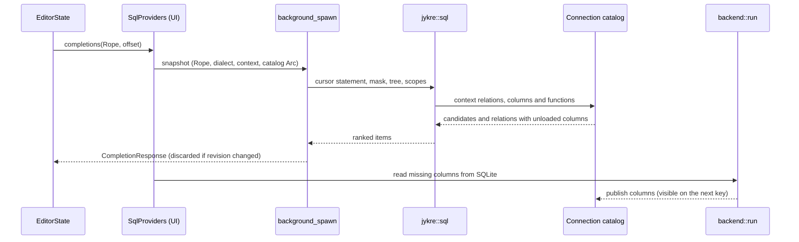

# Architectural investigation — SQL editor: autocomplete, highlighting and formatting

Date: November 4, 2026 · Branch release/0.1.0, commit c876fc3. No code was changed by the original investigation; its proposal was not yet approved by the maintainer.

> **Update, November 4:** tree-sitter was not adopted. A PoC and two later case sets led to the token-based scope model now implemented in completion. See G.4 for results/decision. Other sections retain the original investigation, not current implementation instructions. Versions, activity and license observations are dated evidence.

**Reading markers:** [V] verified in project code, installed dependency source under ~/.cargo/registry or candidate official repositories/docs (H); [I] inference from verified facts without measurement; [H] hypothesis requiring PoC validation (G).

Matrices score 1–5: unsuitable, weak, acceptable with caveats, good, best available. Weights: functional quality 25%, dialects 20%, Rust/GPUI integration 15%, maturity 15%, performance 10%, extensibility 10%, maintenance 5%.

## Recommendation summary

1. No mature embeddable Rust/GPUI library/LSP/engine provides semantic completion for **all PostgreSQL, MySQL and Databricks**. Strong engines are single-database (Postgres LS, Squawk) or require Go/TypeScript runtimes and omit Databricks.
2. Proposed in-process hybrid: retain jykre::sql as the lexical authority for highlighting/splitting/format guards; use tree-sitter plus DerekStride/tree-sitter-sql (tree-sitter-sequel) for the cursor statement with lexer-masked literals/comments (**not adopted; G.4**); build cache/catalog-backed scopes/candidates; use sqruff-lib layout/capitalization with a token-sequence guard.
3. Evolve the existing lexer highlighter to incremental/theme-aware rendering, then add table/column/alias/CTE semantics through gpui-kit 0.9 DocumentRangeSemanticTokensProvider. Reject gpui-component's SQL tree-sitter highlighter: grammar misses string backslash escapes, # comments and nesting [V], disagreeing with execution splitting.
4. Phases 1/2 need no dependencies and fix existing A.5 issues. A short PoC decides tree-sitter/sqruff phases 3/4; failed tree-sitter falls back to improved heuristics A3 without wasted work.

## A. Existing project assessment

### A.1 Architecture and constraints

| Topic | Situation | Evidence |
| --- | --- | --- |
| Process | One native process, GPUI via gpui-kit 0.9.0; gpui-base/component 0.9.0, gpui-pre 0.3.11 | [V] Cargo.toml/lock |
| Layers | src/app views, window-free src/*.rs logic, GPUI-free crates/* | [V] [Architecture](../reference/architecture.md) |
| Golden rules | Views do not decide (1), dialect rather than DriverKind logic (3), no UI blocking (6), screen-bounded frame cost (7) | [V] [Rules](../README.md#golden-rules) |
| Budgets | Frame ≤8 ms p95, metadata search ≤50 ms p95, idle ≤200 MB, 500,000 objects/connection, 50 tabs | [V] [Performance](../standards/performance.md#budgets) |
| Dependencies | Approval required; deny.toml licenses exclude GPL/AGPL/SSPL; no WebView/second async runtime, rustls only | [V] [Policy](../standards/stack-and-dependencies.md), deny.toml:29 |
| Stack changes | ADR required | [V] [Workflow](../standards/workflow.md#architecture-decisions) |
| Interactive path | Nothing remote: explorer/search/editor use local cache | [V] Performance, audited line 44 |

### A.2 gpui-kit 0.9 editor capabilities verified in source

Sources: ~/.cargo/registry/src/index.crates.io-*/gpui-base-0.9.0/src/input/editor/ and gpui-component-0.9.0/src/.

| Capability | Existing API/behavior | Evidence |
| --- | --- | --- |
| Pluggable highlighting | InputHighlighter update(InputEdit,&Rope), styles(range,resolver), fold_ranges; HighlightStyleResolver resolves keyword/string names through theme | [V] highlighting.rs:30 |
| Completion | CompletionProvider::completions(&Rope,offset,ctx) → Task<CompletionResponse>; newer requests supersede older ones, stale document/cursor results discarded | [V] lsp/completions.rs:146,403 |
| Manual trigger | ShowCompletions exists with **no default shortcut** | [V] lsp/completions.rs:317 |
| Menu | detail/documentation, provider order preserved | [V] input/popovers/completion_menu.rs:161,442 |
| Hover/definition/actions/colors | HoverProvider, DefinitionProvider, CodeActionProvider, DocumentColorProvider, show_document | [V] lsp/mod.rs:39 |
| Semantic tokens | DocumentRangeSemanticTokensProvider, 100 ms debounce, theme names resolved every paint without reanalysis on theme change | [V] lsp/semantic_tokens.rs:36,130 |
| Diagnostics | DiagnosticSet severity/code/source | [V] diagnostics.rs:186 |
| Missing | Signature help, InsertTextFormat snippets, sort_text, formatting provider, LSP JSON-RPC/process client | [V] search in gpui-base/src/input |
| Built-in tree-sitter highlighter | tree-sitter-sql feature → tree-sitter-sequel ≥0.3.8 and tree-sitter 0.26.13; incremental parse, 2 ms synchronous up to 256 KB, background reparse after 150 ms; **not enabled**, absent from lockfile | [V] component Cargo.toml, highlighter/languages.rs:508, input_adapter.rs:30–32 |
| syntect | syntect plus two-face feature | [V] component Cargo.toml |

### A.3 Existing SQL components

Paths/line numbers in this investigation refer to c876fc3 where files have since moved.

| Component | Audited file/API | Strengths | Marker |
| --- | --- | --- | --- |
| Dialect tokenizer | src/sql.rs:142, tokens/next_token | MySQL backslash/#/executable comments, nonnested comments, $ identifiers; PG E strings/dollar quotes/nested comments; multichar operators; generic fallback | [V] |
| Splitting | src/sql.rs:347, statements/statement_at | MySQL routines/DELIMITER, PG BEGIN ATOMIC, Databricks compounds, dialect tests | [V] |
| Formatting | src/sql.rs:500, format/map_offset; workspace.rs:2531 | Whitespace/keyword-case only, preserving caret/selection offsets and undo | [V] |
| Highlighter | src/app/sql.rs, SqlHighlighter | Same tokenizer as splitting | [V] |
| Completion/hover/definition | src/completion.rs, src/app/sql_providers.rs | FROM/JOIN/UPDATE/INTO/TABLE/DESCRIBE relations, qualified names, CTE names, namespaces, alias-dot/all-statement columns, dialect quoting, nonblocking Loading columns…, type/null/key/default/comment hover, Ctrl-click explorer navigation | [V] |
| DDL classification | src/ddl.rs | CREATE/ALTER/DROP targets for cache invalidation | [V] |

### A.4 Metadata

- **Storage [V]:** per-connection SQLite (`crates/storage/src/metadata.rs`) with objects(path_key,parent_key,kind,name,object_json,search_name), FTS5 trigram search and metadata_info.version incremented per atomic publication.
- **Scope [V]:** only user-selected introspection ([ADR-0015](../adr/0015-introspect-only-what-the-user-chooses.md)); completion knows only that scope.
- **Types [V]:** Database/Catalog/Schema/Table/View/MaterializedView/Column/ForeignKey/Partition in core metadata.rs:6; no functions/procedures/types/sequences. Kind extension is documented and stored as text, needing no schema migration ([Architecture](../reference/architecture.md#extension-points)).
- **Editor [V]:** backend::name_index reads MetadataRepository::relations into an immutable off-UI spawn_blocking NameIndex (backend.rs:271). relation_columns loads on demand (:315). Tabs cache index/columns and invalidate by cache version (workspace.rs:1229).
- **Context [V]:** per-tab SessionContext catalog/schema resolves unqualified names; DriverCapabilities::identifier_quote chooses quotes (core/driver.rs:20). Driver descriptors supply Postgres/MySql/DatabricksSql dialects (core/connection.rs:54).

### A.5 Problems found in the existing code

These existed independently of the proposed architecture.

| ID | Problem | Evidence | Marker |
| --- | --- | --- | --- |
| P1 | Whole-document UI-thread relex per edit; styles scans every token per range, violating screen-bounded costs | src/app/sql.rs:41,65 | [V] code; magnitude [H] |
| P2 | Quoted identifiers become TokenKind::String and string colors | src/sql.rs:164 | [V] |
| P3 | 33 fixed keywords plus 12 functions for all dialects; EXPLAIN/ANALYZE/DATE misclassified as functions, no types | src/sql.rs:203–209 | [V] |
| P4 | Fixed hex colors rather than light/dark theme | src/app/sql.rs:44–52; UI guidelines:131 | [V] |
| P5 | Synchronous UI completion/hover/definition copies text and splits whole documents per keystroke | sql_providers.rs:58; completion.rs:290 | [V] code; magnitude [H] |
| P6 | ddl::parts uses generic tokens while splitter uses tab dialect; MySQL # or PG backslashes disagree | src/ddl.rs:49 | [V] code; effect [I] |
| P7 | references flattens statements, leaking subquery/CTE-body relations/aliases outward; unknown derived/CTE columns | completion.rs:219 | [V] |
| P8 | No keyword/function candidates, same WHERE/GROUP BY/ORDER BY handling, prefix-only filtering without relevance | completion.rs:452 | [V] |
| P9 | ShowCompletions has no bound manual trigger | src/app/mod.rs:1933–1946 | [V] |
| P10 | Per-tab column cache duplicates identical columns 50 times for 50 same-connection tabs | workspace.rs:112–116 | [V] code; memory [H] |
| P11 | Only top-level clauses/SELECT lists line-break; no subquery/CTE/JOIN ON/CASE indentation; DML/DDL mostly untouched | src/sql.rs:500–569 | [V] |

### A.6 Integration points

1. InputHighlighter replacement and HighlightStyleResolver theme colors [V].
2. Editor Lsp completion/hover/definition/semantic-token/code-action providers return Task; background_spawn can analyze Rope snapshots. Cheap shared immutable Rope cloning is [I]; traits are [V].
3. Workspace format_sql preserves map_offset invariants [V].
4. NameIndex, relation_columns and cache version already provide atomic metadata [V].
5. Shortcut wiring in app/mod.rs: use ctrl-space for ShowCompletions [V integration point].

## B. Best libraries by feature

### B.1 Autocomplete

**Parsing is not completion.** A completion engine needs incomplete-SQL structure, CTE/subquery/alias scopes, cursor clause, metadata/dialect catalogs and ranking.

**1. DerekStride/tree-sitter-sql (tree-sitter-sequel) plus a custom cache-backed engine.** General/permissive grammar [V README], incremental/error-tolerant tree-sitter [V], MIT, push October 30, 2026. Used by Zed SQL, gpui-component and a Postgres LS grammar fork ([NOTICE](https://github.com/supabase-community/postgres-language-server/blob/main/crates/pgls_treesitter_grammar/NOTICE)). Grammar source [V] has one nondialect lexer: strings lack MySQL/Databricks backslash escapes, only --/nonnested block comments, no #/PIVOT. Crates.io 0.3.11 (October 1, 2025) lags repository. Scopes/clause/candidates/ranking remain custom because no embeddable three-dialect engine knows ObjectPath, namespace levels and SessionContext.

**2. Postgres Language Server pgls_completions, Rust/MIT.** [V] Tables/columns/functions/schemas/policies/roles/keywords, relevance/fuzzy-matcher, cursor sentinel REPLACED_TOKEN in sanitization.rs, forked grammar. Active: 5.2k stars, November 2 push. PG-only, unpublished 0.0.0 crates, own sqlx-backed catalog; disconnected editor features unavailable ([docs](https://pg-language-server.com/latest/features/editor_features/)). Git dependency and Snapshot adaptation would be needed [I]. **Design reference only:** sentinel, ranking, snapshot tests.

**3. DataFusion sqlparser-rs, Apache-2.0, plus sentinel.** [V] PG/MySQL/Databricks dialects, full AST, maintained 0.63.0 (September 13, 2026), 88M downloads. Syntax-only [V README], incomplete/inaccurate spans; Result<Vec<Statement>,ParserError> gives no partial tree [I], no error-recovery issue found [V search]. Incomplete JOIN or unsupported dialect syntax anywhere can invalidate the statement [I].

**4. sqls, Go/MIT, representative external LSP.** [V README] SELECT subqueries, INSERT/UPDATE/DELETE, FK JOIN completion, formatting; v0.2.48 July 15, 2026. No CREATE/ALTER TABLE or Databricks [V]. Own remote connections/Go process contradict vault and ADR-0015 scope policies [I].

**Rejected for completion:**

- joe-re/sql-language-server: TypeScript, rewritten September 2026 as Bun executable; MySQL/PG/SQLite, last release 1.7.0 in 2023 [V].
- dt-sql-parser: TypeScript/ANTLR getSuggestionAtCaretPosition for MySQL/PG/Spark/Hive/Flink/Trino/Impala [V]; prohibited JS runtime [I], documented nested-subquery limitations [V].
- Squawk: Rust rust-analyzer-style completion/hover/formatting [V], file semantic index squawk_sema rather than live catalog [V], PG focus [I].
- duck-sqllsp/banshee: too young, two/three stars [V].
- polyglot-sql: complete rather than incomplete SQL [I].
- DBeaver Java/ANTLR semantic model and pgcli Python/sqlparse suggest_type(full_text,text_before_cursor): design references only [V source].

| Criterion (weight) | tree-sitter + custom engine | pgls | sqlparser + sentinel | sqls |
| --- | ---: | ---: | ---: | ---: |
| Functional quality 25% | 4 | 5 | 2 | 3 |
| Dialects 20% | 4 | 1 | 3 | 2 |
| Rust/GPUI integration 15% | 4 | 2 | 5 | 1 |
| Maturity 15% | 4 | 4 | 5 | 3 |
| Performance 10% | 4 | 4 | 5 | 3 |
| Extensibility 10% | 5 | 3 | 3 | 1 |
| Maintenance 5% | 3 | 2 | 3 | 2 |
| **Weighted total** | **4.05** | **3.15** | **3.55** | **2.25** |

Rationale: tree-sitter quality 4 needs engine maturity; dialects 4 assumes lexer masking fixes lexical defects [H1]; Rust/C integration uses existing cc [V]; extensibility 5 reuses structure for hover/definitions/tokens/diagnostics; maintenance 3 includes engine/fork. pgls quality 5 is best for PG but dialects 1 and unpublished/custom-catalog integration 2. sqlparser quality 2 reflects missing recovery/spans; dialects 3 reflect strict unsupported syntax; integration/maturity/performance 5. sqls integration 1 needs an absent LSP client/process/external credentials; dialects 2 omit Databricks.

### B.2 Syntax highlighting

**1. Evolved dialect tokenizer plus semantic tokens.** Already follows the shared-tokenizer rule and dialect tests [V Architecture, audited line 167]. DocumentRangeSemanticTokensProvider [V] can color resolved tables/views/columns/aliases/CTEs/parameters with 100 ms debounce and theme names. Fix P1–P4: restart-window relex, binary styles lookup, theme colors. Function-versus-column structure depends on semantics.

**2. gpui-component tree-sitter-sql plus highlights.scm.** One feature supplies incremental/background parsing with cancellation/injections [V]; Zed SQL has MIT highlight queries [V]. Inherits grammar defects for MySQL/Databricks escaped strings, MySQL # comments and PG nested comments, disagreeing with splitting/execution [V]. A fork still cannot interpret the same backslash as MySQL escape and PG literal [I].

**3. syntect:** component feature, generic regex TextMate SQL, no dialect/structural incrementality [I]; weaker on both relevant axes.

**Rejected:** reusing Zed's editor/language/languages/lsp crates, GPL-3.0-or-later [V], outside deny.toml. Only MIT SQL-extension captures can be reused as a reference.

| Criterion | Custom lexer + semantic tokens | component tree-sitter | syntect |
| --- | ---: | ---: | ---: |
| Quality 25% | 4 | 3 | 2 |
| Dialects 20% | 5 | 2 | 2 |
| Integration 15% | 5 | 4 | 4 |
| Maturity 15% | 3 | 4 | 4 |
| Performance 10% | 4 | 5 | 3 |
| Extensibility 10% | 4 | 3 | 2 |
| Maintenance 5% | 4 | 3 | 4 |
| **Weighted total** | **4.20** | **3.30** | **2.80** |

Custom dialect score 5 comes from tested lexical rules; maturity 3 reflects custom code; performance 4 depends on P1/H5. Tree-sitter performance 5 follows verified incremental/background behavior; dialects 2 reflects verified grammar defects.

### B.3 Formatting

**1. sqruff-lib, Rust/Apache-2.0.** [V] Rust sqlfluff port with PG/MySQL/Databricks/Spark dialect files, configurable rules/exclusions/indentation, active 0.44.0 October 30, 2026. Lossless comment preservation follows sqlfluff design [I]. LSP uses linter.lint_string(source,filename,true).fix_string(), also usable as a library [V]. Formatting is lint+fix for **all active rules**, so restrict layout LT and safe keyword/function/type capitalization; never identifier CP02, because MySQL table names may be case-sensitive [I]. Heavy [V] fancy-regex/regex/rayon/icu_casemap/toml/configparser/ignore/walkdir/normal pretty_assertions and nonoptional deprecated serde_yaml 0.9.34 in dialects. API 0.x targets CLI/LSP rather than stable embedding [I]; CPU/binary costs unknown [H3/H4].

**2. sqlformat-rs, Rust/MIT OR Apache-2.0.** [V] Token-based sql-formatter-plus port, lightweight unicode_categories/winnow (latter already locked), comment-aware, indent/case/inline options, 66M downloads. Tolerates invalid/incomplete SQL by token design [I]. Dialect only Generic/PostgreSql/SQLServer [V], no MySQL/Databricks; generic escape/# handling unverified [H]. Limited style; 0.5.0 October 9, 2025.

**3. Existing jykre::sql::format:** safe whitespace/case-only dialect behavior, low P11 quality; each style capability requires handwritten work.

**Rejected:** sqlparser pretty print drops comments [V README]; polyglot AST regeneration may normalize syntax [H], young February 2026 project [V]; JS sql-formatter lacks Databricks (has spark) [V]; Perl pgFormatter is PG-only [V]; sqlfluff requires Python; squawk-fmt is PG-only, but its validate_no_dropped_tokens/validate_parses/idempotence design informs our guard [V validation.rs].

| Criterion | sqruff-lib | sqlformat-rs | Existing custom |
| --- | ---: | ---: | ---: |
| Quality 25% | 4 | 3 | 2 |
| Dialects 20% | 5 | 2 | 4 |
| Integration 15% | 3 | 5 | 5 |
| Maturity 15% | 4 | 4 | 2 |
| Performance 10% | 3 | 5 | 5 |
| Extensibility 10% | 4 | 2 | 2 |
| Maintenance 5% | 3 | 4 | 2 |
| **Weighted total** | **3.90** | **3.40** | **3.15** |

sqruff dialects 5 uniquely has real grammars for all three [V], actual coverage H3; integration 3 reflects weight/API, performance 3 unknown full-tree cost. sqlformat integration/performance 5 but dialects 2. Custom dialects 4 preserves literals, without dialect-structured layout.

## C. Architecture comparison

| Aspect | A1 — External LSP | A2 — Ready-made libraries | A3 — Improved heuristics | A4 — Hybrid, originally recommended |
| --- | --- | --- | --- | --- |
| Completion | Postgres LS + MySQL sqls; no Databricks | sqlparser/sentinel/NameIndex | Custom clause heuristics like pgcli | Masked-statement tree-sitter, scopes, NameIndex/catalogs |
| Highlighting | Server semantic tokens plus lexer | component tree-sitter | Evolved lexer | Evolved lexer plus analysis tokens |
| Formatting | sqruff LSP/sqls | sqlformat-rs | Extended custom | sqruff + token guard, current fallback |
| New processes | 2–3 | 0 | 0 | 0 |
| New dependencies | LSP client, platform binaries | sqlparser/tree-sitter/sequel/sqlformat | None | tree-sitter/sequel/sqruff |

| Criterion | A1 | A2 | A3 | A4 |
| --- | ---: | ---: | ---: | ---: |
| Quality 25% | 3 | 3 | 3 | 4 |
| Dialects 20% | 2 | 3 | 4 | 4 |
| Integration 15% | 1 | 4 | 5 | 4 |
| Maturity 15% | 4 | 4 | 2 | 4 |
| Performance 10% | 2 | 4 | 5 | 4 |
| Extensibility 10% | 2 | 3 | 2 | 5 |
| Maintenance 5% | 2 | 3 | 2 | 3 |
| **Weighted total** | **2.40** | **3.40** | **3.40** | **4.05** |

- A1 integration 1: no gpui-kit LSP client [V], platform process/binary management, third-party credentials; servers re-introspect and ignore local cache/user scope [I]. Performance 2 duplicates schema caches (Postgres LS startup cache [V]) against 200 MB [I]; dialects 2 lack Databricks.
- A2 integrates well but adds three lexers disagreeing with ours on literals/comments (tree-sitter verified, others inferred); incomplete SQL fails.
- A3 adds no dependencies and handles lexical dialects, but each capability adds heuristics; no diagnostic foundation (extensibility 2), entirely custom without external validation (maturity 2).
- A4 reuses mature error-tolerant structure, dialect layout and GPUI UI; retains the stronger lexer and writes only missing three-dialect metadata logic. Shared phases 1/2 allow a no-waste PoC decision.

## D. Final recommendation

This is the original recommendation; G.4 records the subsequent decision rejecting tree-sitter.

| Decision | Choice |
| --- | --- |
| Autocomplete | Custom jykre::sql engine over tree-sitter/sequel for the cursor statement. Mask strings/comments/non-ASCII identifiers byte-for-byte [H1]; use Postgres LS sentinel design and corrected heuristic fallback |
| Highlighting | Incremental theme-aware dialect SqlHighlighter plus analysis semantic tokens |
| Formatting | Per-statement sqruff layout/safe capitalization under a **token guard**; sqlformat-rs fallback if H3/H4 fail |
| Shared | Lexer/splitter lexical authority; per-statement scopes/tree for completion/hover/definitions/tokens/future diagnostics; per-connection NameIndex/column LRU/cached functions; static dialect keywords/functions/types |
| Not shared | Heavy specialized sqruff parser, on-demand formatting only rather than per-keystroke [I] |

Original module allocation: jykre crate, no GPUI/I/O, under golden rule 1:

| Module | Responsibility |
| --- | --- |
| sql::lexer, then sql.rs | Dialect tokens; QuotedIdentifier/Operator/Parameter/Variable/Type; line restart points |
| sql::split | Existing statements/statement_at |
| sql::syntax | Masked single-statement tree-sitter/sentinel/offset map |
| sql::scope | Aliases, column-bearing CTEs, derived tables, subqueries, LATERAL, cursor clause |
| sql::complete | Clause keywords, relations/namespaces/columns/CTEs/functions/signatures; exact prefix > case-insensitive prefix > contains, then context/scope distance |
| sql::catalog | Generated dialect keywords/built-ins/types, F |
| sql::format | Split, per-statement sqruff, guard, assemble, existing fallback |
| completion → metadata_index | Per-connection NameIndex/columns shared by tabs |
| src/app/sql.rs/sql_providers.rs | gpui-base adapters only: snapshots, background_spawn, lsp_types conversion |

**GPUI integration:** providers snapshot Rope/dialect/SessionContext/catalog Arc, then background_spawn; gpui-base drops stale responses [V]. Highlighter stays synchronous but window-bounded with binary styles lookup. ctrl-space triggers ShowCompletions. Formatting runs in background, applies replace_all and preserves undo. Metadata I/O remains on backend::run/Tokio ([Architecture](../reference/architecture.md#concurrency)).

**Metadata use:** no remote interactive calls; completion reads NameIndex/SQLite columns. Missing columns load in background and appear on the next key [V]. Connection-wide version-invalidated catalogs fix P10. User functions/procedures need new core ObjectKind signatures/returns/comments and selected-scope driver introspection: **approval required**. Built-ins come from official generated PG pg_get_keywords()/pg_catalog.pg_proc, MySQL 8+ INFORMATION_SCHEMA.KEYWORDS RESERVED, Databricks SQL/DBR13.3+ sql_keywords() [V existence] and SHOW/DESCRIBE FUNCTION [I]. Existing ForeignKey cache drives JOIN ON suggestions, as sqls does [V].

**Why this combination:** all three dialects without processes; lexical agreement among editor/splitting/execution; error-tolerant structure validated in leading open-source PG completion; sqlfluff-level formatting with mechanical whitespace/case-only guard preserving map_offset; no duplicated introspection or credentials outside the vault.

## E. Architecture design

```mermaid
flowchart LR
    subgraph UI["UI thread (GPUI)"]
        Editor["EditorState (gpui-base)"]
        HL["SqlHighlighter (InputHighlighter)"]
        Prov["SqlProviders: completion, hover, definition, semantic tokens, code actions"]
        WS["Workspace (tab): dialect, SessionContext, Ctrl+Space, Format"]
    end
    subgraph BG["Background executor (GPUI)"]
        Job["Rope snapshot analysis; editor discards stale responses"]
    end
    subgraph LS["jykre::sql (no GPUI or I/O)"]
        Lex["Dialect lexer (single lexical authority)"]
        Split["Statement splitter"]
        Mask["Literal/comment masking and sentinel"]
        TS["tree-sitter + tree-sitter-sequel (error-tolerant tree)"]
        Scope["Scope model and cursor clause"]
        Comp["Completion engine and ranking"]
        Sem["Semantic tokens and cursor symbol"]
        Fmt["Per-statement formatting and token guard"]
        Sq["sqruff-lib (layout and capitalization)"]
        Cat["Static dialect catalogs"]
    end
    subgraph Meta["Metadata"]
        Idx["Per-connection catalog: NameIndex, LRU columns, functions (cache version)"]
        Run["backend::run (Tokio)"]
        Repo["MetadataRepository (Per-connection SQLite)"]
        Drv["Drivers: refresh and apply_selection"]
        DB[("PostgreSQL / MySQL / Databricks")]
    end
    Editor -- "InputEdit" --> HL
    HL --> Lex
    Editor -- "request + Rope" --> Prov
    Prov --> Job
    WS -- "Format" --> Job
    Job --> Split
    Lex --> Split
    Split --> Mask
    Lex --> Mask
    Mask --> TS
    TS --> Scope
    Scope --> Comp
    Scope --> Sem
    Cat --> Comp
    Idx --> Comp
    Idx --> Sem
    Job --> Fmt
    Fmt --> Sq
    Fmt -- "validates tokens with" --> Lex
    Comp -- "missing columns" --> Run
    Run --> Repo
    Repo --> Idx
    Drv --> Repo
    Drv --> DB
```

Suggestion flow:

**Concurrency/caches:** completion/hover have no debounce; single-statement analysis is small [H2], new requests supersede old [V]. Semantic tokens use gpui-base's 100 ms [V]; highlighter is synchronous/window-limited [H5]; future diagnostics debounce 300 ms. Per-tab analysis caches recent statements by text hash, avoiding invalidation from edits elsewhere. Catalog cache key: ConnectionId plus metadata-cache version.

## F. Integration plan

| Phase | Content | Depends on | Acceptance |
| --- | --- | --- | --- |
| 0 — Disposable PoC outside main | G.2 | — | Measured report, go/no-go for 3/4 |
| 1 — No-dependency foundations | Incremental restart relex/binary styles/theme/token kinds P1–4; background providers/ctrl-space/dialect parts P5/6/9; clause keywords/ranking P8; connection-shared columns P10 | — | Release frame ≤8 ms p95 typing 10 MB script, UI/key ≤1 ms; Criterion completion p95 ≤10 ms on 1 MB/500,000 objects; dialect literal/comment/identifier tests; color deviation removed from UI guidelines |
| 2 — Language catalogs | xtask PG18/MySQL9.7 gate-Docker catalogs with keywords/signatures/summaries/types; manual Databricks CLI; function detail/hover; approved user-function ObjectKind | — | All PG18 pg_get_keywords/MySQL9.7 KEYWORDS entries; generator/snapshot drift test; signature hover |
| 3 — Structural analysis | Approved ADR/dependencies tree-sitter matching gpui component minor due links, pinned sequel; mask/sentinel/scopes/CTEs/derived/subqueries/LATERAL/clause/fallback/tokens/local definitions | 0, H1/H2 | ≥90% expected truncated-prefix contexts across three dialects, no regressions versus heuristics; off-UI ≤5 ms p95 for ≤20 KB; full gate/deny pass |
| 4 — Professional formatting | Approved ADR/sqruff LT+CP01/03/05, per-statement/selected-touching statements, guard, case/indent/comma preferences, rejected-count notice | 0, H3/H4 | Nonwhitespace token property with case-insensitive keywords/functions; ≥95% parsable corpus acceptance per dialect; idempotence; 1,000 lines ≤100 ms p95 off-UI; undo; deny passes |
| 5 — Optional diagnostics/actions | Unresolved names only in fully introspected namespaces; FK JOIN ON, expand star, qualify names | 2/3 | Zero false positives in fully covered corpus; no out-of-scope namespace warnings |

Phases 1/2 are immediately useful for either architecture; 2 feeds 3. Phases 3/4 await PoC; 5 depends on 2/3.

| Reused intact | Custom work and reason |
| --- | --- |
| tree-sitter parsing/recovery/queries | Mask/sentinel: no grammar handles all three lexical dialects [V] |
| sequel permissive SQL grammar | Scopes/cursor clause: no embeddable multidialect engine |
| sqruff layout/dialect grammars | Token guard/assembly: DELIMITER and map_offset invariants unknown to sqruff |
| gpui-base menus/popovers/tokens/diagnostics/stale disposal | ObjectPath/SessionContext candidates/ranking |
| Already-approved lsp-types boundary types | Official-source xtask catalog generation |
| Existing metadata cache/NameIndex/relation_columns | Incremental highlighter relex |

## G. Risks and validation

### G.1 Risks

| Risk | Type | Impact | Mitigation |
| --- | --- | --- | --- |
| Grammar gaps: Databricks missing PIVOT [V], colon fields/pipeline/IDENTIFIER/parameters; MySQL index hints; PG DISTINCT ON | Support | ERROR near syntax | Heuristic fallback, dialect tests, upstream fixes/fork as Postgres LS [V] |
| Crates.io sequel lags repository | Maintenance | Delayed fixes | Pin Git revision or vendor generated gh-pages parser per README [V] |
| links=tree-sitter permits one version/build [V] | Compatibility | gpui tree-sitter feature conflicts | Match gpui-kit minor: 0.26 in 0.9 [V]; upgrade together |
| C grammar build on all platforms | Distribution | CI failures | Existing cc [V]; compile PoC on Windows CI |
| Heavy sqruff, obsolete serde_yaml/normal pretty_assertions [V] | Dependency | Binary/build/deny costs | Measure H4; sqlformat fallback |
| Misconfigured sqruff changes semantics | Semantics | Altered SQL | Explicit rules, mandatory token guard, property tests |
| Weekly unstable sqruff 0.x API [V] | Maintenance | Upgrade breakage | Isolated thin sql::format adapter, pinned deliberate upgrades |
| 500,000-object NameIndex memory | Performance | 200 MB budget | H7, connection sharing, compact interned names |
| Partial-scope diagnostic false positives | UX | Wrong warnings | Only fully introspected namespaces, optional phase |
| Static catalogs versus older servers, PG14/18, MySQL8.4/9.7 | Dialect | Unavailable suggestions | Latest validated sources plus minimum-version metadata where available |
| No signature help/snippets [V] | UX | Less function guidance | detail/documentation/hover signatures; propose upstream SignatureHelpProvider |

### G.2 Minimal proof of concept

Disposable branch example/benchmark, no UI integration; produce only measured results.

1. **Corpus:** about 300 real statements/dialect from tests/fixtures, dev/seed, official docs and src/sql.rs/completion.rs tests. Truncate after each token for end-cursor prefixes.
2. **H1 masked structure:** sequel parsing; complete statements without ERROR and expected relation/alias/CTE/cursor-clause extraction on prefixes, with 50 handwritten expected cases/dialect. Go at ≥90%.
3. **H2 cost:** parse/scope extraction p95 ≤2 ms for ≤20 KB on reference hardware in release.
4. **H3 formatting:** sqruff LT+CP01/03/05 per dialect; ≥95% guard acceptance on parsable statements, idempotence, per-statement/1,000-line p95, comment preservation.
5. **H4 weight:** release executable ≤+10%, clean build ≤+20%, cargo deny --locked check.
6. **H5 highlighter:** ≤1 ms/window/keystroke at 10 MB; measure full relex baseline P1 too.
7. **H6/H7 catalogs/memory:** PG18/MySQL9.7 gate Docker generation; 500,000-object synthetic benchmark NameIndex memory.

Failed H1/H2 replaces phase 3 with token-fed scope heuristics A3; failed H3/H4 replaces phase 4 with sqlformat-rs under the same guard.

### G.3 Open hypotheses

| ID | Hypothesis |
| --- | --- |
| H1 | Lexer masking makes sequel usable for all three dialects, including incomplete SQL |
| H2 | Single-statement analysis needs only milliseconds, no incremental document parse |
| H3 | Layout/case-only sqruff formats ≥95% without changing tokens, including Databricks |
| H4 | Acceptable sqruff weight and cargo deny result |
| H5 | Window relex ≤1 ms/key on 10 MB |
| H6 | Reproducible official-source catalogs |
| H7 | Connection-shared 500,000-object NameIndex fits memory budget |

### G.4 PoC results and decision (November 4, 2026)

**Method:** disposable external Cargo project using crates/sql and crates/sql-language by path, tree-sitter 0.26.13/sequel 0.3.11; none added to this project. Dialect lexer masks strings/comments/parameters/non-ASCII bytes with equal-length neutral text. Insert a sentinel where no word is being typed; close parentheses opened before the cursor. Extract nearest statement/subquery relations/aliases, ancestor CTEs, derived-table sources and cursor clause. Compare with then-current completion::request and a NameIndex containing all case tables.

**Expected answers:** tables whose columns completion should offer: after alias-dot, the alias table (derived sources for a derived table); unqualified, innermost enclosing-query tables. CTEs are not counted as tables. The first round incorrectly expected all scope tables after alias-dot, falsely penalizing heuristics in eight correct cases. Earlier heuristic figures 75%/84%/85% were corrected below [V].

**Three manually authored case sets**, written by implementation authors, so results are optimistic [V]:

1. PoC corpus: 64 statements, 25 PG/19 MySQL/20 Databricks; one expects table-name rather than column completion.
2. First new set: 33 cases after initial results, covering unqualified outer cursors around subqueries/CTEs/UNION, nested derived tables, correlation, UPDATE FROM, DELETE USING, multi-table UPDATE/DELETE, INSERT column lists, MERGE subqueries.
3. Second new set: 24 previously absent patterns written before the scope model's first execution.

**Correct tables at cursor**, complete statements with trailing text:

| Path | Corpus 63 | First new 33 | Second new 24 | Total 120 |
| --- | ---: | ---: | ---: | ---: |
| Previous one-table-list heuristic | 58 | 15 | 15 | 88, 73% |
| tree-sitter | 62 | 22 | 20 | 104, 87% |
| Hybrid clean tree plus heuristic fallback | 62 | 23 | 20 | 105, 88% |
| Token scopes, first execution | 63 | 31 | 23 | 117, 98% |
| Scope model as integrated | 63 | 33 | 24 | 120, 100% |

The old heuristic leaked subquery/CTE/UNION tables outward and could not resolve derived aliases (P7). The initial corpus rarely tested unqualified outer cursors, overstating quality. tree-sitter failed grammar cases (STRAIGHT_JOIN, alias/multi-table DELETE) and PoC extraction gaps (UNION branches, correlated outer aliases, MERGE subqueries). Initial scopes missed two INSERT-column-list cases and one Databricks LEFT ANTI JOIN; both issues were fixed.

**Typing at the end**, each populated-statement prefix with final cursor:

| Dialect | Name-expected positions | Clean tree context | Without closing parentheses | Clause found across all positions | Heuristic responds |
| --- | ---: | ---: | ---: | ---: | ---: |
| PostgreSQL | 320 | 87% | 74% | 71–73% | 98–100% |
| MySQL | 196 | 90% | 79% | 70% | 98–100% |
| Databricks | 234 | 80% | 69% | 67–68% | 98–100% |

Clean context means a found clause without an error node near the cursor. Name-expected positions follow dot/comma/open parenthesis/operators or SELECT/WHERE/ON/BY/SET [V]. Prefixes have no expected-answer oracle. Token scopes answer all prefixes without requiring valid trees and agree with clean tree contexts in 70–97%, depending on set/dialect [V]. Examined disagreement samples favored tokens or concerned table-name positions where columns are irrelevant [I].

**Observed grammar gaps [V]:** PG DISTINCT ON; MySQL STRAIGHT_JOIN/multi-table DELETE; Databricks LATERAL VIEW/PIVOT/QUALIFY become aliases/errors and MERGE UPDATE SET * errors; every dialect's DELETE FROM t alias ends in error.

**Cost**, release on maintainer hardware:

| Measurement | tree-sitter | Scope model |
| --- | --- | --- |
| Case statements up to about 400 bytes | p50 19 µs, p95 0.1 ms | p95 10–25 µs |
| 19.6 KB statement | p95 4.2–6.0 ms | p95 0.8–1.1 ms |
| About 100 KB | — | 3.6 ms, 24 ms debug |
| Executable weight | Entire PoC 2.9 MB versus app 69.4 MB, ≤+4% | None |

**Side finding, fixed:** completion failed after final trailing whitespace (`WHERE |`), so Ctrl+Space returned nothing. completion::statement_at now includes that cursor, covered by a test.

**Hypothesis outcomes:**

| ID | Outcome |
| --- | --- |
| H1 | Failed: 87% correct overall; corpus PG/MySQL/Databricks 100%/95%/100%, new sets 50–86% per dialect; clean prefixes 87%/90%/80% |
| H2 | Failed at 20 KB: 4.2–6.0 ms p95 versus ≤2 ms; typical statements passed at 0.1 ms |
| H3/H4 | Superseded by maintainer approval/integration of sqruff, N010 |
| H5 | Failed: relex 5.3 ms/key at 10 MB versus full relex 57 ms; remaining cost is token-vector copying |
| H6 | Passed: cargo xtask catalogs reproducibly generates all three dialects |
| H7 | Not measured |

**Decision:** do not adopt tree-sitter. completion uses crates/sql-language/src/completion/scopes.rs to model each statement's lexer-token scopes instead of one flat table list:

- **Queries:** statement, parenthesized subqueries, CTE bodies and each SELECT branch after UNION-like operators, INSERT, CREATE AS or WITH own FROM/JOIN/USING/UPDATE/INTO relations.
- **CTEs/derived tables:** expose named SELECT columns, first branch for UNION, renamed by explicit column lists. Star imports source columns; trace each output to its cached source column for suggestion type, hover and definition.
- **Outer aliases:** resolve alias-dot inside the cursor query, then enclosing queries for correlation; unqualified go-to-definition also searches inward-to-outward.
- **Databricks SEMI/ANTI JOIN:** right-hand relations visible only in the join condition.
- **Incomplete text:** an open parenthesis keeps the query open to statement end. No invalid tree and no second path.

Reasons: better accuracy in every set including grammar gaps; about five times cheaper without mask/sentinel/fallback; no dependency or gpui links-version coupling; scope modeling is required even with a tree.

**Excluded:** expressions without aliases, e.g. count(*) or x::int, have dialect-dependent server names and are not offered. Databricks star EXCEPT still offers all columns. Computed aliased columns such as sum(total) AS spent have no inferred type.

**Regression:** 121 cases across the sets plus the maintainer's CTE case live in crates/sql-language/tests/fixtures/scopes.txt, tested through completion::request in tests/scopes.rs ([Testing](../standards/testing.md#completion-scopes)). Previous code fails 32 [V]. Later named-output columns changed 11 expectations from source tables to SELECT-named columns after derived aliases/beside CTEs; the table above measures the earlier version.

**Semantic tokens** can reuse the model, which constructs all query relations [I].

**Revisit tree-sitter** only for a capability requiring a complete tree and grammar supporting all dialects. Syntax diagnostics do not qualify with sequel: about one-third of valid MySQL/Databricks cases end in ERROR, causing false UI errors [V]. Existing sqruff dialect parsing or server validation may fit diagnostics better [H].

## H. Sources

**Project and installed dependencies** (source read during this investigation)
- [docs/reference/architecture.md](../reference/architecture.md), [docs/standards/performance.md](../standards/performance.md), [docs/standards/stack-and-dependencies.md](../standards/stack-and-dependencies.md), [docs/standards/workflow.md](../standards/workflow.md), [docs/reference/ux.md](../reference/ux.md), [docs/standards/ui-guidelines.md](../standards/ui-guidelines.md)
- [src/sql.rs](https://github.com/alandariva/jykre-studio/blob/c876fc3a96839811d1effb19bc30f2666de1ff4f/src/sql.rs), [src/completion.rs](https://github.com/alandariva/jykre-studio/blob/c876fc3a96839811d1effb19bc30f2666de1ff4f/src/completion.rs), [src/ddl.rs](../../src/ddl.rs), [src/backend.rs](../../src/backend.rs), [src/app/sql.rs](https://github.com/alandariva/jykre-studio/blob/c876fc3a96839811d1effb19bc30f2666de1ff4f/src/app/sql.rs), [src/app/sql_providers.rs](https://github.com/alandariva/jykre-studio/blob/c876fc3a96839811d1effb19bc30f2666de1ff4f/src/app/sql_providers.rs), [src/app/workspace.rs](../../src/app/workspace.rs), [crates/storage/src/metadata.rs](../../crates/storage/src/metadata.rs), [crates/core/src/metadata.rs](../../crates/core/src/metadata.rs)
- `gpui-base` 0.9.0 and `gpui-component` 0.9.0 under `~/.cargo/registry` ([docs.rs/gpui-component/0.9.0](https://docs.rs/gpui-component/0.9.0)); repository [longbridge/gpui-kit](https://github.com/longbridge/gpui-kit)

**Editors and grammars**
- [tree-sitter/tree-sitter](https://github.com/tree-sitter/tree-sitter) (`lib/Cargo.toml`: `links = "tree-sitter"`)
- [DerekStride/tree-sitter-sql](https://github.com/DerekStride/tree-sitter-sql) · [crate tree-sitter-sequel](https://crates.io/crates/tree-sitter-sequel)
- [zed-extensions/sql](https://github.com/zed-extensions/sql) (grammar and queries) · Zed crate licenses: [crates/editor/Cargo.toml](https://github.com/zed-industries/zed/blob/main/crates/editor/Cargo.toml)

**Language servers and completion engines**
- [supabase-community/postgres-language-server](https://github.com/supabase-community/postgres-language-server) · [editor features](https://pg-language-server.com/latest/features/editor_features/) · [pgls_completions](https://github.com/supabase-community/postgres-language-server/tree/main/crates/pgls_completions) · [grammar NOTICE](https://github.com/supabase-community/postgres-language-server/blob/main/crates/pgls_treesitter_grammar/NOTICE)
- [sbdchd/squawk](https://github.com/sbdchd/squawk) · [squawk_fmt/validation.rs](https://github.com/sbdchd/squawk/blob/master/crates/squawk_fmt/src/validation.rs)
- [sqls-server/sqls](https://github.com/sqls-server/sqls)
- [joe-re/sql-language-server](https://github.com/joe-re/sql-language-server)
- [DTStack/dt-sql-parser](https://github.com/DTStack/dt-sql-parser) · [DTStack/monaco-sql-languages](https://github.com/DTStack/monaco-sql-languages)
- [dbeaver/dbeaver — model.lsm](https://github.com/dbeaver/dbeaver/tree/devel/plugins/org.jkiss.dbeaver.model.lsm)
- [dbcli/pgcli — sqlcompletion.py](https://github.com/dbcli/pgcli/blob/main/pgcli/packages/sqlcompletion.py)
- [gentleeduck/duck-sqllsp](https://github.com/gentleeduck/duck-sqllsp) · [octofhir/banshee](https://github.com/octofhir/banshee)

**Parsers**
- [apache/datafusion-sqlparser-rs](https://github.com/apache/datafusion-sqlparser-rs) (README: "Syntax vs Semantics", round-trip without comments, spans)
- [tobilg/polyglot](https://github.com/tobilg/polyglot) · [pganalyze/pg_query.rs](https://github.com/pganalyze/pg_query.rs)

**Formatters**
- [quarylabs/sqruff](https://github.com/quarylabs/sqruff) · [crates/lsp/src/lib.rs](https://github.com/quarylabs/sqruff/blob/main/crates/lsp/src/lib.rs) · [configuration](https://playground.quary.dev/docs/usage/configuration/)
- [shssoichiro/sqlformat-rs](https://github.com/shssoichiro/sqlformat-rs)
- [sql-formatter-org/sql-formatter](https://github.com/sql-formatter-org/sql-formatter) · [darold/pgFormatter](https://github.com/darold/pgFormatter) · [sqlfluff/sqlfluff](https://github.com/sqlfluff/sqlfluff)

**Official keyword catalogs**
- Databricks [`sql_keywords()`](https://docs.databricks.com/aws/sql/language-manual/functions/sql_keywords)
- MySQL [`INFORMATION_SCHEMA.KEYWORDS`](https://dev.mysql.com/doc/refman/8.0/en/information-schema-keywords-table.html)
- PostgreSQL `pg_get_keywords()` ([origin commit](https://forger.sitiv.fr/open-dsi/postgres/commit/c63147d6f0e86d96ffb315147f36af613a35c2ce); verify columns in the version manual)

Maintenance observations (latest push, license, versions) were checked November 4, 2026 through GitHub and crates.io APIs.
